# VD01 — Graph / Inspector 첫 화면 검토

- 날짜: 2026-10-16 (Asia/Seoul)
- 범위: W00–W04, 합성 `FG-FIXTURE-01`. [실행·검증 기록](2026-10-16-initial.md).
- 판정: 첫 구현의 화면·상호작용 비교 완료. **VD01의 최종 채택 및 VD02/03 Gate 통과는 아직 아니다.** 사용자/디자인 검토, 실제 Graph 조회·근거 연결, 전체 접근성·stress 검사가 남아 있다.
- 증거: [캡처·source hash·fixture hash·좌표·crop manifest](../../plans/assets/graph-visual-reviews/2026-10-16-initial/after-metadata.json). Chromium 153.0.8010.12, ko-KR, Asia/Seoul, DPR 1, 고정 시각 2026-10-13T03:00:00Z, reduced motion. 실제 브라우저 캡처이며 생성 시안이 아니다.

## 1. 변경 전과 현재

같은 합성 인물 8명·만남 4개를 사용한다. 기존 화면은 임의의 self 노드와 선을 포함했고, 새 화면은 기록에 있는 참석·소개만 표현한다. 기본 진입도 전체 펼침에서 첫 인물 중심의 제한된 이웃으로 바뀌었다. 따라서 아래는 **정보 구조와 과업 비교**이며 동일 상태 pixel diff가 아니다. before는 HEAD·기존 미커밋 manifest와 화면만 남겼고 정확한 당시 diff hash를 따로 기록하지 못했다. 재현 기준 캡처로 소급 주장하지 않는다.

| 이전 전체 화면                                                                            | 새 기본 탐색                                                                                     |
| ----------------------------------------------------------------------------------------- | ------------------------------------------------------------------------------------------------ |
| 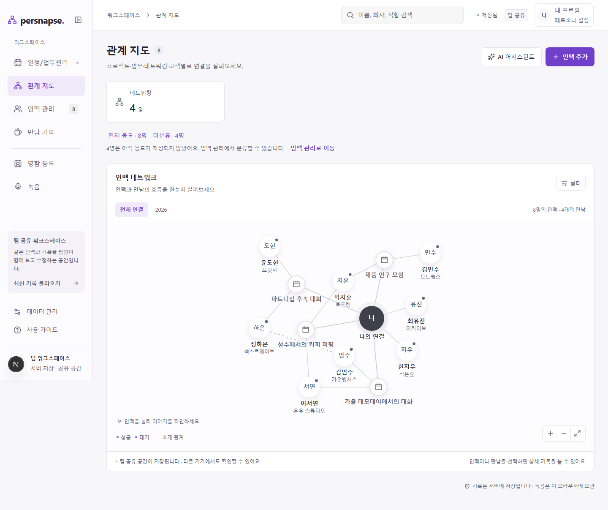 | 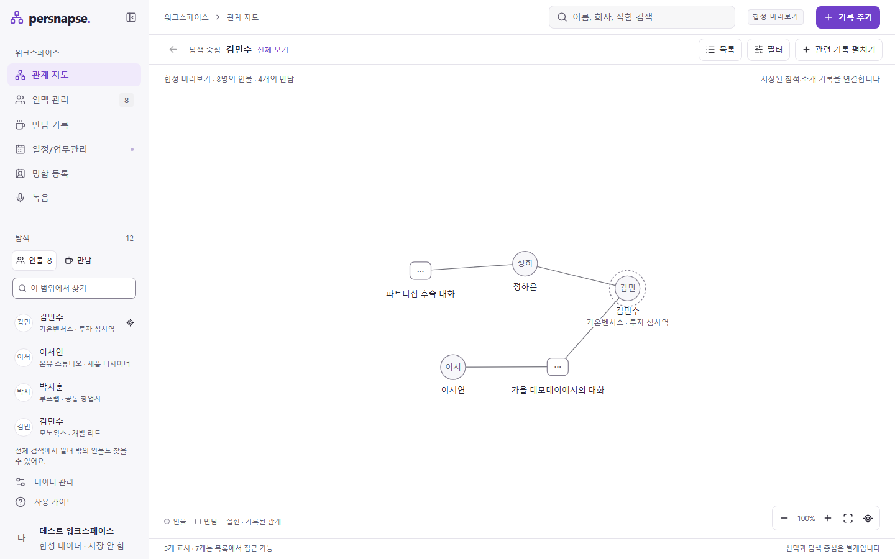 |

전체 데이터 범위 비교에는 아래 `전체 보기` 캡처를 사용한다. 새 화면에는 실제 인물·만남 12개가 있으며 가짜 self는 없다. 기존 좌표를 유지한 채 새 노드가 추가되며 `현재 보기 맞춤`을 명시적으로 눌렀다. 기본 화면의 여백을 줄이려고 데이터 의미를 바꾸거나 임의 관계를 추가하지 않았다.

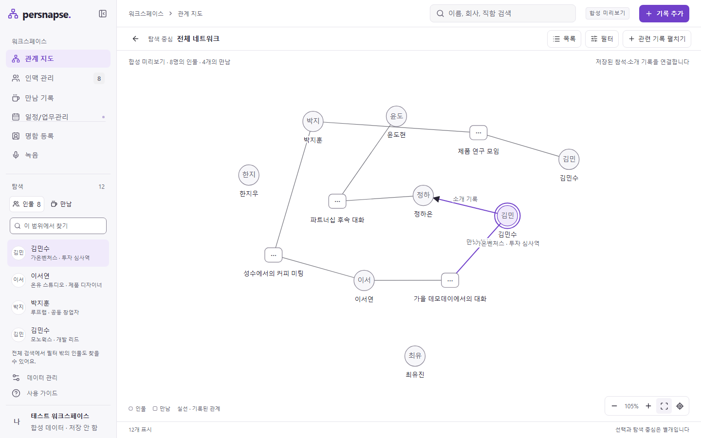

## 2. 레퍼런스와 구축물 비교

원본 자료는 [Reference Atlas](../../plans/frontend_docs/05-frontend-graph-reference-benchmark-2026-10-14.md)와 [출처·crop manifest](../../plans/assets/graph-visual-references-2026-10-14/manifest.json)를 따른다. 공식 자료에서 확보한 31개 이미지의 SHA-256이 모두 기존 manifest와 일치한다. 아래 레퍼런스 이미지는 제품 런타임에 포함하지 않는다.

### B01/B02 — 주변 UI의 절제와 탐색 계층

| Linear 사이드바 crop                                                                                                   | Persnapse 탐색 목록 crop                                                                               |
| ---------------------------------------------------------------------------------------------------------------------- | ------------------------------------------------------------------------------------------------------ |
| 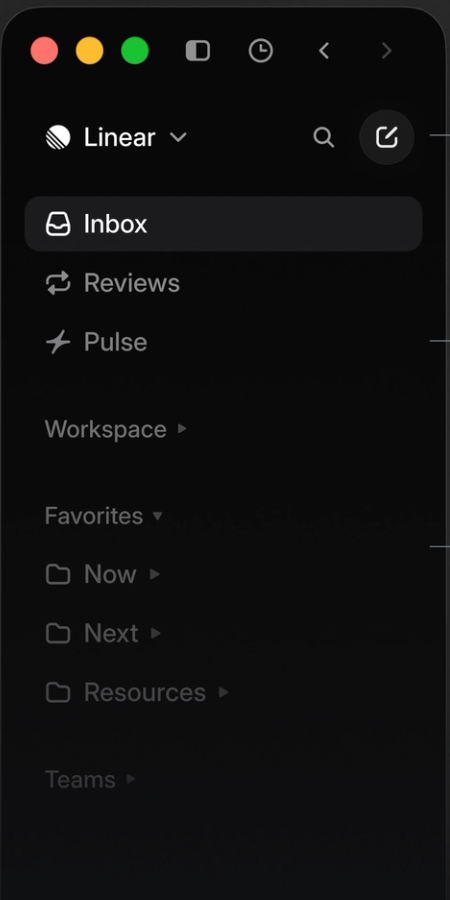 | 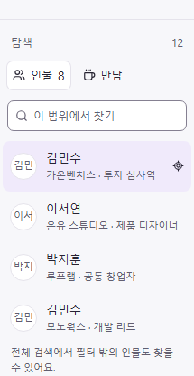 |

채택: 옅은 배경의 고정 탐색 영역, 선택 행의 보라색 배경, 작은 아이콘과 명확한 텍스트 계층. 1440px에서 sidebar 240px, header 56px를 사용했다. 추가 보조 패널을 늘리는 대신 기존 sidebar 아래에 인물/만남 탐색을 넣었다. 축소 폭에서는 목록 전환으로 같은 데이터에 접근한다. 왼쪽의 인물 목록은 화면에 그려진 5개 노드만이 아니라 필터에 맞는 전체 대상을 찾는 경로다.

차이: Linear의 프로젝트 계층을 복제하지 않고 Persnapse의 여섯 기존 작업 경로를 유지했다. Graph는 업무 목록보다 먼저 표시한다. 작은 텍스트가 많은 desktop 밀도는 실제 데이터·장문 이름으로 후속 검토한다.

### B03 — 식별 정보와 상세 행동

| Attio 식별 정보 crop                                                                                        | Persnapse Inspector                                                                                        |
| ----------------------------------------------------------------------------------------------------------- | ---------------------------------------------------------------------------------------------------------- |
| 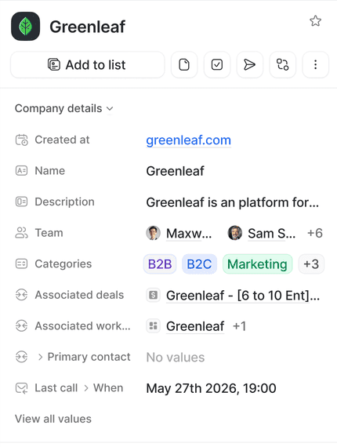 | 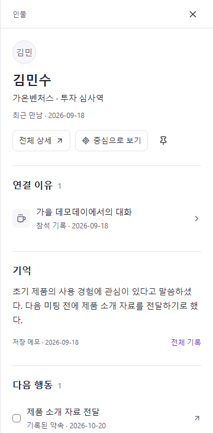 |

채택: 이름·회사/직무를 먼저 읽고, 가까운 위치에서 상세·중심 전환·pin에 접근하는 구성. 최근 만남 아래에 `연결 이유 → 기억 → 다음 행동 → 연락처`를 둔다. 동명이인 두 명은 회사/직무·원본 UUID로 구분한다.

차이: 일반 CRM의 모든 필드를 나열하는 대신 인물을 떠올릴 수 있는 기록과 후속 행동에 우선순위를 줬다. `전체 상세`는 기존 편집 기능으로 연결한다. 패널을 열어도 SVG 영역과 좌표를 다시 계산하지 않는다.

### B05 — 원문을 읽고 동일한 상세로 복귀

| Granola 근거 읽기 crop                                                                                                | Persnapse 저장 기록 읽기                                                                             |
| --------------------------------------------------------------------------------------------------------------------- | ---------------------------------------------------------------------------------------------------- |
| 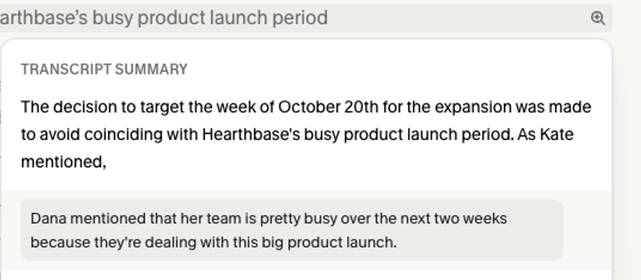 | 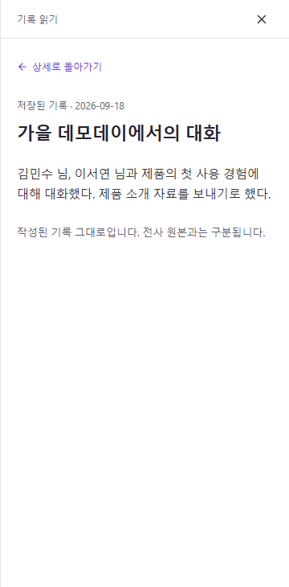 |

채택: 제목·시점·본문 순서와 충분한 행간, 내용이 읽히는 단일 패널, 명시적인 돌아가기. 원문은 임의 생성하거나 요약으로 대체하지 않고 현재 저장된 메모·만남 설명을 보여 준다.

차이: 현재 snapshot은 STT 전사 원본이나 근거 span을 제공하지 않는다. 따라서 `저장된 기록`, `전사 원본과 구분`을 표시하며 Granola 같은 전사 시점 하이라이트가 구현되었다고 주장하지 않는다. 근거 resolver는 W07 작업이다. 기록 삭제 후 새 조회를 받으면 이전 본문을 제거하는 브라우저 검사도 추가했다.

### B11/B12 — 명시적인 확장·고정

| Linkurious 확장·pin 참고                                                                                              | Persnapse 적용                                                                                                                                            |
| --------------------------------------------------------------------------------------------------------------------- | --------------------------------------------------------------------------------------------------------------------------------------------------------- |
| 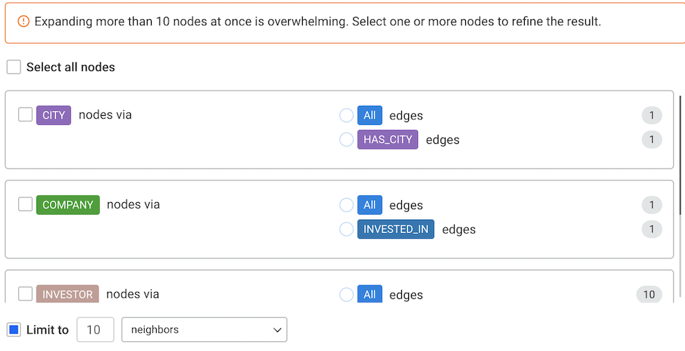 | 확장 전에 종류·남은 수를 제시하고 실제 이웃을 최대 10개씩 추가. 필터 또는 탐색 revision이 바뀐 요청은 이전 탐색에 합쳐지지 않음.                          |
| 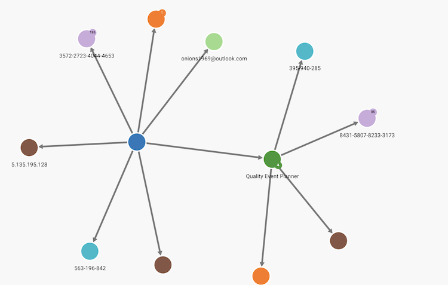         | pin·선택·중심을 별도 상태로 보존. 접기는 해당 확장 소유분을 해제하며 다른 확장·선택·pin이 사용하는 노드는 유지. 이전 탐색으로 카메라·좌표·확장 상태 복귀. |

선의 의미는 `만남 참석`, `소개 기록`이다. 두 사람이 함께 참석했다는 이유만으로 직접적인 친분 선을 추가하지 않는다. 확대/축소 시 라벨을 단계적으로 줄이고 인물/만남 모양을 구분한다. 초기 배치는 seeded D3 계산이며 기존 노드는 확장 때 재배치하지 않는다. 단위·브라우저 검사는 좌표와 상태를 직접 비교한다.

## 3. 반응형 화면

| 폭       | 기본 탐색                                                                         | 인물 선택                                                                            | 검토 결과                                                                          |
| -------- | --------------------------------------------------------------------------------- | ------------------------------------------------------------------------------------ | ---------------------------------------------------------------------------------- |
| 1440×900 | [전체](../../plans/assets/graph-visual-reviews/2026-10-16-initial/after-1440.png) | [선택](../../plans/assets/graph-visual-reviews/2026-10-16-initial/selected-1440.png) | 전체 sidebar·우측 Inspector                                                        |
| 1280×800 | [전체](../../plans/assets/graph-visual-reviews/2026-10-16-initial/after-1280.png) | [선택](../../plans/assets/graph-visual-reviews/2026-10-16-initial/selected-1280.png) | sidebar 축소, 상세 overlay. 선택 대상이 일부 가려지면 `선택 대상 보기`로 명시 이동 |
| 1024×768 | [전체](../../plans/assets/graph-visual-reviews/2026-10-16-initial/after-1024.png) | [선택](../../plans/assets/graph-visual-reviews/2026-10-16-initial/selected-1024.png) | icon rail·320px 상세. 같은 좌표 보존                                               |
| 768×1024 | [전체](../../plans/assets/graph-visual-reviews/2026-10-16-initial/after-768.png)  | [선택](../../plans/assets/graph-visual-reviews/2026-10-16-initial/selected-768.png)  | 하단 탐색·bottom sheet. 초기 배치를 상단으로 조정                                  |
| 390×844  | [전체](../../plans/assets/graph-visual-reviews/2026-10-16-initial/after-390.png)  | [선택](../../plans/assets/graph-visual-reviews/2026-10-16-initial/selected-390.png)  | 긴 노드명 축약, 상세 펼치기·목록 대안                                              |
| 360×780  | [전체](../../plans/assets/graph-visual-reviews/2026-10-16-initial/after-360.png)  | [선택](../../plans/assets/graph-visual-reviews/2026-10-16-initial/selected-360.png)  | 기본 노드명 겹침 수정, 가로 overflow 없음                                          |

| 390px 선택                                                                                      | 768px 선택                                                                                      |
| ----------------------------------------------------------------------------------------------- | ----------------------------------------------------------------------------------------------- |
| 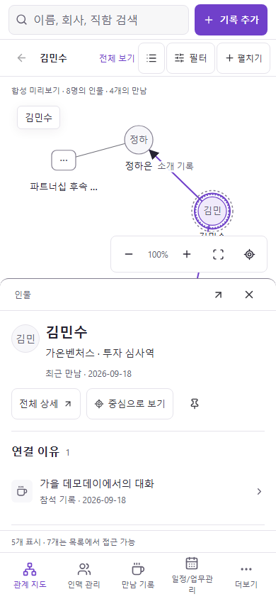 | 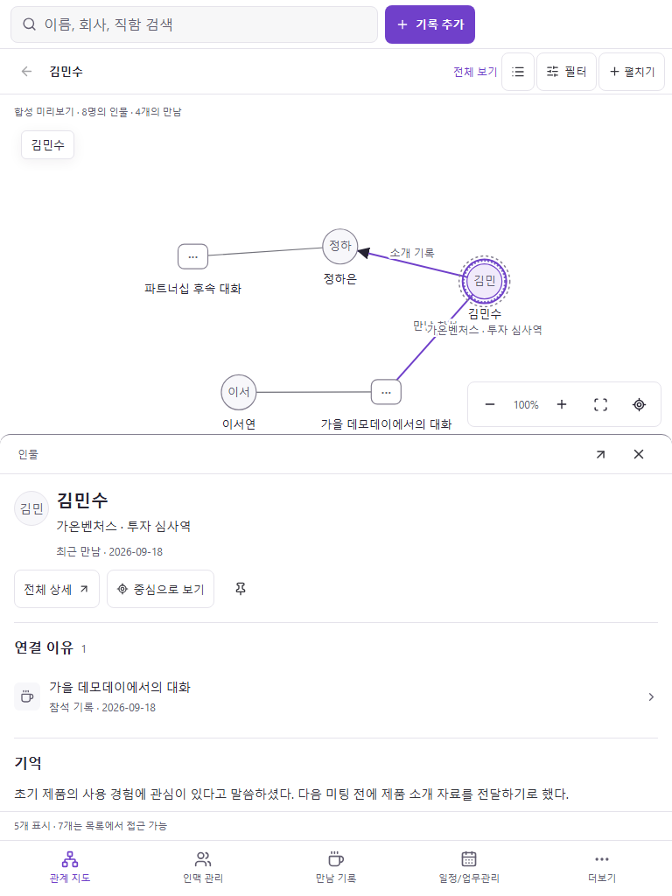 |

캡처 전 fixture 조회·fonts.ready·layout settled를 기다렸다. 기본 상태의 노드 이름 bounding box 겹침과 문서 가로 overflow를 6개 폭에서 확인했다. 캡처 실행의 runtime/console error는 0건이다. 실제 모바일 기기·가상 키보드 검사를 대신하지 않는다.

## 4. 발견 → 수정 → 재검증

| 문제                                            | 적용한 수정                                                         | 증거                                                 |
| ----------------------------------------------- | ------------------------------------------------------------------- | ---------------------------------------------------- |
| 기존 Graph의 가짜 self/연결                     | 실제 UUID와 참석·소개 기록만 adapter에 포함                         | model 단위 검사, 전체 보기 캡처                      |
| 패널 선택과 탐색 중심 혼동                      | selection·focus·inspector·camera 분리                               | 선택/닫기 전후 좌표·포커스 복귀 E2E                  |
| 초기 SVG 크기 전 배치, 기존 caption 스타일 충돌 | 실제 크기 확인 후 최초 배치, Graph scope 안에서 위치 재정의         | 기본/선택 캡처                                       |
| 필터 입력 label 모호성                          | 명시적인 접근성 이름                                                | 필터→동명이인 검색 E2E                               |
| 삭제된 원문 복사본이 계속 남음                  | 본문 복사 상태 대신 source ID로 최신 snapshot에서 조회              | 메모·인물 삭제 후 stale 본문 제거 E2E                |
| 360px에서 긴 만남 이름 겹침                     | 좁은 canvas의 9자 표시 한도, 전체 이름은 목록·상세·접근성 이름 유지 | 360/390 캡처 및 기본 라벨 bounds 확인                |
| 768px에서 하단 탐색 스타일 누락                 | Graph 모바일 breakpoint 안에 고정 위치·동등 폭 버튼 정의            | 768 캡처와 메뉴 위치 E2E                             |
| 태블릿 bottom sheet가 초기 선택 인물을 가림     | 최초 배치만 상단 여유를 두고 계산, 선택 시 좌표 유지                | 768 선택 캡처 및 선택 노드/패널 위치 E2E             |
| 개발 표시 배지가 하단 메뉴를 가림               | 합성 preview flag일 때만 Next devIndicators 비활성화                | 실제 미리보기 캡처. compile/runtime 오류 표시는 유지 |

## 5. 후속 검토의 출발점

- VD01은 이 first iteration을 기준으로 사용자/디자인 평가를 받는다. 자동 검사만으로 visual 채택을 확정하지 않는다.
- 1024/1280에서 상세가 선택 노드 일부를 가리는 overlay 방식은 현재 의도된 좌표 보존 절충이다. 명시적인 `선택 대상 보기`가 있으며, 자동 이동이 필요한지 후속 사용성 검토에서 판단한다.
- 지금 저장 메모·만남 설명과 추후 원본 전사/근거 resolver를 구분한다. Graph API의 불완전 날짜·접근 제한·cursor 상태는 현재 캡처로 검증되지 않았다.
- VD02 Recall·근거, VD03 입력 검토·저장 화면을 다음에 같은 전체/crop·동작 증거 형식으로 추가한다.
- 높은 차수에서의 stress, 200% 브라우저 확대, 실제 IME·터치·screen reader는 남아 있다. 전체 W11 완료로 보고하지 않는다.
