# Persnapse Visual 재설계 — 2026-10-17

상태: **부분별 구현·자체 시각 검토·반복 수정 후, 사용자가 현재 구축물을 메인 프론트엔드 기준으로 채택했다.** [채택 결정 0026](../../decisions/0026-adopt-main-frontend.md). 시각적 보완은 계속하며, 기존 기능 구축의 전체 완료 또는 외부 사용자/VC 검증 완료를 의미하지 않는다.

- 작업 공간: `D:/Persnapse/worktrees/persnapse-frontend-graph-review`
- 미리보기: [관계 지도](http://127.0.0.1:4316/#map) · [명함 등록](http://127.0.0.1:4316/#cards) · [기존 기억 검색/업무](http://127.0.0.1:4316/#todos)
- 데이터: 기존 `FG-FIXTURE-01` 합성 인물 8명·만남 4개. 실제 저장과 외부 AI 호출은 지원하지 않는 로컬 미리보기다.
- 기준 문서: [Visual 설계 24장](../../plans/frontend_docs/03-frontend-graph-visual-design-2026-10-14.md#24-2026-10-17-레퍼런스-재현을-통한-실제-시각-개정), [Reference Atlas](../../plans/frontend_docs/05-frontend-graph-reference-benchmark-2026-10-14.md).
- 요청: 기능·충돌·스모크 검증보다 visual design을 우선하고 레퍼런스를 부분별로 분해하여 실제 화면에 반영한다.

## 1. 첫 화면 전후

| 이번 작업 시작 시점                                                                  | 재설계 후                                                                                            |
| ------------------------------------------------------------------------------------ | ---------------------------------------------------------------------------------------------------- |
| 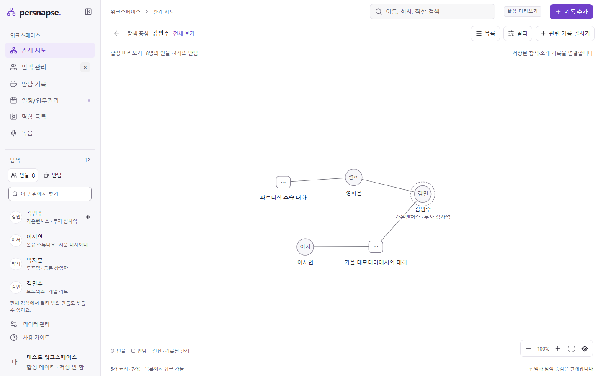 | 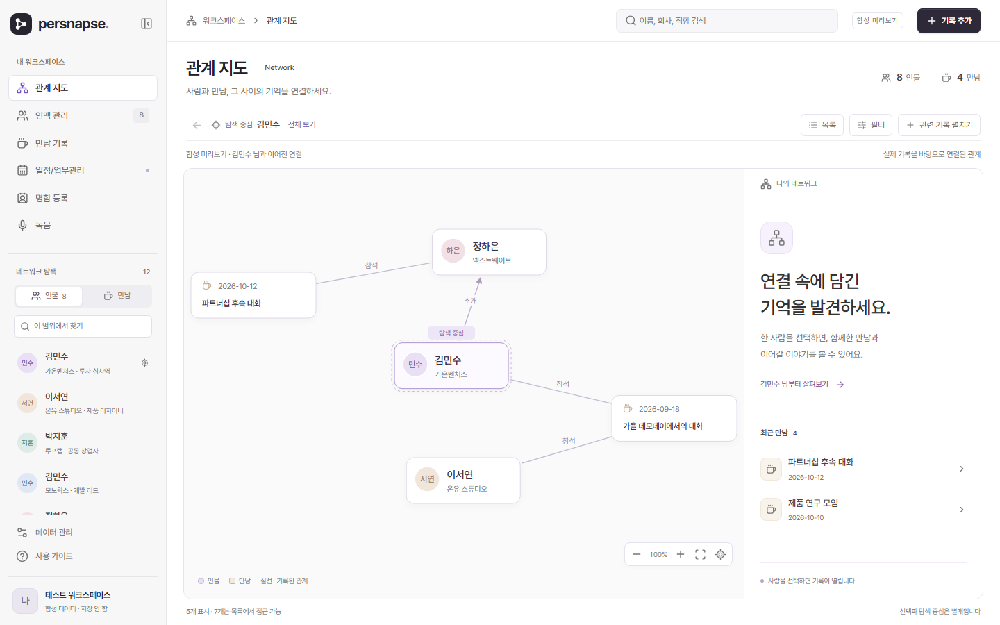 |

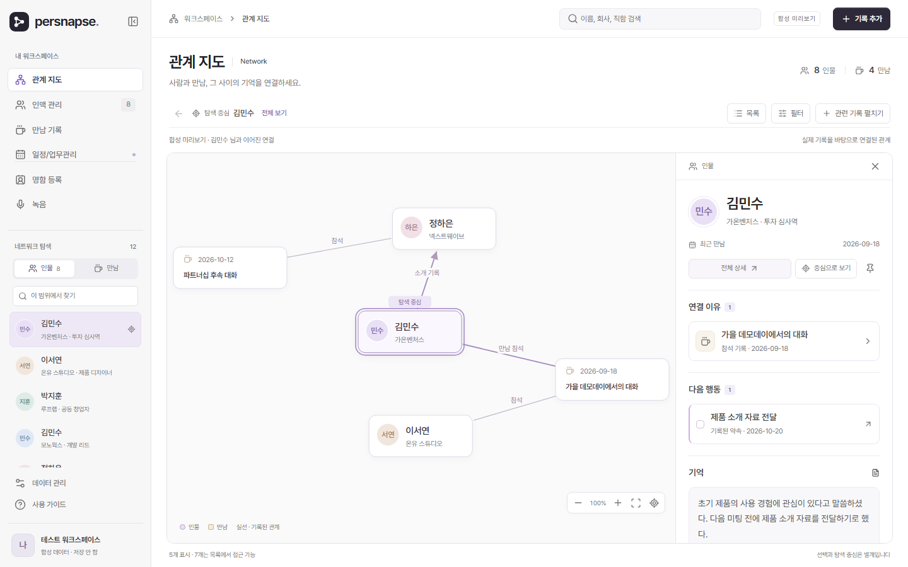

작은 원·가는 선·구분선 중심 화면을 식별 가능한 인물/만남 카드와 독립적인 읽기 열로 재구성했다. 상단은 현재 위치·화면 제목·보기 조작의 역할을 나누고, 오른쪽 열은 선택 전에는 탐색 안내와 실제 최근 만남, 선택 후에는 해당 인물의 연결 이유·다음 행동·기억을 보여준다. 동일 합성 데이터로 비교했다.

## 2. 레퍼런스에서 분해하여 옮긴 부분

| 부분      | 레퍼런스의 구체 요소                                                           | Persnapse 적용                                                                         | 자체 조정                                                          |
| --------- | ------------------------------------------------------------------------------ | -------------------------------------------------------------------------------------- | ------------------------------------------------------------------ |
| 셸        | B01/B02 Linear: 현재 위치와 보기 조작의 분리, 저대비 탐색 영역, 또렷한 현재 행 | 60px header, 240px sidebar, 36px 탐색 행, white active row, 작은 그룹 제목             | light-first 색으로 적용. 브랜드 표식은 자체 SVG                    |
| 글자      | B03 Attio: 이름·보조 정보·활동 제목·날짜의 굵기와 크기 구분                    | Pretendard Variable 로컬 폰트, 25px 화면 제목, 23px 인물, 14px 본문, 11–12px 보조 정보 | 한글을 실제 동일 폰트로 렌더링                                     |
| Graph     | B11/B12 Linkurious: 연결 중심/주변, 실제 관계선, 별도 카메라 조작              | 164×66px 인물 카드, 180×66px 만남 카드, 명시적 중심 표식, 아래쪽 zoom/fit              | 카드 형태는 자체 구성. 좁은 폭·축소에서는 compact 노드로 전환      |
| 상세      | B03 Attio: avatar/이름/행동의 근접, 활동 카드, upcoming action                 | 독립된 344px 읽기 열, identity/행동, 연결 이유, 다음 행동, 기억                        | 기존 overlay 대신 열을 미리 확보하여 상세 열기 전후 폭과 좌표 유지 |
| 기록      | B04/B05 Granola: 제목·날짜·읽을 본문·원문 문맥                                 | 15px/약 29px 본문, 기록 종류/날짜, 상세 복귀, 저장된 내용임을 명시                     | 실제 전사/AI 요약이 없는 상태를 저장 메모로 표시                   |
| 검색      | B06 Raycast: 그룹 제목과 아이콘/항목/보조 정보 행                              | 인물 검색 그룹, 소속이 보이는 동명이인 행, ID 기준 avatar tint                         | 지원되지 않는 command shortcut을 추가하지 않음                     |
| 생성      | B07 Attio: 행동별 아이콘과 명확한 행 분리                                      | 238px 메뉴, 5가지 기존 기록 진입, 각 행동의 짧은 설명                                  | 명함·만남·인물·음성·텍스트의 실제 기존 경로 사용                   |
| 입력      | B15 Dex: label/field/간격의 일관성                                             | 320px 2열 Graph 필터, 명함 단계 표시·촬영/업로드·확인 가이드                           | 명함 업로드 면과 CSS 명함 도식은 Persnapse 자체 디자인             |
| 작은 화면 | B08/B13 folk: 인물 식별 후 읽기, 한 방향 상세                                  | 모바일 sheet 42dvh, 태블릿 32dvh, 상세 펼치기, 모바일 초기 중심 상단 배치              | 노드 선택으로 위치를 바꾸지 않음                                   |

기존 공식 레퍼런스 PNG 31개를 그대로 참조했다. 외부 제품의 로그인 화면을 새로 사용해 본 것으로 보고하지 않는다. 구체 캡처 출처는 [기존 manifest](../../plans/assets/graph-visual-references-2026-10-14/manifest.json)에 있다.

## 3. 부분별 직접 비교

### 탐색 영역 — Linear B02

| 레퍼런스 crop                                                                                                      | 적용 후                                                                                                  |
| ------------------------------------------------------------------------------------------------------------------ | -------------------------------------------------------------------------------------------------------- |
| 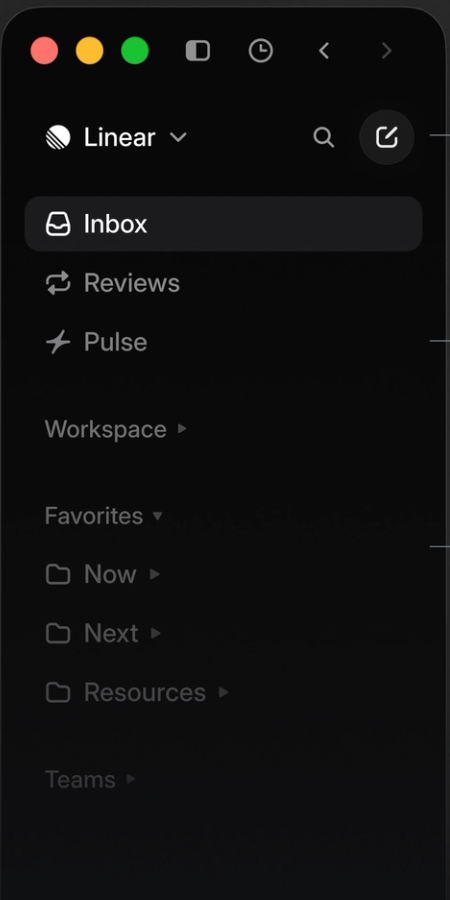 | 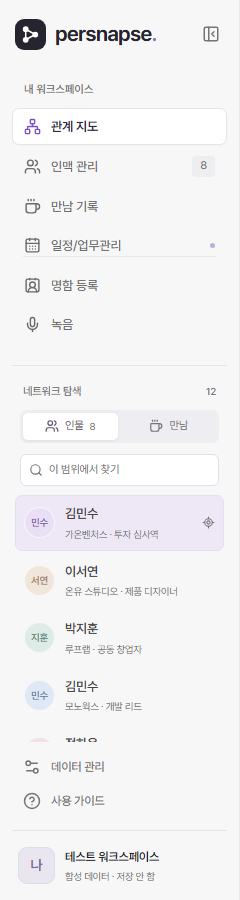 |

그룹 이름을 작게 낮추고 선택 행에만 명확한 면을 주었다. 네트워크 목록은 아이콘/이름/소속을 동일 기준선으로 맞췄다. 처음에는 배경을 바꾸는 수준이었고, 이후 폰트·행 높이·선택 대비·avatar까지 함께 수정했다.

### 인물과 활동 — Attio B03

| 레퍼런스                                                                                                       | 적용 후                                                                                                      |
| -------------------------------------------------------------------------------------------------------------- | ------------------------------------------------------------------------------------------------------------ |
| 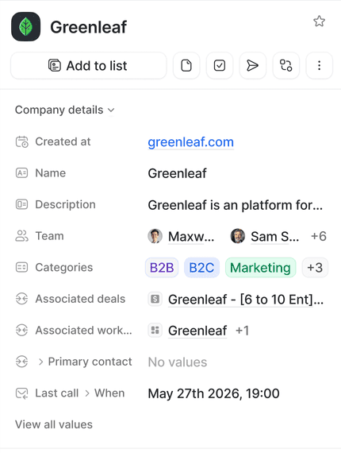 | 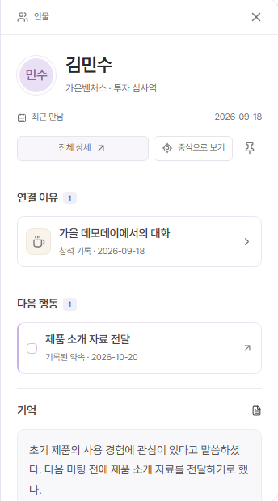 |

인물 이름과 행동을 가까이 배치하고, 연결 이유와 다음 행동을 개별 기록 행으로 만들었다. 긴 기억 본문 때문에 다음 행동이 첫 화면 아래로 밀리는 것을 확인하여 **연결 이유 → 다음 행동 → 기억** 순서로 수정했다. 실제 약속이 없는 인물은 원래의 빈 상태를 표시한다.

### 저장 기록 읽기 — Granola B05

| 레퍼런스                                                                                                          | 적용 후                                                                                                |
| ----------------------------------------------------------------------------------------------------------------- | ------------------------------------------------------------------------------------------------------ |
| 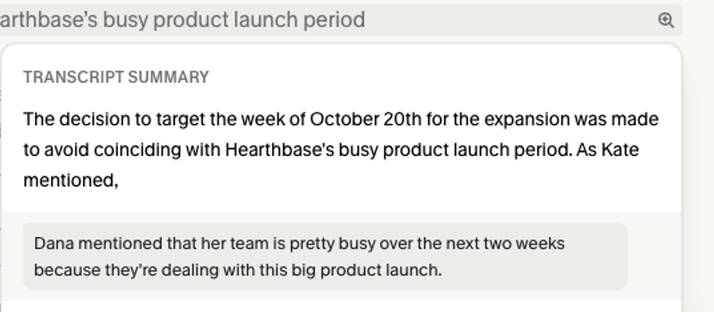 | 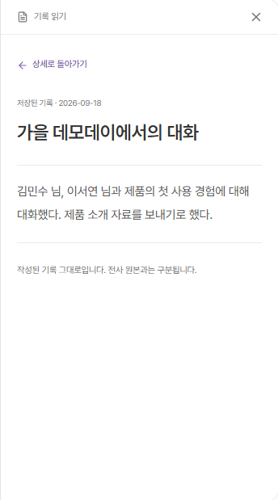 |

메타 정보보다 본문을 크게 하고, 작성된 저장 기록과 설명을 분리했다. 오른쪽 열 안에서 읽고 기존 상세로 복귀할 수 있다. 이 화면에 없는 전사·AI 생성 내용을 장식용으로 만들지 않았다.

### 검색과 기록 추가 — Raycast B06 / Attio B07

| 검색                                                                                            | 기록 추가                                                                                    |
| ----------------------------------------------------------------------------------------------- | -------------------------------------------------------------------------------------------- |
| 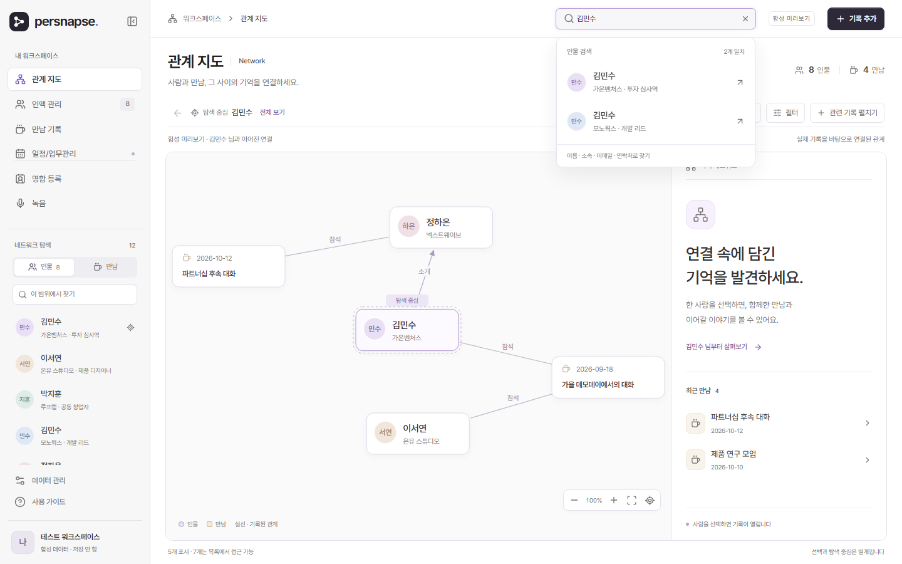 | 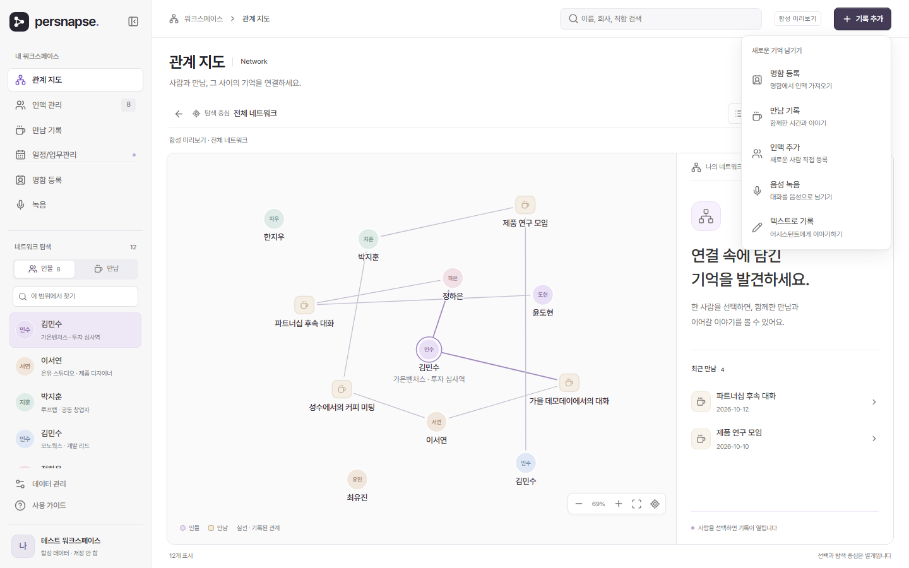 |

같은 이름인 두 사람을 소속과 avatar로 함께 식별한다. 기록 메뉴는 아이콘·행동명·설명을 같은 정렬로 반복한다. 필터는 한쪽으로 몰린 기존 배치를 제거하고 label과 field가 정렬된 2열 폼으로 바꿨다.

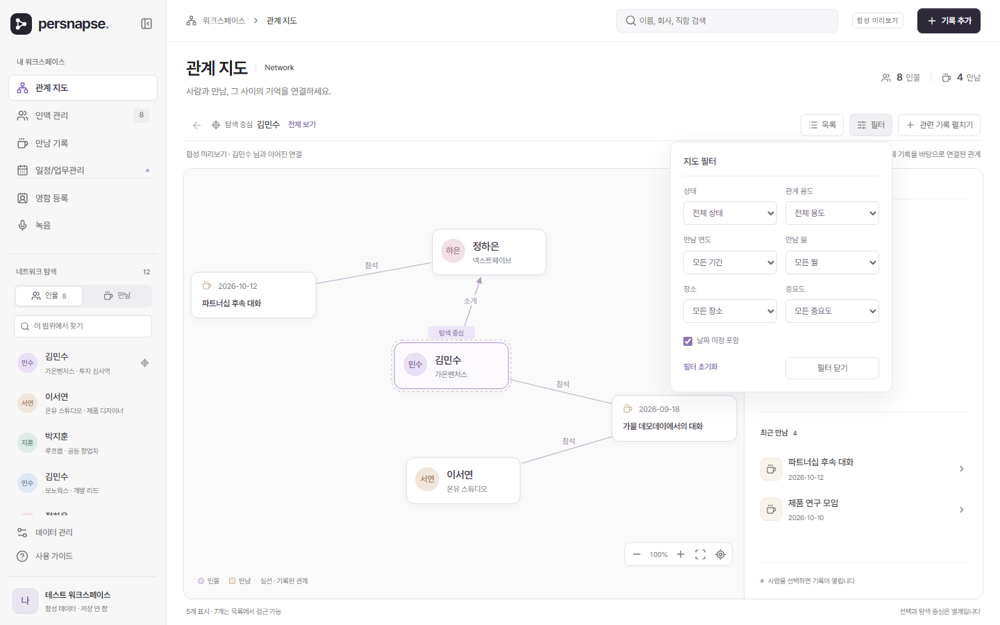

## 4. 명함·기존 기억 검색 진입의 연속성

아래 before는 이번 작업 중 공통 폰트를 적용한 뒤, 각 화면을 개별 정제하기 전의 중간 기준이다. 전체 작업 시작 시점 이미지와 구분한다. 이 두 화면의 비교는 10월 17일 날짜 표시를 사용한다.

| 명함 진입 중간 기준                                                                                | 적용 후                                                                                        |
| -------------------------------------------------------------------------------------------------- | ---------------------------------------------------------------------------------------------- |
| 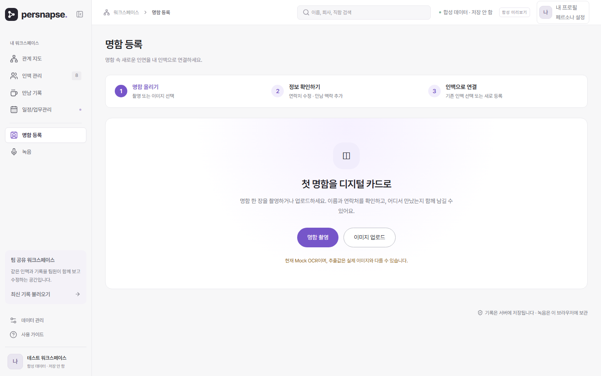 | 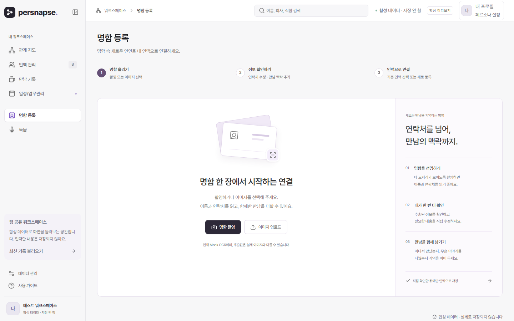 |

촬영·업로드와 사용자가 확인할 내용을 나눴다. 보정/OCR/저장 처리 코드는 그대로이며, 이번에는 시작 화면의 JSX와 스타일만 바꿨다. 업로드 이미지나 실제 인물이 없는 도식은 장식용 명함 그림이다.

| 기존 기억 검색 중간 기준                                                                               | 적용 후                                                                                             |
| ------------------------------------------------------------------------------------------------------ | --------------------------------------------------------------------------------------------------- |
| 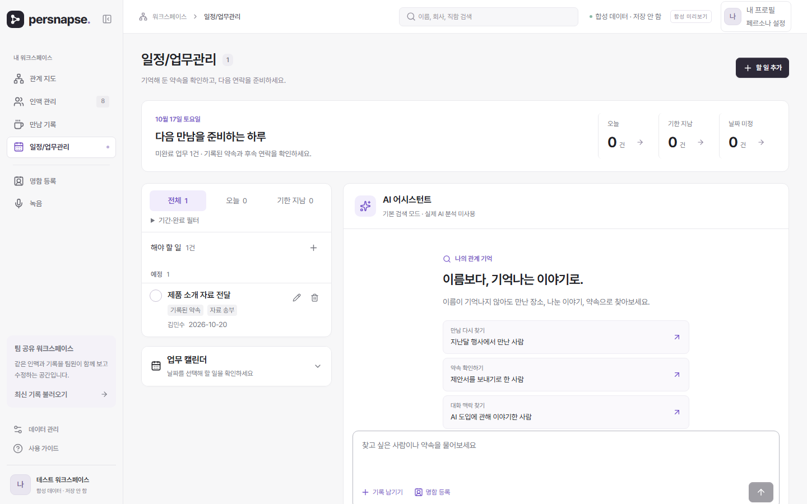 | 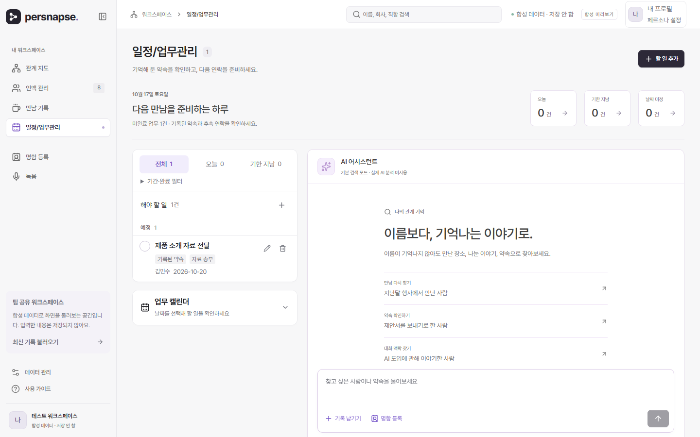 |

기존 업무/Assistant 진입에서 제목·설명·질문 예시 행·입력창을 정리했다. 실제 Recall 결과와 Graph의 통합은 이번 시각 작업의 완료 범위에 포함하지 않는다.

[모바일에서 AI 어시스턴트 탭을 연 실제 화면](../../plans/assets/graph-visual-reviews/2026-10-17-redesign/final-recall-390.png)도 별도로 확인했다.

## 5. 사용자·VC 관점으로 발견하고 반복 수정한 내용

실제 외부 리뷰 참가자는 없다. 아래는 Codex가 두 관점으로 직접 화면을 열어 판단한 자체 리뷰다.

| 반복          | 사용자 관점에서 발견                                                         | VC의 첫 제품 검토 관점에서 발견                 | 반영                                                                    |
| ------------- | ---------------------------------------------------------------------------- | ----------------------------------------------- | ----------------------------------------------------------------------- |
| 01 셸         | 폰트·선택 행은 정돈됐으나 캔버스는 여전히 작은 도식                          | 제품 차이가 충분히 보이지 않음                  | 다음 반복에서 캔버스·노드·읽기 열을 함께 재구성                         |
| 02 Graph·상세 | 작은 보라색 글자, 잘리는 만남 제목, 모바일 선택 가림                         | 일관되지만 흐릿하고 내용보다 스타일이 앞섬      | 중성 본문, 더 큰 record 제목, 만남 카드 별도 형태                       |
| 03 읽기       | 선택 인물이 모바일 sheet 위에 보여야 함                                      | Graph에서 기록 읽기로 이어지는 흐름이 보여야 함 | 초기 compact 배치를 깊이별로 조정, 원문 읽기 화면 정제                  |
| 04 관련 진입  | 검색/추가 메뉴·명함 입력에서 시각 문법이 바뀜                                | 화면 간 제품 완성도의 격차                      | 공통 행·field·입력창·명함 단계 적용                                     |
| 최종 정제     | 태블릿 선택 가림, 필터 우측 쏠림, 약속이 메모 아래로 밀림, 축소 시 이름 누락 | 관계를 본 뒤의 행동이 잘 드러나지 않음          | 태블릿 32dvh sheet, 필터 2열, 다음 행동 우선, 작은 전체 Graph 이름 유지 |

중간 산출물은 `iteration-01-*` ~ `iteration-04-*`로 보존했다. 최종 판단은 `final-*` 화면을 사용한다.

### 작은 화면

| 모바일 390px                                                                                      | 태블릿 768px                                                                                      |
| ------------------------------------------------------------------------------------------------- | ------------------------------------------------------------------------------------------------- |
| 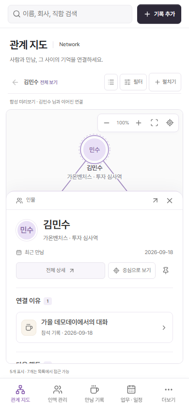 | 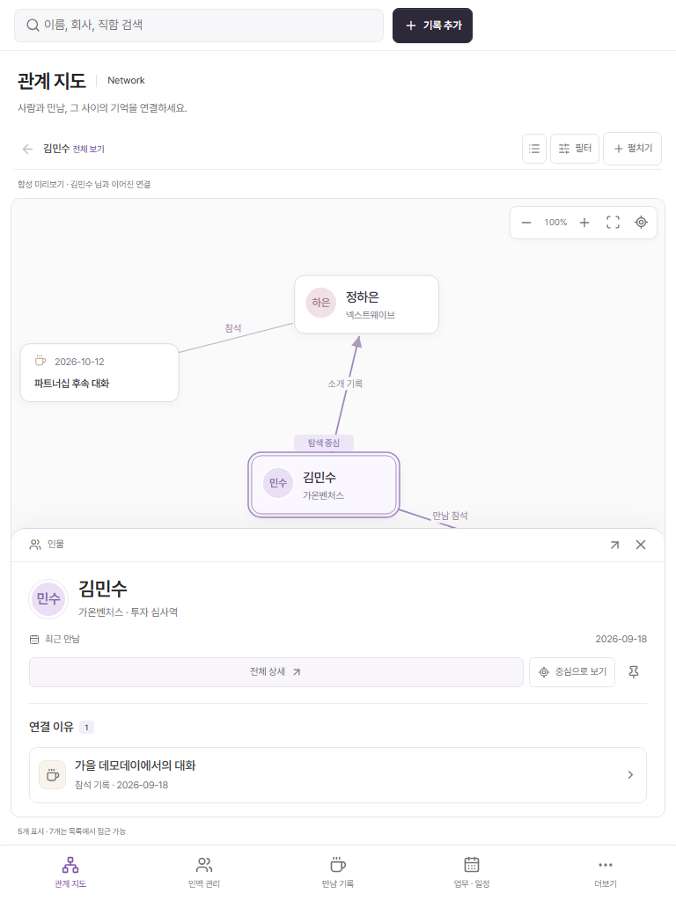 |

## 6. 제한한 검증과 실제 관찰

사용자가 이번 작업의 기능/충돌/스모크 검증을 최소화하도록 명시했다. 전체 unit, 전체 E2E, production build를 다시 돌리지 않았다. 이전 세션의 308개 단위 테스트·51개 E2E 통과를 이번 변경의 검증 결과로 재사용하지 않는다.

- 변경 JS/TS/TSX 7개에 ESLint 실행: exit 0.
- 브라우저가 실제 렌더링한 글꼴은 `Pretendard Variable`(custom font)로 확인했다. CSS의 이름만 선언한 fallback 상태가 아니다.
- dev 서버에서 실제 페이지를 열어 클릭·검색·선택·원문 이동·팝오버·보기 맞춤과 화면 렌더링을 확인.
- Graph 1440×900, 1280×800, 1024×768, 768×1024, 390×844, 360×780의 기본/선택 화면을 캡처. 비교 중 페이지 가로 넘침·브라우저 pageerror 없음. 인물 선택 전후 노드 좌표 동일.
- 최종 캡처 기록: [Graph 17개 상태](../../plans/assets/graph-visual-reviews/2026-10-17-redesign/final-review.json), [검색·필터·입력/기억 검색 진입 및 소스 해시](../../plans/assets/graph-visual-reviews/2026-10-17-redesign/final-source-and-entries.json).
- Graph는 fixture 시각 2026-10-13, ko-KR, Asia/Seoul, DPR 1. 관련 진입은 2026-10-17 고정 날짜. 브라우저 자동화는 시각 재현용이며 전체 기능 회귀 테스트가 아니다.
- 실제 한국어 IME·화면낭독기·실기기 터치·200% 확대·대형 데이터 검증은 수행하지 않았다.

## 7. 적용 파일과 이어갈 범위

| 파일/영역                                          | 변경 책임                                                                                       |
| -------------------------------------------------- | ----------------------------------------------------------------------------------------------- |
| `src/features/workspace/visual-system.css`         | 레퍼런스 기반 공통 셸·폰트·Graph 외형·읽기·검색·명함/기억 검색 진입                             |
| `tokens.css`, `src/app/page.tsx`                   | 색상 토큰 및 마지막 시각 스타일 로드                                                            |
| `graph/appearance.ts`                              | 동일 ID의 안정된 avatar tint, 관계 의미와 무관                                                  |
| `graph/GraphCanvas.jsx`, `graph/layout.js`         | 카드/compact 표현, 초기 화면 구성, label/관계선                                                 |
| `graph/GraphWorkspace.tsx`                         | 보기 제목·안내 열·인물/기록 위계·2열 필터                                                       |
| `ui/ContactGraph.jsx`                              | 브랜드 표식·검색 행·생성 메뉴·모바일 이름·합성 데이터 안내                                      |
| `src/features/capture/business-card-workspace.tsx` | 명함 진입 presentation JSX만 변경                                                               |
| `public/fonts/pretendard/`                         | [Pretendard 1.3.9](https://github.com/orioncactus/pretendard)의 원본 WOFF2와 SIL OFL, 로컬 제공 |

기존 Graph 데이터 모델·서버 API·DB·OCR/STT 처리·실제 저장 경로를 추가하지 않았다. 원본 저장소나 다른 worktree도 수정하지 않았다. commit/deploy는 수행하지 않았다.

다음 visual 검토는 실제 사용자 피드백을 기준으로 Graph 밀도·읽기 열의 비례를 조정하고, VD02 실제 Recall 결과 및 VD03 원본/추출값 검토 상태를 이어서 구성한다. 지금의 합성 화면을 최종 제품 디자인으로 자동 확정하지 않는다.

로컬 서버 재시작:

```powershell
Set-Location D:\Persnapse\worktrees\persnapse-frontend-graph-review
$env:PERSNAPSE_GRAPH_PREVIEW = '1'
npm run dev -- --hostname 127.0.0.1 --port 4316
```
