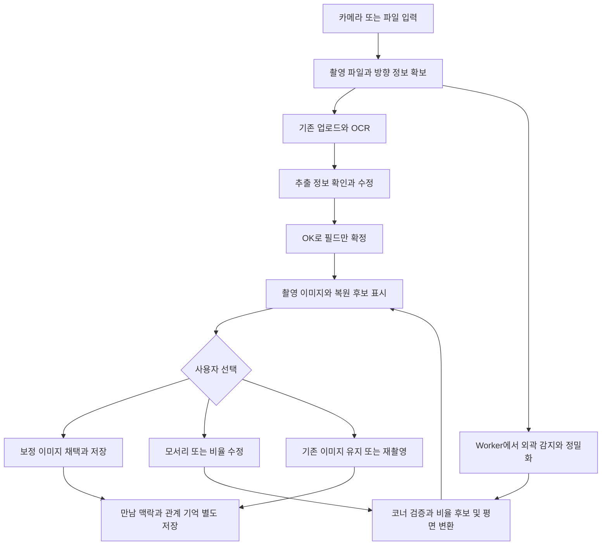

# 단일 명함 외곽 인식과 평면 복원 작업 설계

- 기준일: 2026-10-12
- 상태: 구현 전 설계안. 제품 요구사항은 기존 합의를 따르며, 아래 모듈과 API는 신설 제안이다.
- 대상: `D:\Persnapse\persnapse-mvp`, `card_recognition/`, 통합 워크스페이스 `/#cards`.
- 목적: 명함 외곽을 정확히 찾고 글자·숫자·로고·색·배치를 보존한 보기 전용 이미지를 만든다. 정확성 우선, 처리 시간은 가능한 범위에서 줄인다.

## 1 범위와 용어

| 용어               | 이번 작업의 정의                                                                             |
| ------------------ | -------------------------------------------------------------------------------------------- |
| 외곽 인식          | 사진에서 명함 한 장의 네 변과 네 모서리를 찾는 작업                                          |
| 내부 레이아웃 분석 | 명함 안의 이름·회사·전화·로고 등의 영역 분류. 이번 집중 개선 범위 밖                         |
| 평면 복원          | 사진의 원근 왜곡을 보정하여 명함을 정면의 직사각형으로 표시하는 작업                         |
| 촬영 파일          | 사용자가 이번 세션에서 촬영·선택한 파일. 첫 복원의 가장 높은 품질 소스                       |
| 저장 원본          | 현재 `original` 자산. 전체 사진을 최대 2560px 등으로 축소·압축한 이미지이며 촬영 파일과 구분 |
| 복원 소스          | 새로 제안하는 `restoration_source` 자산. 원근 변환 전 명함 주변 영역을 보존한 이미지         |
| 표시 이미지        | `display` 자산. 사용자가 채택한 평면 복원 결과 또는 기존 표시 이미지                         |

촬영 안내 그리드는 넣지 않는다. 필드 OK는 추출 정보만 확정한다. 복원 이미지 채택과 인물·만남·관계 기억 저장은 각각 기존의 별도 동작을 유지한다. 디자인 편집, 다중 명함, OCR 제공자 변경, 생성형 글자·로고 복원은 이번 작업에 포함하지 않는다.

## 2 기술 선택과 모델 선정

| 구성           | 설계 기준                                        | 채택 조건                                                                     |
| -------------- | ------------------------------------------------ | ----------------------------------------------------------------------------- |
| 주 검증 모델   | **DocAligner FastViT-T8**, 공개 FP32 ONNX        | 실제 명함의 검출·내용 보존 기준을 만족하고 모바일에서 실행 가능               |
| 경량 비교 모델 | DocAligner LC100                                 | T8 대비 품질 저하 없이 다운로드·지연·메모리 개선이 확인되면 대체              |
| 핵심 비교 모델 | DocQuadNet-256                                   | 동일 평가에서 오류·수동 수정이 줄면 주 모델로 교체                            |
| 추론           | `onnxruntime-web`, 전용 Worker, WASM 단일 스레드 | 모델별 연산 호환과 Next production build에서 자산 로딩 확인                   |
| 정밀화와 변환  | 기존 `@techstark/opencv-js` 재사용               | Worker에서 DOM 없이 Mat 생성·변환·해제 가능                                   |
| 추가 복원 비교 | UVDoc                                            | 휘어짐 또는 잔여 왜곡 사례에서 글자·색·배치 보존이 실제로 개선될 때 후속 적용 |

T8 선정은 현재 요구사항에 맞춘 검증 순서다. SmartDoc 제작자 평가를 명함 정확도로 간주하지 않는다. 최종 서비스에는 검증 후 주 모델 하나를 선택한다. 각 후보를 매 촬영마다 모두 실행하는 구조는 기본 경로에 넣지 않는다.

모델 manifest에는 원 저장소 commit, 다운로드 URL, 파일명·바이트 수·SHA-256, 라이선스·NOTICE, 전처리 버전, 입력·출력 이름과 shape를 기록한다. DocQuadNet은 공개 ONNX와 최신 앱 ORT의 일치 여부부터 확인한다. 다운로드한 파일을 검사하기 전 해시나 모델 버전을 확정된 값으로 만들지 않는다.

모델은 버전과 해시가 포함된 동일 출처 정적 경로에 배포한다. 개발·빌드 준비 스크립트가 로컬 모델 저장소에서 복사하며, 네트워크 다운로드는 별도 명령으로 수행한다. 생성 모델·WASM 파일은 Git 제외, manifest와 라이선스는 추적한다. 라이브러리 정확한 버전은 첫 호환성 검증에서 고정하고 lockfile에 남긴다.

## 3 현재 코드와 연결 지점

| 현재 경로                                          | 확인한 현재 동작                                         | 예정 변경                                                                          |
| -------------------------------------------------- | -------------------------------------------------------- | ---------------------------------------------------------------------------------- |
| `card_recognition/restore-image.ts`                | 필드 OK 뒤 메인 스레드 OpenCV, 가장 큰 윤곽 선택         | 외부 진입점 유지, 검출·정밀화·비율·Worker를 내부 모듈로 분리                       |
| `card_recognition/geometry.ts`                     | 네 점 순서와 사진 속 변 길이로 출력 크기 계산            | 볼록성·교차·변환 안정성 검증, 출력 비율을 별도 입력으로 받기                       |
| `card_recognition/card-corner-editor.tsx`          | 고정 8%·92% 네 점으로 시작                               | 현재 소스에 대응하는 검출 후보로 초기화, 수동 수정 중 점 순서를 고정               |
| `src/features/capture/business-card-workspace.tsx` | OK 뒤 자동 복원, 수동 복원은 저장 원본을 다시 다운로드   | OCR 중 로컬 계산 준비, OK 뒤 후보 공개, 촬영 파일 우선 선택, 오래된 작업 결과 무시 |
| `src/features/capture/card-image-processing.ts`    | 원본·표시 이미지 압축과 OCR 업로드 준비                  | OCR 업로드 경로는 재사용. 복원용 입력 선택과 인코딩 경로를 구분                    |
| `restore-display` API와 card service/repository    | 3.2MB JPEG 교체, `{ corners, coverage }`, 이전 경로 비교 | v2 좌표·비율·소스·모델 메타데이터와 저장 revision 지원                             |
| Supabase `source_assets`                           | `original`·`display`만 variant로 허용                    | `restoration_source`와 nullable 참조를 추가하는 마이그레이션 제안                  |

현재 수동 보정은 촬영 파일이 메모리에 있어도 저장 원본을 사용한다. 자동·수동 작업 모두 같은 소스 선택 규칙으로 통일한다. 기존 OCR 캐시·연락처 종류 분류·필드 확인값은 복원 과정에서 바꾸지 않는다.

## 4 처리와 사용자 흐름



- 명함 화면·카메라 진입 시 런타임과 주 모델을 준비한다. 서비스 기본 화면 로딩은 이 자산 다운로드를 기다리지 않는다.
- OCR 업로드를 먼저 시작하고 복원은 낮은 우선순위로 이어 실행한다. 기기에서 동시 decode가 메모리 압박을 만들면 원본 준비 단계를 순차 실행한다.
- OK 전에는 복원 결과를 로컬 상태에만 둔다. OK API 성공 후 결과를 표시하며, 아직 처리 중이면 촬영 이미지를 먼저 표시한다.
- 외곽이 불확실하면 원본에 후보를 표시하여 수정할 수 있게 한다. 작은 명함이나 사진을 거의 채운 명함을 현재 면적 상수만으로 배제하지 않는다.
- 검출 실패와 이미 정면인 스캔본을 구분한다. 명시적 스캔본 입력 또는 검증된 경계가 정면에 가까운 경우만 `already-flat` 경로를 사용한다. 감지 실패를 정면 판정으로 바꾸지 않는다.
- 기존의 이미지 채택 버튼을 유지한다. 복원 오류 때문에 확정된 OCR 필드가 사라지거나 관계 기억이 자동 저장되지 않게 한다.

### 상태와 동시 작업

복원 상태는 `idle → preparing → detecting → refining → rendering → candidate → saving → saved`로 관리하고, `needs-review`, `fallback`, `error`, `cancelled`를 별도 결과로 둔다. OCR·필드 확정 상태와 분리한다.

각 작업은 `jobId`, `captureId` 또는 업로드 전 `queueItemId`, `sourceRevision`, `recipeVersion`을 가진다. 사진 변경·다시 촬영·점 이동·비율 변경 때 revision을 증가시킨다. 현재 revision과 다른 응답은 표시·저장하지 않는다. `AbortSignal`은 호출 취소 의도를 전달하고, 실행 중 WASM을 즉시 중단해야 하면 Worker를 종료·재생성한다. 취소 후 도착한 Promise 결과를 적용하지 않는다.

## 5 모듈 구조와 계약

아래 파일은 구현 시 추가할 예정이다. 유사한 책임은 한 모듈에 두고 모델별 차이만 어댑터로 분리한다.

```text
card_recognition/
  restore-image.ts                 외부 호출 진입점과 기존 호출 호환
  rectification-types.ts          상태 결과 좌표 비율 진단 타입
  model-manifest.ts               모델 파일 해시 전처리 출력 계약
  detectors/
    docaligner.ts                 LC100와 T8 공통 어댑터
    docquad.ts                    모서리와 mask 어댑터
    opencv.ts                     기존 대조군과 수동 보정 보조 후보
  source-image.ts                 방향 소스 선택 ROI 좌표 변환
  refine-boundary.ts              원본 경계 주변 직선과 교점 정밀화
  geometry.ts                    점 순서 볼록성 변환 안정성
  aspect-policy.ts               실제 비율 추정 미리보기 사용자 확인
  warp-image.ts                  한 번의 원근 변환과 인코딩
  quality.ts                     후보 검증과 검토 이유
  runtime/
    client.ts                    Worker 생성 통신 재시도 취소
    worker.ts                    ONNX와 OpenCV 작업 실행
  card-corner-editor.tsx          후보 기반 수동 조정
  card-viewer.tsx                 원본 결과 보기와 이동 확대
  contracts.ts                   기존 API와 v2 메타데이터 스키마

scripts/card_recognition/         모델 준비와 벤치마크 실행
tests/fixtures/card_recognition/  합성 이미지 정답과 공개 가능한 예시
```

외부 호출은 `restoreBusinessCardImage(file, options)`로 정리한다. options에 normalizedCorners, aspectPolicy, detector, signal, progress를 전달한다. 기존 두 번째 인자 `CardCorners` 호출은 내부 변환하여 호환한다. 정상 결과와 실패 결과를 다음처럼 구분한다.

| 결과           | 필수 내용                                                                         | UI 동작                                   |
| -------------- | --------------------------------------------------------------------------------- | ----------------------------------------- |
| `candidate`    | JPEG, width·height, 정규화 코너, 비율 출처, 소스·모델 버전, 진단                  | OK 후 미리보기와 채택 가능                |
| `needs-review` | 원본, 가능한 코너 후보, 검토 이유                                                 | 점 수정·비율 조정·재촬영·기존 이미지 선택 |
| `fallback`     | `engine-unavailable`·`unsupported-image`·`resource-limit`·`no-boundary` 등의 사유 | 원본 유지, 가능한 경우 수동 조정          |
| `cancelled`    | jobId                                                                             | 화면 오류로 표시하지 않고 폐기            |

### 좌표의 기준

1. 기준 좌표는 EXIF 방향을 적용한 촬영 이미지의 normalized 좌표 `[0,1]`이다. 원본 크기, EXIF 적용 여부, ROI의 원본 내 위치와 크기를 함께 기록한다.
2. 모델 입력 좌표, heatmap 좌표, 원본 픽셀 좌표, ROI 픽셀 좌표는 별도 타입과 변환 함수로 구분한다. pixel 좌표를 normalized 좌표로 오인하지 않도록 v2에 `coordinateSpace`를 필수로 둔다.
3. 자동 후보는 순환 순서를 정규화하되 화면상의 시작점과 명함 내용의 위쪽 방향을 구분한다. 시작점을 정했다고 텍스트가 정방향이 되는 것은 아니므로 결과에는 90도 회전 조작을 제공한다.
4. 수동 점은 드래그마다 재정렬하지 않는다. 자기 교차·오목 사각형이면 적용을 막고 점 위치를 수정하도록 한다.
5. 둥근 모서리는 곡선 끝점 대신 네 직선 변의 교점을 정답으로 정의한다. 검증 이미지에서 교점이 프레임 밖이면 완전한 자동 복원 대상에서 제외한다.

모서리 편집기의 이미지도 현재 선택한 소스와 일치시킨다. 저장 ROI를 표시할 때는 원본 normalized 좌표를 ROI 좌표로 변환하고, 적용 시 다시 원본 기준으로 되돌린다. 과거 v1의 pixel 코너는 기준 이미지 크기가 확인될 때만 편집 초기값으로 사용하며, 불명확하면 다시 검출한다.

## 6 모델 전처리와 경계 정밀화

| 항목        | DocAligner LC100와 T8                        | DocQuadNet                                               |
| ----------- | -------------------------------------------- | -------------------------------------------------------- |
| 입력        | BGR, 직접 256×256 resize, float32 0..1, NCHW | RGB, 검정 letterbox 256×256, float32 0..1, NCHW          |
| 출력        | `heatmap`의 네 코너 채널                     | `corner_heatmaps`와 `mask_logits`                        |
| 기준 후처리 | 공식 threshold·영역 중심점 계산을 먼저 재현  | 공식 logit 변환·peak 계산·letterbox 역변환을 재현        |
| 개선 비교   | 기준과 subpixel 추정 차이를 별도 비교        | 영역 mask와 사각형 일치 검증, 공식 후처리의 웹 재현 비교 |

공식 전처리를 임의로 통일하지 않는다. 모델별 score는 성공 확률이 아니므로 모델 사이에서 같은 숫자 threshold를 사용하지 않는다.

DocAligner 공식 후처리의 전체 해상도 heatmap 확대는 먼저 제한된 참조 입력에서 재현한다. 제품에서는 원본 크기의 네 heatmap을 동시에 만들지 않고 축소 좌표계 또는 국소 영역에서 점을 계산하는 안을 비교한다. 결과 차이가 품질 기준을 넘으면 임의로 대체하지 않는다.

정밀화는 원본에서 예측 변 주변 좁은 영역만 읽는다. 탐색 폭은 예측 명함 대각선의 1%를 시작값으로 하고 최소 3px·최대 32px로 제한한다. 다중 명암·색 경계를 후보로 만들고 예측 변과의 거리·연속성·색 대비를 함께 평가한다. 직선은 이상점에 강한 fitting을 사용하고 네 교점을 구한다.

이동량이 탐색 범위를 넘거나, 새 경계가 인쇄선·그림자로 이동하거나, 후보 전체의 경계 지지가 나빠지면 원래 점을 유지한다. 경계가 너무 약하면 조정하지 않고 검토 상태로 둔다. 탐색 폭과 채택 threshold는 튜닝 데이터에서 고정하고 보류 데이터에는 변경하지 않는다.

후보 검증은 네 점의 유효 범위·중복·볼록성·교차·과도한 변환 확대·경계 지지·heatmap 분산을 기록한다. DocQuadNet은 mask 일치도도 사용한다. 사다리꼴의 사진 속 각도가 90도가 아니라는 이유로 거부하지 않는다. 일반 문서 모델이므로 배경 사각형을 명함으로 오인할 가능성도 별도 평가한다.

## 7 출력 비율과 원본 보존

### 비율 결정 순서

| 우선순위 | 정보                                              | 처리                                                                                           |
| -------- | ------------------------------------------------- | ---------------------------------------------------------------------------------------------- |
| 1        | 사용자가 선택·입력한 실제 가로와 세로             | 해당 비율로 변환하고 출처 `user-dimensions` 기록                                               |
| 2        | 실제로 확보한 카메라 보정 정보와 유효한 평면 기하 | 추정 비율과 유효성 기록. 현재 브라우저가 이 정보를 제공한다고 가정하지 않음                    |
| 3        | 규격·보정 정보 없음                               | 사진 속 변 길이 등의 근사로 미리보기 생성, `estimated` 표시. 사용자 비율 조정과 시각 확인 제공 |

세 번째 경로는 원래 비율을 정확히 복구했다는 뜻이 아니다. 결과 화면의 간단한 비율 조정에서 흔한 규격 예시·가로세로 직접 입력·회전을 제공한다. 기본 채택 버튼은 모양 확인도 포함하지만 이를 실측 비율 정답으로 기록하지 않는다. 모든 명함에 90×50을 강제하지 않는다. 카메라 가정을 이용한 자동 비율 추정은 정답 비율 데이터에서 유효성이 입증된 경우만 후속 채택한다.

### 복원 화질

- 첫 자동·수동 복원은 촬영 파일을 우선 사용한다. 새로고침 후에는 복원 소스, 저장 원본 순으로 사용한다.
- 전체 사진을 먼저 2560px로 줄이지 않는다. 명함 주변의 축 정렬 ROI를 확보하고 변환 행렬에 ROI offset·scale을 반영해 한 번만 warp한다.
- 원본 정보량을 넘는 기본 확대는 적용하지 않는다. 출력 비율과 해상도 상한을 함께 사용하고 출력 긴 변은 초기 2600px·총 4MP 이하로 제한한다.
- 기본 변환은 bilinear를 기준으로 cubic을 비교한다. 변환 행렬은 float64로 계산하고 입력 픽셀은 기존 색 경로를 유지한다. 최종 결과의 글자·색·테두리 손상을 비교해 보간법을 선택한다.
- 이진화·강한 대비 강화·자동 샤프닝·생성형 보완은 기본값으로 적용하지 않는다. 화면 및 저장된 표시 이미지 양쪽에서 색을 확인한다.
- JPEG는 최종 변환 결과에서 인코딩한다. 크기 초과로 재인코딩할 때는 직전 압축 JPEG를 다시 decode하지 않고 동일 변환 결과에서 수행한다.

## 8 모바일 실행과 자원 관리

| 항목               | 초기 설계값 또는 방침                                                    |
| ------------------ | ------------------------------------------------------------------------ |
| 촬영 입력          | 현재 JPEG·PNG·WebP, 파일 최대 10MiB 유지                                 |
| 모델 추론          | WASM 한 스레드, 한 Worker, 한 장씩 실행                                  |
| 복원용 Mat ROI     | 최대 8MP부터 시작하고 기기 측정으로 조정                                 |
| 출력               | 긴 변 2600px·총 4MP 이하, 현재 API width·height 상한과 최소 크기 만족    |
| 복원 JPEG          | 현재 파일 상한 3,200,000 bytes, HTTP 전체 4,400,000 bytes 유지           |
| 관리하는 작업 버퍼 | 128MiB를 초기 예산으로 계산. 브라우저 decode 내부·GPU 메모리는 별도 측정 |
| 준비 시간 제한     | 모델 다운로드·초기화 20초를 시작값으로 설정, 취소·재시도 제공            |
| 이미지 작업 제한   | 15초를 시작값으로 설정, 초과 시 원본·수동 경로 제공                      |

위 자원·시간 값은 실측 전 개발 기본값이다. 화면의 모든 버튼이 제한 시간만큼 기다리게 만들지 않는다. 모델 크기 외에 ORT와 OpenCV의 실제 전송·압축·실행 메모리를 기록한다.

모든 Mat·ImageBitmap·tensor·Object URL은 성공·실패·취소 경로에서 해제한다. 동시 촬영 항목이 있어도 고해상도 작업은 한 개만 실행한다. Worker는 DOM의 `cv.imread(canvas)`·`cv.imshow()`에 의존하지 않고 ImageData 또는 typed array로 Mat을 생성한다.

Worker 또는 OffscreenCanvas 미지원 시 작은 화면 준비 작업만 메인 스레드에서 수행하고 추론은 Worker로 보낸다. Worker 자체가 불가능하면 기존 이미지 유지·제한된 수동 보정으로 전환한다. 큰 메인 스레드 자동 복원을 무조건 재시도하지 않는다.

WebGPU는 별도 전용 Worker에서 검증하고 초기화·실행 실패 시 WASM을 한 번 시도한다. WASM proxy Worker와 WebGPU를 혼용하지 않는다. 멀티스레드는 `crossOriginIsolated` 등 지원 조건이 필요하므로 첫 구현에서는 도입하지 않는다. 런타임 JS·WASM은 같은 버전의 자산을 사용한다.

## 9 복원 소스와 저장 계약

### 소스 보존 선택

명함 주변 ROI를 원근 변환 전에 별도 보존한다. 여백은 각 방향으로 ROI 크기의 10% 또는 원본 64px 중 큰 값을 시작값으로 사용하고 사진 경계에서 제한한다. 이 여백은 수정 범위를 위한 것이며 실제 명함 외곽을 늘리는 설정은 아니다.

복원 소스는 최대 8MP·JPEG 3.2MB의 압축 이미지다. 촬영 파일의 무손실 복사로 부르지 않는다. 추가 저장 비용은 소스 최대 3.2MB/명함과 요청 한 회이며, AI API 추가 비용은 없다. 고품질 목표를 충족할 수 없는 경우 압축·축소 여부를 진단에 기록하고 낮은 품질을 정상 결과로 숨기지 않는다.

첫 채택 결과는 촬영 파일에서 만들고 저장·재개 품질은 따로 비교한다. 저장 소스에서 다시 만든 결과가 품질 기준에 미달하면 소스 해상도·압축 정책을 수정한다. ROI 밖으로 큰 수정을 해야 하면 전체 저장 원본을 사용하거나 재촬영한다. 기존 데이터에 고해상도 픽셀이 있다고 가정하지 않는다.

### DB와 API 변경 제안

| 대상                                                      | 변경                                                                                           |
| --------------------------------------------------------- | ---------------------------------------------------------------------------------------------- |
| `source_assets.variant`                                   | 기존 값 유지, `restoration_source` 추가                                                        |
| `business_card_drafts`                                    | nullable `restoration_source_asset_id`, 정수 `restoration_revision` 기본 0 추가                |
| `business_cards`                                          | nullable `restoration_source_asset_id` 추가, commit 시 같은 소스 참조 복사                     |
| 소스 FK                                                   | `(workspace_id, asset_id)`로 기존 workspace 경계 유지, original·display와 별도 이미지임을 검증 |
| `POST /api/business-cards/{captureId}/restoration-source` | 필드 OK 이후, 채택 시 복원 소스를 임시 업로드. 파일·좌표·SHA-256·멱등성 키 검증                |
| 기존 `POST .../restore-display`                           | v1 입력 유지, v2 메타데이터와 sourceAssetId·expectedRevision·멱등성 키 추가                    |
| session/projection 응답                                   | 복원 소스 ID·revision·복원 요약을 추가 필드로 제공. 기존 연락처 구조 유지                      |

v2 메타데이터는 `schemaVersion`, `recipeVersion`, `coordinateSpace`, normalizedCorners, 촬영·ROI·저장 소스 크기, ROI 위치, coverage, 비율과 출처, 회전, detectorId·modelSha256, 정밀화 적용 여부, 품질 검토 이유, 출력 크기를 포함한다. 클라이언트 진단은 제품 내부 기록으로 보관하며 성공 확률이나 서버 검증 결과로 신뢰하지 않는다. 서버는 파일·차원·범위·소스 소유·revision을 독립 검증한다.

v2 coverage는 촬영 기준 polygon 면적에서 계산하고 유효 범위 `0 < coverage ≤ 1`를 검증한다. 현재 v1의 최소 0.01과 자동 검출의 0.12를 작은 명함의 일괄 거부 기준으로 가져오지 않는다. 실제 픽셀이 부족한 경우는 면적 비율 대신 읽을 수 있는 소스 해상도와 변환 확대량으로 판정한다.

### 채택 저장 순서와 복구

1. 사용자가 채택하면 소스를 별도 요청으로 올린다. 표시 이미지와 한 요청에 합쳐 현재 4.4MB 제한을 넘기지 않는다. 임시 소스는 capture에 속한 asset 행으로 기록하고 요청 키로 재사용한다.
2. 표시 이미지 업로드 후 하나의 DB transaction에서 display 경로·메타데이터, draft의 소스 참조·revision, 이미 commit된 card의 참조를 함께 갱신한다. expectedRevision과 기존 display 경로로 충돌을 감지한다.
3. 재전송한 같은 요청은 같은 결과를 반환한다. 충돌은 최신 session을 다시 읽고 사용자 후보를 자동 덮어쓰지 않는다.
4. DB 실패 시 새 display 파일을 정리하고 기존 표시 이미지·소스를 유지한다. 임시 소스는 재시도에 사용할 수 있다.
5. 성공 후 이전 display·교체된 소스의 참조 여부를 확인해 정리한다. 참조 없는 임시 소스는 24시간을 초기 보관값으로 두고 명시적인 유지보수 작업에서 제거한다. 정리 실패는 재시도 가능하게 기록한다.

복원 후보는 채택 전까지 메모리 상태다. 채택 전에 새로고침하면 저장 원본에서 다시 시작하며 촬영 파일 수준의 품질이 유지된다고 보장하지 않는다. 채택 후에는 표시 결과와 복원 소스를 보존한다.

현재 초안 삭제는 capture 소속 모든 이미지 자산을 조회하므로 새 variant도 함께 처리되도록 검증한다. 기존 원본 삭제 동작에는 복원 소스의 참조 해제·삭제를 포함하고, 저장된 표시 결과는 기존 정책을 따른다. 과거 데이터의 null 소스는 저장 원본으로 동작한다.

## 10 벤치마크와 판정

세부 계산·집합·반복 수·실패 처리·기기 조건·모든 단계의 통과 기준은 [정량 검증 명세](card-boundary-rectification-benchmark-2026-10-12.md)를 따른다. 아래 수치는 통과 기준이며 달성 결과가 아니다. 품질·성능·안정성·데이터 충족을 각각 PASS/FAIL/NOT_RUN/INSUFFICIENT_DATA로 표시한다.

### 필수 품질 기준

| 지표      | 강화한 기준                                                                              |
| --------- | ---------------------------------------------------------------------------------------- |
| 코너 오차 | 평균 ≤0.35%, 카드 평균 오차 p95 ≤0.75%, 최대 코너 오차 p95 ≤1%, 전체 최대 ≤1.5%          |
| 외곽 일치 | IoU 중앙값 ≥0.995·p5 ≥0.985, 검출 성공률 전체 ≥95%·어려운 조건별 ≥90%                    |
| 내용 보존 | 필수 인쇄 영역별 ≥99.9% 보존, 정상 후보의 글자·숫자·로고 잘림 0건                        |
| 비율      | 실제 규격 입력 오차 ≤0.5%, 자동 비율 p95 ≤2%·최대 ≤3%. 근사·사용자 입력 경로를 따로 판정 |
| 결과 채택 | 수정 없이 채택 ≥95%, 조건별 ≥90%. 실패·미검출도 분모 포함                                |
| 허위 복원 | 실제 명함 없는 독립 장면 0/300건, 재촬영 대상의 잘못된 정상 후보 0/50건                  |
| 영상 손상 | 정답 코너 복원 SSIM ≥0.990·PSNR ≥38dB, 글자·로고 영역 SSIM ≥0.980                        |
| 저장 재개 | 저장 JPEG hash 100% 일치, 소스 재복원 SSIM ≥0.985·비율 변화 ≤0.2%·추가 잘림 0건          |

검출기·정밀화·비율·원본 해상도·warp·인코딩은 같은 입력에서 각각 바꿔 비교한다. 영상 기준은 동일 촬영 소스에 정답 코너·실제 비율을 적용한 이미지다. 실제 사진과 정면 스캔의 조명 차이를 복원 손상으로 오인하지 않는다. 점이 정확해도 내용이 잘리면 FAIL이다.

### 성능과 안정성 기준

| 지표                | 필수 기준                                                          | 최적화 목표           |
| ------------------- | ------------------------------------------------------------------ | --------------------- |
| 반복 전체 로컬 복원 | p95 ≤4초·p99 ≤6초, 오류·시간 초과 0/200                            | p95 ≤2.5초            |
| 캐시된 재진입       | 새 session에서 후보 준비 p95 ≤6초                                  | ≤4초                  |
| 최초 실행           | 통제 네트워크에서 다운로드부터 후보 준비 p95 ≤20초, 시간 초과 0/50 | ≤12초                 |
| 준비된 후보 표시    | OK 응답 수신부터 화면 표시 p95 ≤150ms                              | ≤80ms                 |
| UI                  | 입력 화면 반영 p95 ≤100ms·p99 ≤200ms, 200ms 초과 rAF 간격 0건      | 프레임·long task 감소 |
| OCR 병행            | 고정 mock OCR에서 필드 준비 p95 증가 ≤10%이면서 ≤150ms             | 회귀 0                |
| 메모리              | 관리하는 작업 버퍼 ≤128MiB, 100회 사용의 오류·OOM·미해제 객체 0건  | 기기별 peak 감소      |

주 모델 후보마다 실제 Android·iPhone·개발 PC를 분리해 측정한다. 반복 처리 200회, 최초 다운로드 50회, 캐시 재진입 50회, 누적 사용 100회가 기준이다. 내려받기 10Mbps·업로드 5Mbps·RTT 80ms를 네트워크 포함 시험에 적용한다. decode·전처리·추론·정밀화·warp·encode·화면·저장을 따로 측정하고 전체 경로도 직접 측정한다.

3초는 촬영에서 필드 수정 가능까지의 지향 목표로 유지한다. mock 시간은 live OCR 성능으로 표시하지 않는다. Worker 시간과 UI 시간을 같은 구간으로 오인하지 않으며 API 미지원·누락 지표를 0으로 처리하지 않는다. 품질을 낮춰 시간 기준을 맞추지 않는다.

### 표본과 최종 판정

합성 정상 1,200장·명함 없음 300장·비정상 200장을 준비한다. 도안별로 개발·튜닝·보류를 분리한다. 실제 약 20장은 경로 제공 후 물리적 카드로 분리하여 파일럿에 사용한다. 예를 들어 보류 10장에서 95% 기준을 통과하려면 10/10이 필요하며 이를 최종 검증으로 간주하지 않는다.

최종 실제 정상 평가는 보류 카드 ≥100개·사진 ≥300장, 실제 명함 없음 독립 장면 ≥300장, 재촬영 대상 ≥50장을 최소량으로 둔다. 비율 평가에는 실측 사진 ≥50장·서로 다른 카드 ≥30개가 필요하다. 부족하면 INSUFFICIENT_DATA로 남긴다. 개인 자료와 결과는 Git 제외 경로에 저장하고 외곽 평가에서는 외부 AI API를 호출하지 않는다.

정량 보고는 분자/분모, 조건별 실패, percentile, 95% 구간, 최악 품질 10개·가장 느린 10개를 포함한다. 같은 카드 사진의 상관을 고려한 카드 단위 비교를 사용한다. 20개 독립 표본에서 오류 0건이어도 한쪽 95% 오류율 상한은 약 13.91%이므로 1% 이하를 입증했다고 주장하지 않는다.

## 11 작업 단계별 통과 기준

| 단계 | 작업                  | 수치 검증과 완료 조건                                                                                                              |
| ---- | --------------------- | ---------------------------------------------------------------------------------------------------------------------------------- |
| 1    | 대조 결과와 입력 준비 | 합성 정상 1,200·명함 없음 300·비정상 200 준비, 누락·분할 누출 0건, 기존 결과와 정답 코너 복원 구분 기록                            |
| 2    | 모델과 웹 호환성      | 후보별 공식 전후처리 30개 재현, FP32 tensor 허용 오차 충족, 기준 환경별 실제 처리 20회 오류 0건                                    |
| 3    | 경계와 평면 복원      | 보류 품질 기준·1,000개 좌표 왕복·200개 비정상 기하·비율·SSIM·PSNR 기준 통과, 정밀화 효과 별도 판정                                 |
| 4    | 통합 화면             | 늦은 응답·순서 변경 200회에서 오래된 결과 적용 0건, UI 응답·OCR 회귀 기준 충족, OK·채택·관계 저장 경계 유지                        |
| 5    | 저장과 재개           | 실제 합성 저장·새로고침 각각 50회, hash 일치 100%, 재복원 품질 통과, 중복 100회·동시 100쌍·단계별 장애 20회에서 손실·잔여 자산 0건 |
| 6    | 최종 품질와 성능      | 실제 최소 표본과 모바일 반복·최초·누적 기준 충족, 품질·성능·안정성 모두 PASS, 주 모델 선택 근거 기록                               |

각 단계의 원자료·해시·모델·기기·기준·실측값·판정을 남긴다. 기술 작업을 진행했더라도 필수 검증이 없으면 해당 단계는 통과로 표시하지 않는다. 실기기가 없으면 모바일 부분은 NOT_RUN, 실사진 표본이 부족하면 단계 6은 INSUFFICIENT_DATA다.

단위 검증은 독립적인 기하 정답, 공식 모델 기준, 정답 이미지와의 비교를 사용한다. 기존 통합 E2E를 확장하되 mock OCR·DB와 실제 모델·DB·Storage 검증을 분리한다. 큰 구현 단계마다 기존 npm run verify, 관련 E2E, git diff --check를 실행한다.

## 12 적용과 되돌리기

개발 설정은 `NEXT_PUBLIC_CARD_RECTIFICATION_MODE=legacy|learned`와 모델 ID를 사용한다. 개발·평가에서는 learned 경로를 명시적으로 켜고, 제품 기본 전환은 품질·호환성 검증 뒤 별도 변경으로 수행한다. 모델 ID와 recipeVersion은 저장 결과에 남긴다.

초기 마이그레이션은 nullable 컬럼과 기존 값을 허용하는 제약 추가로 한다. 되돌릴 때는 플래그로 신규 추론을 끄고 기존 display를 유지한다. 기존 바이너리 API와 새 v2 요청을 동시에 읽을 수 있는 기간을 둔다. 새 자산이 남아 있는 상태에서 variant 제약이나 참조 컬럼을 제거하지 않는다.

구현 순서 1~3은 사진 경로 없이 시작할 수 있다. 최종 모델 선택·실제 수용률·제품 기본 전환은 실촬영 평가에 의존한다. 서버 추론·새 모델 학습·다중 명함·UVDoc 기본 적용은 관측된 실패와 비교 결과가 나온 뒤 다음 작업으로 결정한다.

## 근거

- [기존 기능 결정](../decisions/0019-business-card-recognition-v2.md), [외곽 인식 개선 제안](../decisions/0021-card-boundary-rectification.md), [모델 조사와 Google AI 제안 비교](../research/card-boundary-rectification-2026-10-12.md).
- DocAligner [공식 전후처리와 가중치 설정](https://github.com/DocsaidLab/DocAligner/blob/main/docaligner/heatmap_reg/infer.py), [공식 문서 평가](https://docsaid.org/en/docs/docaligner/benchmark/).
- DocQuadNet [입출력과 전처리 계약](https://github.com/egdels/makeacopy/blob/main/training/README.md), [원본 ONNX 공개 댓글](https://github.com/egdels/makeacopy/issues/90#issuecomment-5066485032).
- ONNX Runtime Web [실행과 Worker 설정](https://onnxruntime.ai/docs/tutorials/web/env-flags-and-session-options.html), OpenCV [원근 변환](https://docs.opencv.org/4.x/da/d54/group__imgproc__transform.html).
