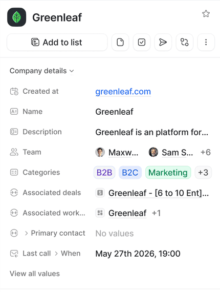
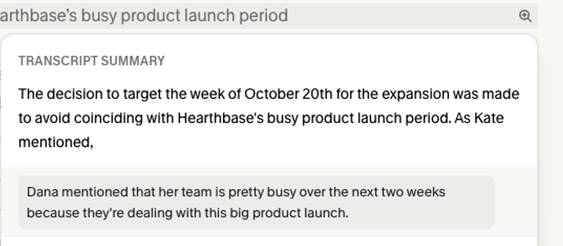
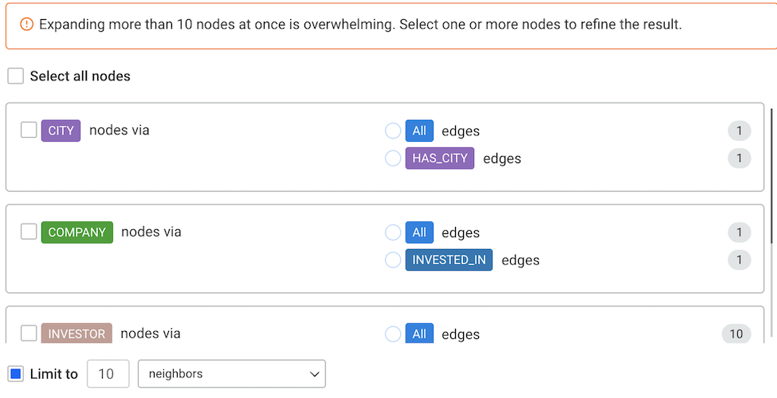
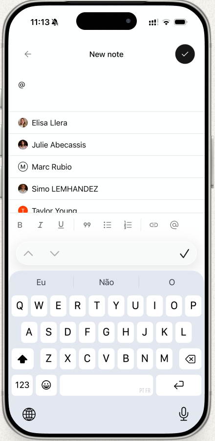

# Persnapse 프론트엔드·Graph Network Visual Design 상세 설계 v0.3

- 작성일: 2026-10-14 (Asia/Seoul)
- 보완일: 2026-10-17 (Asia/Seoul)
- 실행·계약: [구축 실행 설계](01-frontend-graph-execution-2026-10-15.md), [Graph 상태·조회 계약](04-frontend-graph-contracts-2026-10-15.md).
- 연결 문서: [전체 작업 설계](02-frontend-graph-work-design-2026-10-14.md)
- 시각 자료·반복 검토: [Visual Reference Atlas·벤치마킹 설계](05-frontend-graph-reference-benchmark-2026-10-14.md) — 전체 이미지 15개·crop 16개, V0–V7 비교 계획.
- 상태: **2026-10-17 사용자 피드백에 따라 레퍼런스 부분 재현 중심으로 Visual 재설계.** [최신 구현·비교 기록](../../operations/frontend-graph-runs/2026-10-17-visual-redesign.md). 실제 적용 수치는 24장을 우선한다. VD02/03 전체 흐름·사용자 채택·실데이터 검증은 남아 있다.
- 목적: Persnapse의 사람·만남·기억·행동을 정확하게 읽고 탐색할 수 있도록 화면 구조, 시각 문법, 토큰, 컴포넌트, 상태 전환과 검증 기준을 구체화한다.

이 문서는 두 번째 브리프의 디자인 방향을 실제 제품에 맞게 전개한 설계안이다. 5.5장에서 고정 원칙·기본 구현값·조정 재량을 구분한다. 수치는 우선 적용할 기준이며 승인된 브랜드 가이드나 검증 완료된 화면을 뜻하지 않는다. 도메인 의미·ID 연결·근거 보존·선택과 탐색 중심 분리는 유지할 원칙이다. 23장의 핵심 3화면을 실제 구현·검토한 뒤 Persnapse 자체 기준으로 채택한다.

## 1. 적용 범위와 읽는 순서

전체 구조·데이터·개발 단계는 연결된 전체 작업 설계를 따른다. 이 문서는 그 문서의 4·6·7·8·9·11장을 시각 설계 관점에서 상세화한다. 서로 충돌하면 모호하게 혼합하지 않고 제품 결정을 기록한다.

| 구분                     | 이번 문서의 역할                                                                              |
| ------------------------ | --------------------------------------------------------------------------------------------- |
| 브리프에서 유지하는 방향 | Calm Professional Context Workspace, light-first, 검정·보라·흰색, 실제 기록 중심, 절제된 강조 |
| 이번에 구체화한 제안     | 영역 비례, 컴포넌트 치수, 노드·선·라벨 문법, 화면별 정보 순서, 반응형 전환, QA 판정           |
| 구현 전 확인할 사항      | 실제 CSS cascade·폰트 렌더링, Graph 읽기 계약, 브라우저 동작, 표시량·레이아웃 성능            |
| 후속 범위                | Shared Context 비교, 고급 Recall Path, Action Lens, 저장된 보기, Time Context, 고급 군집      |

읽는 순서: 실행 설계의 현재 W 작업 확인 → 제품 판단 2장 → 목표 화면 23장 → 해당 레퍼런스 3장 → 토큰·레이아웃 5~6장 → 해당 Graph/상세/입력 절 → 상태·모바일·검증. 매 작업마다 전체 문서를 다시 읽지 않고 관련 절과 참조 ID를 작업 카드에 연결한다.

현재 `AGENTS.md`의 검색·텍스트 기록 위치와 Graph 내 Recall 제안의 충돌은 전체 작업 설계 4.1장의 미결정 사항을 유지한다. 이 문서의 화면 제안이 해당 규칙의 변경이나 구현 시작을 자동 승인하지 않는다.

## 2. Persnapse에서 디자인이 해결할 문제

### 2.1 제품의 시각적 중심

Persnapse의 중심은 **사람에 연결된 기억을 회수하고, 관계의 이유를 확인하고, 다음 행동을 판단하는 것**이다. Graph는 이 세 작업을 연결하는 탐색 공간이다.

| 사용자 질문                  | 먼저 읽을 정보                  | 시각적 결과                                          |
| ---------------------------- | ------------------------------- | ---------------------------------------------------- |
| 이 사람이 누구였지?          | 이름, 소속·역할, 만남 맥락      | 인물 식별은 가장 강한 타이포, 식별 단서는 바로 아래  |
| 어디서 어떤 이야기를 했지?   | 만남·날짜·주제·실제 기록        | Graph에는 짧은 맥락, Inspector에는 읽을 수 있는 기억 |
| 왜 이 두 대상이 연결돼 있지? | 관계 종류, 방향, 근거           | 선 선택으로 관계 설명과 원문 접근                    |
| 다른 기억도 볼 수 있나?      | 확장 종류, 추가 범위, 이전 상태 | 명시적 확장·접기·복귀, 기존 위치 유지                |
| 지금 무엇을 하지?            | 저장된 약속, 기한, 제안 여부    | 사실과 제안을 구분한 행동 영역                       |

### 2.2 시선의 우선순위

기본 Graph에서는 현재 탐색 맥락 → 인물·맥락 노드 → 탐색 목록 → 보조 조작 순서다. 인물을 선택하면 선택 노드와 Inspector의 이름·연결 이유가 함께 읽힌다. Recall에서는 질문·관련 사람·일치 이유가 우선하고, 입력 검토에서는 원본·수정 필드·저장 상태가 우선한다.

브랜드 로고, KPI, 큰 아바타, 장식적 AI 표시가 이 순서를 앞서지 않는다. 페이지마다 중요 정보의 위치를 새로 학습하게 만들지 않는다.

### 2.3 같은 정보의 공통 표현

- 같은 인물 ID는 같은 이름·사진 또는 이니셜·식별 단서로 표시한다. 동명이인을 이름 문자열로 연결하지 않는다.
- 같은 기록은 Graph, Recall, Inspector에서 동일한 출처 종류·날짜 정밀도·원문 접근 상태를 가진다.
- 선택은 읽는 대상, 탐색 중심은 현재 부분 그래프의 기준, 키보드 포커스는 다음 조작 대상을 뜻한다. 세 상태를 같은 ring 하나로 처리하지 않는다.
- `사용자 확인`, `AI 제안`, `근거 없음`은 별개의 정보다. 사용자 확인이 외부 사실의 진실성을 보증하는 표현으로 보이지 않게 한다.
- 저장 전 추출값·초안은 검토 화면에 둔다. 확정 Graph의 사실 노드처럼 표현하지 않는다.

## 3. 레퍼런스 관찰과 적용 결정

### 3.1 확인 범위

2026-10-14에 아래 공식 페이지의 공개 문서 내용을 확인했다. 초기 상세화에서는 Linear 헤더 설계 이미지, Attio 레코드 상세 이미지, Granola 홈 화면 이미지를 메모리에서 관찰했다. 이후 사용자의 시각 자료 포함 요청에 따라 공식 페이지에 게재된 전체 이미지 15개·crop 16개를 설계 문서용으로 저장하고 직접 확인했다. 출처·crop 좌표·해시는 atlas와 manifest에 기록했다. 로그인된 제품 조작, 외부 제품의 모든 상태 전환, Ogma 데모 실행은 수행하지 않았다.

아래의 ‘적용’은 공식 자료로부터 도출한 **Persnapse 설계 판단**이다. 해당 제품과 같은 효과가 이미 검증되었다는 뜻은 아니다.

| 우선 자료                                                                                                                                                               | 확인한 내용                                                                                                  | Persnapse 적용                                                       | 제외·제한                                               |
| ----------------------------------------------------------------------------------------------------------------------------------------------------------------------- | ------------------------------------------------------------------------------------------------------------ | -------------------------------------------------------------------- | ------------------------------------------------------- |
| [Linear 2026 refresh](https://linear.app/now/behind-the-latest-design-refresh)                                                                                          | 위치·보기 헤더의 역할 분리, 보조 내비게이션의 낮은 시각 무게, 경계·아이콘의 정제. 공개 헤더 설계 이미지 관찰 | 공통 앱 헤더와 Graph toolbar 분리, 조용한 좌측 탐색, 반복되는 기준선 | dark 색상·전체 그리드의 복제, 별도 데스크톱 앱 탭       |
| [Attio record redesign](https://attio.com/changelog/2026/record-page-redesign)                                                                                          | 이름·핵심 행동의 근접 배치, 상세 속성·활동의 구분, 자동 활동의 기본 접힘. 공개 레코드 이미지 관찰            | Inspector 상단 identity, 기억·원문·행동 섹션, 중요 기록 우선         | 영업 파이프라인·deal·자동화 기능, 모든 속성의 상시 노출 |
| [Granola 101](https://docs.granola.ai/help-center/getting-started/granola-101), [AI-enhanced notes](https://docs.granola.ai/help-center/taking-notes/ai-enhanced-notes) | 기록 목록·Chat 접근, 노트와 전사 기반 정리. 공개 홈 이미지 관찰; AI 노트는 문서 설명 확인                    | 기록의 제목·참여자·날짜 위계, 짧은 답변에서 기록으로 이동하는 구조   | 달력 연동·팀 공유 기능, 녹색 브랜드·배경 장식           |
| [Raycast search](https://manual.raycast.com/search-bar)                                                                                                                 | 단일 검색 진입, 결과와 항목별 행동, 키보드 선택. 문서 설명 확인                                              | 전역 검색 진입, 사람·기록·명령 구분, 명시적 Recall 제출              | OS 전체 검색·학습 기반 순위 도입, 단축키의 무조건 복제  |
| [folk mobile profile](https://help.folk.app/en/articles/15179426-people-company-profiles-on-mobile)                                                                     | 단일 스크롤 프로필, 상세·노트·상호작용, 상단 빠른 행동. 문서 설명 확인                                       | 모바일 전체 상세의 한 방향 스크롤, 핵심 정보와 행동 근접             | 메시징·외부 데이터 연동, 실제 데이터가 없는 연락 버튼   |
| [Dex overview](https://getdex.com/product-overview/)                                                                                                                    | 사람의 기록·타임라인과 후속 행동. 공식 설명 확인                                                             | 저장된 약속과 실제 기억을 함께 읽는 순서                             | 신규 알림·연락 주기 자동화, 외부 import                 |
| [Bloom visual tour](https://neo4j.com/docs/bloom-user-guide/current/bloom-visual-tour/)                                                                                 | 검색·scene·Inspector·Graph 조작의 구성. 문서 설명 확인                                                       | 목적별 부분 그래프와 현재 선택 해석                                  | 전문 분석가 도구의 전체 메뉴·Neo4j 도입                 |
| [Linkurious expand](https://doc.linkurious.com/user-manual/latest/expand/), [pinning](https://doc.linkurious.com/user-manual/latest/pinning/)                           | 종류·개수 제한 확장, 위치 고정. 문서 설명 확인                                                               | 종류별 ‘관련 기록 펼치기’, 고정·복귀                                 | 전체 이웃 자동 노출, 더블클릭을 필수 확장 조작으로 사용 |
| [Ogma graph/table](https://doc.linkurious.com/ogma/latest/examples/graph-table.html)                                                                                    | Graph와 표 연동의 공개 예제 설명 확인                                                                        | 단일 선택 ID, 목록에서 Graph와 상세 접근                             | 데모 실행 검증 주장, SDK 교체                           |
| [Geist colors](https://vercel.com/geist/colors), [typography](https://vercel.com/geist/typography), [command menu](https://vercel.com/geist/command-menu)               | 의미별 색 계층·타이포·명령 UI의 공개 문서 확인                                                               | 공통 상태 토큰, 재사용 컴포넌트, 키보드 힌트                         | Geist 폰트·컴포넌트 의존성의 자동 추가                  |

### 3.2 보조 레퍼런스의 역할

TheBrain·Kumu·Obsidian·Connected Papers는 중심 탐색·부분 그래프·연결 의미의 보조 자료, Capacities·Heptabase는 객체와 기록 읽기의 보조 자료다. Cambridge Design Kit·G6·Cytoscape·yFiles는 표현 대안 비교 자료다. Clay는 브리프가 지정한 과거 개인 관계 제품 사례로 취급한다.

Mobbin·Refero·SaaSFrame은 추가 상태별 화면을 찾는 후보이며 이번 상세화에서 접속·관찰하지 않았다. 보조 자료의 전체 링크는 원본 브리프 19장을 유지한다. 현재 작업을 위해 모든 자료를 열거나 모든 패턴을 섞는 것을 요구하지 않는다.

### 3.3 이후 관찰 기록

구현 작업마다 `자료 URL → 실제 확인 상태 → 해결할 UX 문제 → 채택 패턴 → 제외 요소 → 적용 위치 → 검증 결과`를 기록한다. 공개 이미지 관찰과 로그인 제품 조작을 구분한다. 현재 존재하지 않는 스크린샷 경로나 적용 파일을 완료 상태로 채우지 않는다.

### 3.4 핵심 비교 crop과 전체 자료

아래는 문서에서 바로 볼 대표 crop이다. 해당 이미지 전체·추가 crop·출처·자료의 한계·Persnapse 적용 판단은 [Reference Atlas 2장](05-frontend-graph-reference-benchmark-2026-10-14.md)에 있다. `전체`는 공식 게재 이미지 전체이며 전체 앱 창을 뜻하지 않는다.

| B03 인물 상세의 참고: identity·속성                                                                            | B05 관계·Recall의 참고: 근거 읽기                                                                                           |
| -------------------------------------------------------------------------------------------------------------- | --------------------------------------------------------------------------------------------------------------------------- |
|  |  |

출처: [Attio record redesign](https://attio.com/changelog/2026/record-page-redesign), [Granola AI-enhanced notes](https://docs.granola.ai/help-center/taking-notes/ai-enhanced-notes). 회사 레코드의 정보 구조를 사람 Inspector에 응용하고, 근거 UI는 실제 제공된 evidence로 연결한다.

| B11 Graph의 참고: 선택적 확장                                                                                                     | B14 모바일의 참고: 키보드가 열린 입력                                                                               |
| --------------------------------------------------------------------------------------------------------------------------------- | ------------------------------------------------------------------------------------------------------------------- |
|  |  |

출처: [Linkurious expand](https://doc.linkurious.com/user-manual/latest/expand/), [folk mobile profile](https://help.folk.app/en/articles/15179426-people-company-profiles-on-mobile). 전문 분석가 도구 전체를 복제하지 않고 종류·범위 제어를 가져오며, 모바일은 실제 키보드·IME·오류 상태를 검증한다.

자료를 제품 runtime asset으로 사용하지 않는다. 현재 구축물의 before/after 이미지와 대비 검토는 구현 단계에서 실제 같은 상태를 재현해 생성한다. 레퍼런스 crop만으로 제품 UI나 상태 전환 검증이 완료되었다고 판단하지 않는다.

## 4. 현재 스타일에서 출발할 지점

2026-10-14 파일 확인 기준:

| 실제 파일                                    | 확인 사실                                                 | 설계 대응                                                     |
| -------------------------------------------- | --------------------------------------------------------- | ------------------------------------------------------------- |
| `src/app/page.tsx`                           | workspace → integration → experience CSS 순서로 import    | 뒤에 새 override를 추가하는 대신 공통 의미 토큰과 책임 정리   |
| `src/app/globals.css`                        | 전역 녹색 토큰·배경 gradient·폰트 선언                    | 통합 workspace 밖 스타일 영향 확인, Graph의 흰색 작업 면 확보 |
| `src/features/workspace/workspace.css`       | 보라색 `#7541D6`, 여러 폰트 fallback·기본 컴포넌트        | 기존 selector·컴포넌트와 호환하는 토큰 매핑                   |
| `src/features/workspace/integration.css`     | 같은 workspace 변수 재정의, 어시스턴트·입력 관련 스타일   | 동일 상태·컴포넌트의 중복 정의 정리                           |
| `src/features/workspace/experience.css`      | `#7040CA`, `#262332`, `#625E70`, `#F7F7FA` 등 경험 레이어 | 현재 보라색·중립색을 상세 설계의 출발점으로 사용              |
| `src/features/workspace/ui/ContactGraph.jsx` | `lucide-react` 사용                                       | 기존 아이콘 세트 유지                                         |

CSS 선언 확인은 실제 computed style·폰트 로딩 확인과 다르다. 이번에는 앱을 실행하지 않았으므로 실제 화면의 유효 스타일은 구현 전 inventory에서 확인한다. Pretendard·Inter 이름이 fallback에 있다는 이유만으로 해당 폰트가 로딩된다고 가정하지 않는다.

## 5. 디자인 토큰 상세안

### 5.1 색상과 사용 규칙

새 브랜드 팔레트를 만들기보다 현재 경험 레이어를 중심으로 역할을 통합한다. 아래 명칭은 설계상 의미 이름이다. 구현 시 현재 CSS 변수와 대응시키고 도메인 상태에 쓰는 기존 색 의미를 보존한다.

| 의미 토큰                 | 초기값                | 사용                                   |
| ------------------------- | --------------------- | -------------------------------------- |
| `bg-app`                  | `#F7F7FA`             | 좌측 탐색·앱 바탕                      |
| `bg-canvas` / `bg-panel`  | `#FFFFFF`             | Graph·Inspector·읽기 면                |
| `bg-hover`                | `#F4F2F8`             | 행·보조 버튼 hover                     |
| `bg-selected`             | `#F0EAFB`             | 선택된 행·약한 선택 면                 |
| `ink-strong`              | `#262332`             | 이름·제목·핵심 판단                    |
| `ink-default`             | `#34343B`             | 본문·근거·필드                         |
| `ink-muted`               | `#625E70`             | 날짜·출처·보조 설명                    |
| `border-subtle`           | `#E5E3EB`             | 장식적 섹션·패널 구분                  |
| `border-control`          | `#858091`             | 조작 경계를 알아야 하는 입력·노드 경계 |
| `brand-primary`           | `#7040CA`             | 주 행동·선택·키보드 포커스             |
| `brand-hover`             | `#5B2EAF`             | 주 행동 hover·pressed 후보             |
| `graph-edge`              | `#71717A`             | 의미 있는 기본 관계                    |
| `status-success` / `soft` | `#176B45` / `#E3F3E8` | 저장 완료·완료된 행동                  |
| `status-review` / `soft`  | `#936214` / `#FFF0CC` | 검토 필요·불확실 저장·제안             |
| `status-danger` / `soft`  | `#B3263A` / `#FFF0F0` | 실패·유효성 오류                       |

보라색은 선택과 행동의 의미를 가진다. 인물의 직업·회사·노드 연결 수에 임의의 보라색 등급을 붙이지 않는다. 한 작업 영역의 primary action은 하나를 우선한다. modal 안에서 저장이 primary이면 뒤의 전역 추가는 사용할 수 없는 배경 상태가 된다.

`border-subtle`은 장식 경계다. 필수 입력·선택·관계 구분의 유일한 신호로 사용하지 않는다. 같은 의미 토큰은 DOM과 Graph에서 동일하게 해석하며 alpha를 추가하면 실제 합성색 대비를 다시 계산한다.

### 5.2 초기 팔레트 대비 계산

2026-10-14 sRGB 상대 휘도 공식으로 다음 **색상 쌍만 계산**했다. 표시 숫자는 소수 둘째 자리로 요약한 값이다. 전체 UI 접근성 통과나 실제 렌더링 검증을 뜻하지 않는다.

| 전경 / 배경           | 계산 대비 |
| --------------------- | --------- |
| `#262332` / white     | 15.34:1   |
| `#34343B` / white     | 12.35:1   |
| `#625E70` / white     | 6.26:1    |
| `#625E70` / `#F7F7FA` | 5.85:1    |
| `#7040CA` / white     | 6.41:1    |
| `#7040CA` / `#F0EAFB` | 5.46:1    |
| `#71717A` / white     | 4.83:1    |
| `#858091` / white     | 3.82:1    |
| `#858091` / `#F7F7FA` | 3.57:1    |

일반 크기 텍스트는 4.5:1 이상, 필요한 비텍스트 경계·그래픽은 3:1 이상을 검증 목표로 삼는다. 장식·비활성 등의 예외는 요소의 역할로 판단한다. [W3C 텍스트 대비 설명](https://www.w3.org/WAI/WCAG22/Understanding/contrast-minimum.html), [비텍스트 대비 설명](https://www.w3.org/WAI/WCAG22/Understanding/non-text-contrast.html).

### 5.3 타이포그래피

| 역할             | 크기 / 행간 | 굵기    | 적용                          |
| ---------------- | ----------- | ------- | ----------------------------- |
| 페이지 제목      | 22 / 30px   | 600     | 인맥·만남·업무 등 제목        |
| Inspector 인물명 | 22 / 30px   | 600     | 이름, 최대 2줄 이후 전체 상세 |
| 섹션 제목        | 16 / 24px   | 600     | 연결 이유·기억·다음 행동      |
| 목록 이름·버튼   | 14 / 20px   | 500~600 | 조작 가능한 핵심 정보         |
| 일반 본문        | 14 / 22px   | 400     | 기억 요약·설명                |
| 원문·긴 답변     | 15 / 25px   | 400     | 전사·메모·긴 기록             |
| 메타데이터       | 12 / 18px   | 400~500 | 날짜·출처 종류                |
| Graph 이름       | 13 / 18px   | 500     | 줌 1 기준 인명                |
| Graph 보조 라벨  | 12 / 16px   | 400     | 유형·날짜·소속                |
| 모바일 입력      | 16 / 24px   | 400     | 검색·편집 textarea/input      |

현재 시스템 폰트 계열을 우선 사용한다. 한글 자간은 기본값에서 시작하며 제목에도 큰 음수 자간을 일괄 적용하지 않는다. 긴 영문·이메일은 필요한 곳에서 줄바꿈하고, 날짜·집계값은 정렬에 유용한 경우 tabular numbers를 사용한다.

숫자는 초기 CSS px 기준이며 구현은 rem 대응을 포함한다. 사용자 글꼴 크기·200% 확대에서도 정보가 사라지지 않아야 한다. 중요 본문을 메타데이터 크기로 축소해 폭 문제를 해결하지 않는다.

### 5.4 공간·경계·아이콘·레이어

| 항목           | 초기 기준                                                          |
| -------------- | ------------------------------------------------------------------ |
| 간격           | 4·8·12·16·24·32px, 큰 섹션만 40·48px                               |
| 패널 안쪽      | desktop 20px, mobile 16px                                          |
| 섹션 사이      | 24px, 섹션 내 행 사이 8~12px                                       |
| radius         | 입력·버튼 8px, menu/dialog 10~12px, Graph 사람 원형                |
| 그림자         | 고정 패널 없음, 떠 있는 menu/dialog만 절제된 단일 shadow           |
| 아이콘         | lucide 16px inline, 18px 조작, 20px 주요 전환; 기본 stroke 1.75~2  |
| 기본 버튼      | desktop 높이 36px, 중요 입력·저장 40px, mobile 터치 영역 44px 이상 |
| keyboard focus | 2px 외곽선 + 2px offset, 선택 테두리 바깥에 별도 표시              |

레이어 순서는 Graph 선 → 노드 → 라벨 → 선택·포커스 표시 → 고정 toolbar·Inspector → popover → modal → toast다. CSS z-index 숫자는 구현에서 하나의 체계로 매핑한다. 여러 modal·우측 drawer를 쌓는 것을 해결책으로 삼지 않는다.

Dark는 신규 P0 필수가 아니다. 실제 제공 중인 테마가 있으면 접근을 보존하고 토큰별로 검증한다. 단순 색 반전으로 완료했다고 판단하지 않는다.

### 5.5 명세 강도와 Codex의 변경 재량

| 강도         | 항목                                                                                                                | 작업 규칙                                                                                      |
| ------------ | ------------------------------------------------------------------------------------------------------------------- | ---------------------------------------------------------------------------------------------- |
| 고정 원칙    | 원본 ID·근거·draft 보존, 선택/focus/keyboard 구분, 가짜 관계·성공 금지                                              | 시각 개선을 이유로 완화하지 않음. 변경 필요 시 제품·계약 결정으로 분리                         |
| 기본 구현값  | 5장의 색·type·spacing·button, 6장의 폭·전환점, 7~9장의 노드·라벨                                                    | 먼저 명시값을 적용하고 측정 후 조정. 매 값마다 사용자 확인을 요구하지 않음                     |
| 자율 조정    | 같은 spacing scale 내 간격, 줄바꿈, radius 8~~12px 내 역할 대응, panel 내 여백 16~~24px, 명시된 type 범위·모션 범위 | 가독성·대비·터치·정보 위계 통과를 전제로 before/after와 이유 기록. 공통 토큰에서 일관되게 적용 |
| 검토 후 조정 | 표의 panel 폭·breakpoint·Graph 표시량·줌 구간을 벗어나는 변경                                                       | VD 화면에서 실효 폭·라벨·200%·mobile 검증 후 기준표와 영향 화면을 함께 갱신                    |
| 제품 결정    | Graph 진입·검색 배치·후속 기능 범위·데이터 계약·브랜드/테마 교체                                                    | 실행 설계 D01–D04 및 별도 결정으로 관리. 임의 적용 금지                                        |

타이포를 작게 하거나 대비를 낮추어 공간 문제를 해결하지 않는다. 임의 새 색·페이지별 간격 체계를 늘리지 않는다. 현재 팔레트와 시스템 폰트를 기본값으로 사용하며 실제 computed style·로딩 결과가 다르면 W00 inventory에 기록한다.

## 6. 앱 셸과 영역 비례

### 6.1 기본 구성

```text
공통 헤더: Persnapse / 현재 위치                 전역 검색   + 기록 추가
────────────────────────────────────────────────────────────────────
좌측 탐색 240       중앙 작업 영역 가변             Inspector 360
기존 여섯 메뉴       현재 중심 / 보기 / 기간          이름·식별 단서
사람·맥락 목록       집중 Graph 또는 검색 결과        연결 이유
필터·표시 범위       확장·복귀·보기 맞춤              기억·원문·행동
```

기본안은 **하나의 240px 좌측 영역**이다. 상단에 기존 메뉴, 하단에 현재 화면의 탐색 목록을 둔다. 넓은 앱 sidebar와 넓은 Archive를 나란히 추가하지 않는다. 메뉴는 구획별 정돈된 행으로 표시하고 더 넓은 Graph가 필요할 때 전체 좌측 영역을 56px rail로 접는다.

### 6.2 검토용 치수

| 화면 폭     | 좌측              | Inspector                | Inspector가 열린 중앙 유효 폭 | 동작                       |
| ----------- | ----------------- | ------------------------ | ----------------------------- | -------------------------- |
| 1440px      | 240px             | 360px                    | 840px                         | 기본 비교 기준             |
| 1280px      | 224px             | 344px                    | 712px                         | 목록 텍스트·상세 위계 보존 |
| 1024px      | 접힌 rail 56px    | 320px                    | 648px                         | 목록은 필요 시 drawer      |
| 768px       | 상시 넓은 열 없음 | sheet 또는 단일 상세     | 한 작업 면                    | 목록·Graph 전환            |
| 390 / 360px | 메뉴 drawer       | bottom sheet / 전체 상세 | 한 작업 면                    | 아래 17장의 모바일 흐름    |

1200px 이상은 세 영역, 960~1199px는 접힌 좌측과 상세, 960px 미만은 단일 작업 면을 초기 전환 기준으로 삼는다. 이 breakpoint는 브리프의 대략적 범위를 실제 유효 폭으로 구체화한 제안이며 200% 확대·본문 길이에 따라 조정한다. 중앙 읽기·조작 폭이 부족하면 열을 접고 가로 스크롤을 만들지 않는다.

- 공통 헤더: desktop 56px, mobile 52~56px. 로고는 작은 wordmark로 시작하며 새 로고 제작은 포함하지 않는다.
- Graph toolbar: 48px, 넘치는 필터는 ‘필터’ popover로 모은다. 두세 줄 toolbar로 캔버스를 계속 줄이지 않는다.
- 전역 검색: desktop 최대 420px, mobile은 검색 호출 버튼에서 전체 검색 화면으로 전환한다.
- Inspector: 헤더는 남기고 본문을 한 번 스크롤한다. 여러 카드별 내부 스크롤을 만들지 않는다.
- 페이지 본문: Graph는 작업 영역을 활용하고, 목록·기록은 읽기 폭을 제한한다. 모든 화면을 큰 둥근 카드 하나 안에 강제로 넣지 않는다.

### 6.3 Inspector 열림과 카메라

선택 전에는 오른쪽 Inspector를 닫고 현재 범위와 시작 대상은 toolbar·좌측 목록에 제공한다. 선택하면 오른쪽 해석 패널이 열린다. 패널의 등장 때문에 Graph가 자동 fit·재배치되지 않는다.

설계 구현안: Graph의 논리 viewport와 camera transform을 유지하고 오른쪽 패널이 작업 면 일부를 덮도록 처리한다. 가려진 영역에는 Graph 포인터 조작을 전달하지 않는다. 선택 대상이 가려지거나 화면 밖이면 ‘선택 대상 보기’를 제공하고 사용자가 요청할 때만 카메라를 이동한다. 패널을 닫아도 자동 재중앙화하지 않는다.

이 방식과 실제 DOM 폭 변경 방식은 브라우저에서 비교하되, **선택에 따른 기존 노드의 화면 위치·확대 수준 보존**이 판단 기준이다. 선택 때 흔들리는 배치를 패널 애니메이션으로 숨기지 않는다.

W03 기본 구현은 overlay 방식으로 시작한다. 표의 중앙 ‘유효 폭’은 Inspector를 제외한 보이는 조작 영역이고 논리 Graph viewport 폭과 다르다. 선택만으로 viewBox·좌표 재계산·simulation 재시작을 하지 않는다. DOM 폭 변경안을 비교하려면 동일 노드의 화면 좌표 불변을 입증하고 방식 선택을 VD01 리뷰에 기록한다. 여러 방식을 동시에 유지하지 않는다.

## 7. Graph 노드의 시각 문법

### 7.1 타입별 기본 표현

초기 줌 1 기준이다. 크기는 시각적인 도형 크기이며 클릭 영역과 구분한다.

| 타입      | 기본 도형·크기                         | 라벨                              | ID·표현 제약                        |
| --------- | -------------------------------------- | --------------------------------- | ----------------------------------- |
| 사람      | 원형 40px, 이니셜 또는 실제 사진       | 아래 이름 13px, 필요 시 소속 12px | Person ID, 사람끼리 기본 크기 동일  |
| 만남      | 32×28px rounded rect, 대화 아이콘      | 만남 제목·날짜                    | Interaction ID, 행사와 다른 타입    |
| 행사      | 40×32px rounded rect, 행사 아이콘      | 행사명, 필요한 시점               | Event ID, 이름만으로 만남 병합 금지 |
| 회사      | 32×32px rounded square, 건물 아이콘    | 회사명                            | Organization ID·소속 시점 계약 필요 |
| 주제      | 높이 28px, 폭 48~120px의 짧은 text tag | 주제명                            | Topic ID, 관심·참석을 혼동하지 않음 |
| 집계 그룹 | 간결한 묶음 도형 + 정확한 개수         | ‘관련 만남 12’ 등                 | 엔터티가 아닌 표시 그룹, 후속 범위  |

약속은 P0 기본 Graph에 별도 노드로 늘리지 않고 Inspector·업무에서 읽는다. Action Lens 도입 때만 보기 목적과 범례를 갖춘 표현을 추가한다.

사진·회사 로고는 실제 저장된 데이터가 있을 때만 사용한다. 사진이 없으면 중립색 이니셜이다. 한국어 이름은 첫 한두 글자, 영문은 최대 두 이니셜을 후보로 검토한다. 이니셜은 식별 보조이며 고유성을 주장하지 않는다. 동명이인은 소속·만남 날짜로 구분하고 최종 선택은 ID로 처리한다.

### 7.2 상태 표현의 조합

| 상태            | 표시                                            | 변화시키지 않는 것            |
| --------------- | ----------------------------------------------- | ----------------------------- |
| 기본            | 흰색/중립 면, 식별 가능한 경계, 이름            | 중요도에 따른 자동 크기       |
| hover           | 약한 면 변화, 작은 정보 tooltip                 | 현재 선택·카메라·Inspector    |
| selected        | 보라색 2.5px outline, 약한 선택 면, 이름 우선   | 좌표·확대·부분 그래프 중심    |
| 탐색 중심       | `탐색 중심` 텍스트 marker와 toolbar의 동일 이름 | 선택 상태와의 동일시          |
| keyboard focus  | 선택 ring 바깥 2px offset outline               | 자동 선택·자동 중심 이동      |
| pinned          | 작은 pin 표시, 메뉴의 ‘위치 고정 해제’          | 관계 강도·확인 상태           |
| 검색 결과       | 일치 이유를 목록에 표시, Graph에는 결과 marker  | 검색 점수를 확률처럼 표시     |
| 새 기록 저장 후 | 관련 대상에 일시적인 `새 기록` 표시             | 전체 Graph 이동·계속되는 발광 |

selected+중심+pinned가 겹쳐도 이름과 실제 도형이 읽혀야 한다. 모든 상태를 큰 badge 세 개로 겹치지 않고 선택 경계·중심 문구·pin glyph로 분담한다.

## 8. 관계 선과 신뢰 표현

### 8.1 기록·공유·제안

| 의미                           | 선·색 초기안                               | Inspector 표현                           | 기본 노출                    |
| ------------------------------ | ------------------------------------------ | ---------------------------------------- | ---------------------------- |
| 저장 기록에서 확인 가능한 연결 | `graph-edge`, 1.5px solid                  | ‘만남 참석’, ‘당시 소속’, ‘소개 기록’ 등 | 실제 계약이 제공한 범위      |
| 파생 공유 맥락                 | `graph-edge`, 1.5px dash 6/4 + ‘공유 맥락’ | 양쪽 기록을 각각 제시                    | 직접 연결보다 맥락 경로 우선 |
| AI 추론·제안                   | `status-review`, dot 2/4 + ‘AI 제안’       | 제안 이유·검토 필요·사실과의 차이        | 기본 사실 보기에서 제외      |
| 현재 선택 관계                 | 해당 의미 스타일 유지 + 2.5px 강조         | 관계 라벨·근거 즉시 표시                 | 사용자 선택 시               |

색과 dash만으로 의미를 전달하지 않는다. 선택 패널·관계 목록·범례에 같은 용어를 표시한다. `사용자 확인`은 별도 확인 상태로 표시하고 solid만으로 진실 여부를 판단하게 만들지 않는다. [W3C 색 사용 기준](https://www.w3.org/WAI/WCAG22/Understanding/use-of-color.html).

### 8.2 도메인 의미를 보존하는 규칙

- 행사·주제가 같다는 이유로 두 사람 사이에 직접 친분 선을 생성하지 않는다. 기본은 `사람 → 만남/행사/주제 맥락 ← 사람`이다.
- 저장된 만남 참석 자체는 기록된 연결이다. 그 두 기록에서 도출한 ‘공유 맥락’ 설명은 파생 관계다. 맥락 노드의 모든 선을 무조건 점선으로 바꾸지 않는다.
- 소개 방향은 실제 `introduced_by` 역할과 상대 참석자 계약이 설명하는 범위에서만 표시한다. 일반 참석 관계에 화살표를 넣지 않는다.
- 특정 주제를 다룬 만남의 참석은 그 사람의 관심 표명이 아니다. 관심을 표시하려면 해당 기억·원문 근거를 제시한다.
- 여러 기록을 한 선으로 집계하면 같은 관계 의미와 현재 기간 범위에서 묶는다. 소개·참석·공유를 하나의 ‘관계 강함’ 선으로 합치지 않는다.
- 선 길이·각도·공간적 근접·굵기는 친밀도·확률·소개 가능성을 뜻하지 않는다. 선택에 의한 굵기 변화는 조작 상태다.
- `나`가 layout anchor로 필요해도 사실 관계를 만들어 연결하지 않는다. 관계가 없는 인물은 독립 노드·목록으로 접근한다.

### 8.3 선 읽기와 선택

기본 화면에서 모든 edge label을 상시 표시하지 않는다. 선택 관계·선택 인물의 관련 관계를 우선한다. 선 중앙의 짧은 의미 라벨은 흰색 읽기 면을 두어 다른 선에 겹치지 않게 한다. 직접 소개처럼 중요한 방향은 arrowhead와 설명 텍스트를 함께 제공한다.

보이는 선은 1.5~~2.5px이지만 초기 포인터 hit band는 desktop 12~~16px로 검토한다. 모바일은 조밀한 선을 직접 누르는 것보다 관계 목록을 기본 대체 경로로 제공한다. 겹친 hit band에서 임의의 첫 선을 열지 않고 선택 후보를 구분한다.

## 9. Graph 배치·라벨·정보 밀도

### 9.1 목적별 초기 표시

선택된 인물 또는 최근 실제 기록을 기준으로 작은 부분 그래프를 제시한다. ‘전체’는 저장 데이터를 모두 그리는 명령이 아니라 현재 한도와 생략 범위가 있는 개요 보기다.

1440px 기준 비교 출발점은 사람 12~~18개와 맥락 6~~10개, 선 약 45개 이내다. **승인된 표시 한도·성능 SLA가 아니다.** 한글 라벨 충돌·확장 가독성을 검증해 조정한다. 실제 선택 대상·검색 결과·설명에 필요한 근거가 한도보다 우선하며 과밀하면 목록과 ‘추가 보기’를 사용한다.

숫자는 Graph가 더 풍성해 보이도록 노드를 채우라는 뜻이 아니다. 기록이 한 명이면 한 명만 보여준다. 검색 결과 2명과 설명용 맥락 20개가 있을 때 결과와 맥락 개수를 분리한다.

### 9.2 안정성·배치 기준

- 인물 중심은 시각적으로 읽기 쉬운 위치에 놓고 관련 만남·행사·주제를 주변에 둔다. 고정된 별 모양으로 가짜 구조를 만들지 않는다.
- 새 노드는 연결된 맥락 근처의 빈 공간에 추가한다. 기존 노드는 유지하고 필요 시 제한된 충돌 해소만 수행한다.
- label bounding box를 충돌·배치 판단에 포함한다. 도형끼리 겹치지 않는다는 이유로 라벨 중첩을 허용하지 않는다.
- 초기 collision 여유는 도형 외곽 12~20px에서 검토한다. 선 길이는 라벨을 읽는 데 필요한 공간으로 정하고 관계 강도로 해석하지 않는다.
- drag 후 위치는 해당 탐색 세션에 유지한다. drag가 영속 사용자 선호나 DB 좌표 저장을 자동으로 뜻하지 않는다. 명시적인 pin을 별도로 제공한다.
- 선택·근거 로드·주기적 snapshot 갱신에 전체 simulation을 재시작하지 않는다. 안정화 후 계산을 멈춘다.
- 초기 배치가 끝나기 전 여러 번 fit하지 않는다. 첫 배치 이후 fit은 사용자가 요청하는 조작이다.

### 9.3 라벨 우선순위·축약

선택/키보드 포커스 → 탐색 중심 → 검색 결과 → 그 설명에 필요한 맥락 → 나머지 순서로 가림을 해소한다. 우선순위가 낮은 라벨을 숨길 수 있지만 목록·상세 접근을 유지한다.

이름은 최대 2줄·폭 120px를 초기안으로 삼는다. 회사·행사 라벨은 140px 범위에서 비교한다. 이름이 긴 경우 도형을 키우거나 폰트를 계속 줄이지 않는다. 축약한 전체 값은 키보드·터치로도 열 수 있어야 한다.

### 9.4 Semantic Zoom

| 초기 줌 구간 | 정보량                                             |
| ------------ | -------------------------------------------------- |
| 0.75 미만    | 선택·중심·검색 결과 이름 유지, 다른 보조 라벨 생략 |
| 0.75~1.35    | 기본 인명·맥락 제목, 선택한 대상의 식별 단서       |
| 1.35 초과    | 필요한 소속·날짜·선택 관계 의미 추가               |

줌은 정보를 더 읽는 수단이며 새로운 사실·노드를 자동 생성하는 수단이 아니다. 라벨은 읽을 수 있는 화면 크기를 유지하며 ‘모든 이름을 5px로 남기기’를 피한다. 노드가 작아지는 구간은 대체 목록과 접근 가능한 hit target을 함께 검증한다.

## 10. Graph 조작의 상세 시각 피드백

| 조작               | 화면 변화                                         | 보존 상태                      |
| ------------------ | ------------------------------------------------- | ------------------------------ |
| 인물·맥락 클릭     | selected ring, 해당 Inspector, 관련 선 강조       | focus·좌표·카메라·질문         |
| 선 클릭            | 관계 label, 양 끝 대상, 근거 Inspector            | 다른 탐색 상태                 |
| 빈 캔버스 클릭     | selection만 해제, Inspector 닫힘                  | 중심·필터·이력·query           |
| ‘이 사람 중심으로’ | 이력 저장 후 focus marker 변경, 필요한 slice 갱신 | 돌아갈 이전 상태               |
| ‘관련 기록 펼치기’ | 종류별 menu, 새 노드만 추가, 범위 안내            | 기존 좌표·선택·카메라          |
| ‘추가 항목 보기’   | 같은 종류 다음 묶음, 표시 개수 갱신               | 서버가 제공한 순서·한도        |
| ‘이 확장 접기’     | 해당 확장의 독점 노드만 제거                      | 다른 확장·선택에서 쓰는 대상   |
| 탐색 ‘이전으로’    | focus·필터·확장·선택·좌표·카메라 복원             | 작성 초안·저장 사실            |
| ‘현재 보기 맞춤’   | 표시 중인 노드만 fit                              | 표시 데이터·검색 조건          |
| ‘배치 다시 정리’   | pin 보존 범위 안내 후 재배치                      | 기존 고정 위치, 명시적 해제 전 |

확장 menu는 ‘만남’, ‘행사’, ‘주제’, ‘소속’ 중 실제 계약이 제공하는 것만 표시한다. 초기는 종류별 최대 10개 추가를 비교 기준으로 두고 `hasMore`·정확한 count가 없으면 전체 개수를 추측하지 않는다. 확장 오류는 해당 anchor 주변 상태와 재시도에서 복구한다.

더블클릭·우클릭은 보조 조작일 수 있지만 필수 경로로 삼지 않는다. 이름이 불분명한 ‘Analyze’, ‘AI’, ‘Sync’ 대신 결과를 설명하는 행동명을 사용한다. 탐색 복귀와 데이터 수정 Undo는 다른 버튼·문구다.

## 11. Inspector·원문·전체 상세

### 11.1 인물 Inspector

360px 패널에서 안쪽 20px, 콘텐츠 폭 약 320px로 비교한다. 첫 약 320px 높이 안에서 **이름·식별 단서·연결 이유·최소 하나의 실제 기록 접근**이 보이도록 구성한다. 데이터·사용자 확대 때문에 넘치는 경우 줄바꿈과 스크롤을 우선한다.

```text
김민수                                      …   닫기
ABC Ventures · Partner
최근 기록된 만남 2026-09-08
전체 상세                                   중심으로 보기
───────────────────────────────────────────────────
연결 이유
Startup Demo Day에서 만남              기록 보기
AI Agent 관련 대화                     원문 보기
───────────────────────────────────────────────────
기억
실제 저장된 짧은 기억 요약
날짜·출처 유형                         전체 기록
───────────────────────────────────────────────────
다음 행동
저장된 약속                  기한·완료·완료 취소
AI 제안이 있으면 별도 표시                    검토
```

위 이름·날짜·소속·기억은 **가상 예시**다. 실제 화면에서는 저장값만 사용하며 관심·약속을 채워 넣지 않는다.

| 섹션           | 구성·기본량                                  | 빈 정보                                             |
| -------------- | -------------------------------------------- | --------------------------------------------------- |
| identity       | 32px 보조 아바타, 이름, 회사·역할, 최근 만남 | 사진 없음은 이니셜, 소속 없음은 생략 또는 편집 경로 |
| 연결 이유      | 현재 탐색·질문과 관련된 실제 이유 1~3개 우선 | ‘연결 이유를 확인할 기록이 없습니다’                |
| 기억           | 관련 기억 1~3개, 날짜·출처, 더 보기          | ‘저장된 기억이 없습니다’                            |
| 다음 행동      | 저장 약속과 제안 분리, 기존 완료 동작        | AI 행동 제안을 임의 생성하지 않음                   |
| 연락·추가 속성 | 존재하는 연락처·중요도·상태, 필요 시 접기    | 가짜 값·가짜 연락 버튼 없음                         |

현재 데이터가 ‘최근 만남’을 정확하게 계산할 수 없으면 ‘최근 기록’ 등 사실에 맞는 문구를 쓴다. 추가 섹션을 하나하나 카드로 감싸지 않고 제목·여백·얇은 구분선으로 구성한다.

### 11.2 관계 Inspector

상단 제목은 `만남 참석`, `소개 기록`, `공유 행사 맥락`처럼 실제 의미다. 그 아래 양 끝 대상 → 방향이 있으면 소개 방향 → 발생 시점 → 해당 기록 → 원문 순서다.

공유 맥락이면 두 사람 각각의 원본 연결을 보여준다. ‘두 사람은 친한 관계’ 같은 문장을 생성하지 않는다. 근거가 없는 상태와 읽을 수 없는 상태는 16장의 상태 계약을 따른다.

### 11.3 행사·주제·회사 Inspector

- 행사: 행사명·시점·확인된 관련 만남 → 참석 인물 → 각 기록. 행사와 개별 만남을 하나의 타임라인 항목으로 섞지 않는다.
- 주제: 주제명 → 해당 주제가 기록된 만남 → 관련 인물 → 발언·기억 근거. 참석자 전체를 ‘관심 있는 사람’으로 표시하지 않는다.
- 회사: 회사명 → 실제 소속 인물 → 현재/당시 소속 시점 → 해당 근거. 현재 회사로 과거 소속을 덮어쓰지 않는다.

이 화면은 해당 ID·관계·시점이 조회 계약에 제공될 때 구현한다. 문자열을 프론트에서 묶은 가짜 엔터티로 완료 처리하지 않는다.

### 11.4 근거 행과 원문 보기

근거 행은 `출처 종류·발생일 → 실제 발췌 2~3줄 → 원문 보기` 순서다. 서버가 준 발췌가 없으면 AI 요약을 따옴표로 꾸며 원문처럼 표시하지 않는다. 검색 일치 구절은 약한 강조 면과 텍스트 문맥을 유지하며 관계 증명을 뜻하는 표시와 구분한다.

360px Inspector는 빠른 읽기용이다. 긴 원문은 동일 상세 영역의 읽기 모드 또는 전체 상세로 확장하고, 이전 선택·스크롤로 돌아갈 수 있게 한다. desktop 전체 상세는 최대 1040px, 본문 읽기 폭 640~720px를 초기안으로 비교한다. 원문·전사 텍스트에 줄 번호나 시간 위치가 실제 제공될 때만 해당 위치로 이동한다.

### 11.5 편집 중 선택 변경

읽기 패널의 선택 변경과 편집 draft를 분리한다. 다른 인물을 선택해도 작성값이 사라지지 않는다. 대상별 편집 모드에서는 대상 이름을 고정 표시하고 ‘편집으로 돌아가기’를 제공한다. 저장 대상은 처음 연 ID로 유지하며 새 selection으로 자동 바꾸지 않는다. 초안을 버리는 행동에만 명시적인 안내를 둔다.

## 12. 전역 검색·Recall·AI 결과

### 12.1 검색 진입과 결과 행

전역 검색은 헤더의 단일 호출부다. desktop 검색 layer는 최대 640px 폭, 화면 상단에서 80~120px 아래를 초기안으로 비교한다. mobile은 전체 검색 화면으로 전환한다. 초기 placeholder는 `사람·회사·기억 찾기`다.

| 입력 상태        | 화면                                                             |
| ---------------- | ---------------------------------------------------------------- |
| 빈 입력          | 실제 최근 접근 항목이 있으면 표시, 없으면 가능한 검색 예시       |
| 이름·회사·연락처 | 결정적 검색 결과, 사람·관련 기록·명령의 종류 구분                |
| 자연어 질문      | 입력을 유지하고 `기억에서 찾기` 제출 행동 표시                   |
| 필터 밖 결과     | 결과 유지 + `현재 지도 범위 밖` 안내, 대상 열기와 지도 보기 구분 |

결과 행은 초기 56px, 이름 14px, 식별 단서 12~13px, 필요 시 1줄 일치 이유다. 행마다 점수·상태 badge·여러 CTA를 붙이지 않는다. 결과가 0이면 현재 조건을 설명하고 범위 해제나 새 기록 추가 중 적합한 다음 행동을 제공한다.

`Ctrl/Cmd+K`는 Persnapse 전역 검색 호출 제안이다. Raycast의 모든 shortcut을 복제하지 않는다. IME 조합 중 Enter는 제출하지 않으며 ↑/↓ 결과 탐색, Enter 선택/명시 제출, Esc layer 닫기와 호출부 포커스 복귀를 제공한다.

검색 모드는 추측으로 전환하지 않는다. 기본 입력은 지원되는 이름·회사·연락처의 결정적 검색이며 `기억에서 찾기`는 명시적 별도 제출 행동이다. 질문처럼 보인다는 이유만으로 Recall을 호출하지 않는다. 방향키로 선택한 결과가 있으면 Enter는 해당 결과 열기이고, Recall 제출 버튼/명령을 선택한 경우만 질의를 제출한다. 관련 기록·명령 그룹은 현재 계약으로 실제 검색·실행 가능한 항목만 노출한다.

### 12.2 Recall 작업 상태

키 입력마다 LLM을 부르지 않는다. 명시 제출 뒤 현재 시스템이 알려주는 범위에서 준비·검색·답변 상태를 표시한다. 실제 단계 정보가 없으면 ‘기록을 찾는 중’처럼 정직한 하나의 상태를 쓰고 가짜 퍼센트·가짜 단계 진행을 만들지 않는다.

기존 검색 준비가 완료되지 않은 상태는 회복 방법과 함께 표시한다. 준비 일부 실패를 결과 없음으로 바꾸지 않는다. 새 질의가 시작되면 이전 답변은 ‘이전 검색 결과’로 구분하거나 접어 최신 상태와 혼동하지 않게 한다.

### 12.3 Recall 결과 배치

제출 후 좌측에는 질문·검색 범위·일치 인물 목록, 중앙에는 짧은 답변·결과 이유를 읽는 결과 면, 우측에는 선택 인물·근거를 표시하는 것을 기본으로 한다. 중앙의 명시적 `결과 / 지도` 전환으로 확인 가능한 Graph를 본다. 전환은 query·selection·filter·camera를 보존한다. 별도의 Chat drawer와 Person drawer를 동시에 열지 않는다. 이 기본 배치는 VD02 시안에서 검토하며 D02 승인 전 구현하지 않는다.

질문은 초기에 2줄로 표시하고 전체 질문을 펼칠 수 있게 한다. 사람을 선택하면 결과 행·노드·Inspector는 같은 ID로 연결한다. 답변 문장 안의 인물 링크도 실제 person ID로 처리한다.

Recall의 결과 ID와 확인 가능한 원본 관계만 Graph에 강조한다. ID가 부족하면 결과 인물만 선택하고 ‘지도 경로를 확인할 정보가 없습니다’와 제공된 근거를 보여준다. 텍스트의 회사·행사 이름을 파싱해 근거 경로를 만들어내지 않는다.

### 12.4 AI 답변 정보 순서

짧은 답 → 관련 사람 → 일치 이유 → 실제 근거 → 저장된 약속 → 별도 AI 제안 순서다. 답변은 본문 읽기 형식으로 구성하고 문장마다 카드·보라색 badge를 추가하지 않는다.

긴 답변의 축약은 실제 출력 내용을 접는 방식이다. 없는 요약을 UI에서 사실처럼 만들지 않는다. 근거가 부족하거나 답변이 중단되면 해당 상태를 본문 가까이에 표시한다. 피드백은 기존 저장 계약이 있을 때 연결하고, 저장되지 않는 피드백을 전송 완료로 표시하지 않는다.

## 13. 명함·텍스트·음성 입력 검토

### 13.1 공통 흐름과 시각적 중심

`입력 선택 → 처리 → 원본/추출 검토 → 인물 확인 → 맥락 검토 → 저장 → 저장된 대상 열기`

공통 헤더의 `+ 기록 추가`에서 현재 지원 중인 입력 방법을 제시한다. 인물 상세에서 시작한 입력은 해당 인물 맥락을 상단에 표시하되 원본 인물 판정을 무조건 덮어쓰지 않는다.

검토 모드에서는 Graph를 배경으로 읽으려 하지 않고 원본과 수정값에 집중한다. 기존 화면·dialog를 재구성하며 새 독립 라우트는 만들지 않는다.

### 13.2 Desktop 검토 배치

검토 dialog는 최대 1040px, 높이는 viewport에서 위아래 24px 여유를 초기안으로 둔다. 960px 이상에서 원본 40% / 필드 60%를 비교하고, 좁은 화면에서는 원본→필드 순서로 한 열로 전환한다. footer의 저장·취소·저장 상태는 콘텐츠를 가리지 않게 공간을 확보한다.

| 영역      | 내용                                                           |
| --------- | -------------------------------------------------------------- |
| 원본      | 명함 이미지·텍스트·전사, 확대·회전·원본 보기 중 실제 지원 조작 |
| 인물      | 이름·소속·연락처, 새 인물/기존 후보, 구분 단서                 |
| 맥락      | 날짜·장소·행사·주제·기억·약속 중 실제 추출·계약 제공 항목      |
| 검토 상태 | 추출값·사용자 수정·확인 필요를 텍스트와 아이콘으로 구분        |
| footer    | `저장`, 저장 중/실패/확인 필요, 입력 보존·재시도               |

처음부터 모든 고급 필드를 펼치지 않는다. 필수 정보와 확인이 필요한 항목을 우선한다. 미확인 값은 가짜 정확도 98%로 표시하지 않는다. 이름만으로 기존 인물에 자동 병합하지 않는다.

### 13.3 명함의 구체적 요구

기존 감지 → 수동 모서리 보정 → warp 승인 → OCR → 추출 검토 순서를 보존한다. 원본·보정본을 구분하고 90도 회전·재시도·수동 입력의 접근을 유지한다. 보정 UI에서 화면 장식보다 이미지와 조작점이 우선이다.

긴 회사명·OCR 누락·같은 이름의 후보를 테스트한다. 디지털 명함 재현은 별도 기존 방향 문서의 후속 작업이며 이번 시각 설계가 구현 완료를 뜻하지 않는다.

### 13.4 음성·텍스트의 구체적 요구

녹음 중은 시간·정지·취소 등 실제 상태, 전사 중은 처리 상태, 전사 완료는 수정 가능한 텍스트를 보여준다. 파형은 실제 신호를 나타낼 때만 사용한다. 사용자 입력·전사 결과를 잃지 않고 부분 실패를 구분한다.

녹음 보관의 실제 IndexedDB·서버 저장 차이는 사용자가 판단해야 하는 보관 상태에 맞는 문구로 표현한다. ‘서버에 안전하게 저장됨’을 실제 계약 없이 표시하지 않는다. 파일 음성·실시간 STT·텍스트 입력을 같은 처리처럼 뭉개지 않는다.

### 13.5 저장 후 Graph 연결

저장 성공 확인 뒤 `인물 1명·만남 1개 저장`처럼 실제 결과를 표시하고 ‘저장한 기록 보기’를 제공한다. 자동으로 전체 Graph를 재배치하거나 새 인물을 중심으로 이동하지 않는다.

새 기억에 대한 국소 표시를 먼저 제공하고, 해당 부분 그래프에 대상이 없으면 사용자가 열 때 추가한다. 저장 미확인·version 충돌은 16장의 지속 상태를 유지한다. 이후 Memory Update 강화는 P1이며 P0에서도 기존 저장 성공·실패 표현은 완전해야 한다.

## 14. 인맥·만남·업무·녹음·설정의 일관성

| 화면      | 정보 위계와 밀도                                                                     | 보존 동작                                 |
| --------- | ------------------------------------------------------------------------------------ | ----------------------------------------- |
| 인맥      | 이름·소속 → 최근 맥락 → 필요한 상태·행동. Archive row 56px, 전체 표는 64~80px를 비교 | 검색·정렬·중요도·상태·편집·기존 연락처    |
| 만남      | 제목·발생일 → 참석자 → 기억·원문 → 약속                                              | 참석자 수정·기록·근거·날짜 미정           |
| 업무      | 오늘 필요한 저장 행동 → 예정/날짜 미정 → 완료. 숫자 요약은 실제 과업 진입일 때만     | 기한·캘린더·완료·완료 취소·어시스턴트     |
| 녹음      | 제목·기록 시점·보관 상태 → 재생/전사 → 관련 인물·기억                                | 기존 파일·실시간 입력·로컬 보관 경로      |
| 설정·보관 | 실제 설정 → 저장/백업/복원 상태 → 실패 복구                                          | 현재 제공되는 조작, 미구현 성공 버튼 금지 |

Timeline은 실제 발생일 기준을 우선하고 기록일은 별도 metadata다. 날짜가 연·월까지만 확인되면 그 정밀도를 표시한다. 날짜 미정은 별도 구획에 두고 가짜 일자를 넣지 않는다. 과거 회사·역할은 당시 값이라는 단서를 유지한다.

목록에서 읽을 수 있는 정보와 전체 상세에서 읽을 정보를 구분하되, 기존 기능·필드를 메뉴에서 사라지게 하지 않는다. 중요도는 기존 사용자 지정값으로 보존하고 자동 관계 점수처럼 바꾸지 않는다.

## 15. 공통 컴포넌트의 상태 계약

| 컴포넌트                | 기본                             | hover / 선택·포커스                                 | loading / 오류·비활성                           |
| ----------------------- | -------------------------------- | --------------------------------------------------- | ----------------------------------------------- |
| Primary button          | 보라색 면·흰 글자, 명확한 행동명 | 어두운 보라색, 외곽 focus                           | 중복 제출 차단+상태 문구, 비활성 이유 인접 표시 |
| Secondary / text action | 흰 면·필요 경계 또는 텍스트      | 중립 hover, 동일 focus 규칙                         | 단순 흐림만으로 이유 숨기지 않음                |
| Sidebar item            | 이름+단일 icon, 낮은 시각 무게   | active 약한 면+이름 강조, hover와 구별              | 접근 불가일 때 실제 이유                        |
| List/result row         | 이름·식별 단서, 행 전체 선택     | selected 약한 보라 면+marker, keyboard 별도 outline | 초기 4~6행 skeleton, 국소 재시도                |
| Panel header            | 제목·대상·닫기·필요 행동         | 고정 기준선, 내용 줄바꿈                            | 헤더 유지, 본문 오류 복구                       |
| Field                   | visible label·value·help         | border-control, focus outline                       | 오류 문구+icon, 입력값 유지                     |
| Evidence row            | 종류·시점·발췌·원문              | 전체 값·실제 출처 이동                              | 출처 없음/삭제/접근 불가/로드 실패 구분         |
| Status label            | 짧은 의미 문구+icon              | 필요 설명은 지속 접근                               | 성공·미확인·실패를 색 외에도 구분               |
| Popover / dialog        | 하나의 목적·이름·닫기            | 종류별 포커스 규칙은 15.1장                         | modal만 배경 차단, draft 폐기 별도 안내         |

badge는 상태·종류가 실제 판단에 필요한 경우에만 사용한다. tag는 주제·필터 같은 의미, card는 실제로 묶이는 정보 단위에만 사용한다. 일반 문단·속성 한 줄을 각각 card로 만들지 않는다.

P0는 단일 기본 밀도다. compact를 전역·각 패널에 중복 추가하지 않는다. 버튼 크기 차이는 의미·터치 환경으로 설명되고 페이지별 취향으로 바뀌지 않아야 한다.

### 15.1 Layer별 키보드·포커스 계약

| 종류                  | 포커스·키보드                                          | 배경·닫기·반환                                                                                                              |
| --------------------- | ------------------------------------------------------ | --------------------------------------------------------------------------------------------------------------------------- |
| 명령 menu             | 호출 후 첫/현재 menuitem, ↑/↓·Home/End, Enter 실행     | 일반 menu는 modal 아님. Esc·외부 클릭으로 닫기, Esc는 호출부 복귀. 포인터가 다른 조작을 누르면 그 대상 포커스를 빼앗지 않음 |
| 필터 popover          | label된 form control 순서로 이동, 일반 Tab 이동        | 비모달 기본, 전역 focus trap·배경 inert 금지. 명시 닫기/Esc는 호출부 반환                                                   |
| 전역 검색 layer       | 이름 있는 modal 검색 dialog, 입력→결과/행동, IME 보호  | 열려 있는 동안만 배경 inert·focus trap. Esc/닫기 후 호출부로 반환                                                           |
| 읽기 Inspector        | 문서의 일반 panel/region, 자동 focus trap 없음         | Graph·목록과 왕복 가능. 닫기는 선택 유지, 호출 대상/대체 toolbar로 반환                                                     |
| 편집·입력 dialog      | 이름 있는 modal, 첫 필수/오류 필드 등 의미 있는 진입점 | 배경 inert·focus trap. Esc/취소는 draft 상태 확인 후 처리, 저장 대상 ID 유지                                                |
| mobile compact sheet  | 비모달 상세 region을 기본으로 해 지도/목록 접근 유지   | backdrop으로 배경을 차단하지 않음. 펼침/닫기 버튼, 닫기는 선택 유지                                                         |
| mobile 전체 편집/상세 | 편집은 modal, 전체 읽기는 하나의 작업 면               | 읽기/작성 종료 후 이전 스크롤·선택 복원. 중첩 sheet를 만들지 않음                                                           |

한 화면에서 popup 위에 새 modal이 열리면 popup을 닫고 반환 대상을 보관한다. Esc는 가장 위의 닫을 수 있는 layer부터 한 단계씩 처리한다. 배경 차단 여부와 ARIA modal 의미를 일치시키고 실제 키보드 테스트로 확인한다.

## 16. 빈 상태·오류·저장·근거의 화면 계약

| 상태                  | 보여줄 내용                                    | 복구·다음 행동                               |
| --------------------- | ---------------------------------------------- | -------------------------------------------- |
| 데이터 0개            | ‘아직 저장된 인맥이 없습니다’ + 지원 입력 설명 | 첫 기록 추가                                 |
| 인물만 있고 관계 없음 | 인물 접근, 연결 기록 없음                      | 인물 상세·만남 기록 경로                     |
| 필터 결과 0개         | 현재 조건·기간을 명시, 실제 빈 Graph           | 조건 해제 또는 다른 범위                     |
| Graph 렌더링 실패     | Graph 영역 오류, 목록·Inspector 사용 가능      | Graph 재시도                                 |
| 초기 로딩             | 영역 구조 유지, 실제 데이터와 구분된 skeleton  | 완료·실패에 따른 전환                        |
| 갱신·확장 실패        | 기존 화면 유지, 실패 범위 표시                 | 해당 요청만 재시도                           |
| 원문 부재             | ‘원문이 연결되지 않은 기록입니다’              | 가능한 기록 상세·수정                        |
| 출처 삭제             | ‘연결된 원문이 삭제되었습니다’                 | 대체 기록이 실제 있으면 별도로 제시          |
| 접근 불가             | ‘이 원문을 열 수 없습니다’ 등 제공된 상태      | 가능한 접근 경로, 비공개 제목·내용 누출 금지 |
| 근거 로드 실패        | ‘원문을 불러오지 못했습니다’                   | 재시도, 근거 없음과 구분                     |
| AI 근거 부족          | 답변 한계·제공된 실제 근거                     | 질문 수정·기록 확인                          |
| 저장 중               | 대상·중복 제출 차단·입력 보존                  | 처리 상태                                    |
| 저장 실패             | 실패 대상·원인 범위, draft 유지                | 안전한 재시도·수정                           |
| 저장 미확인           | ‘저장 결과를 확인하고 있습니다’                | 기존 request ID 재사용·서버 확인             |
| version 충돌          | 충돌 안내·작성 내용 유지                       | 최신 내용 확인·재검토                        |
| 저장 완료             | 서버 확인 결과, 저장된 대상                    | 기록 열기                                    |

toast는 보조 알림이며 저장 실패·충돌·접근 불가의 유일한 설명이 아니다. 실패 상태는 문제가 있는 영역에 남는다. 알 수 없는 출처 상태를 ‘삭제’나 ‘권한 없음’으로 추정하지 않는다.

## 17. 모바일·태블릿 상세 동작

### 17.1 단일 작업 면

360~767px에서는 상단 현재 화면·검색·추가, 그 아래 `지도 / 목록` 전환을 제공한다. 기존 여섯 메뉴는 drawer에서 모두 접근한다. bottom navigation에 여섯 개의 작은 아이콘을 억지로 배치하지 않는다.

Graph와 목록은 selection·filter·focus를 공유한다. 보기 전환이 새로운 탐색 시작이나 query 초기화를 뜻하지 않는다. Graph가 손가락 조작에 과밀하면 목록을 우선 접근 경로로 안내한다.

### 17.2 상세 sheet·전체 상세

- 인물·관계 선택 후 sheet의 첫 높이는 약 42dvh에서 비교한다. 이름·식별 단서·연결 이유·기록 보기 우선이다.
- 전체 펼침은 약 90dvh 또는 전체 상세로 전환하고 한 방향으로 스크롤한다.
- sheet drag만으로 모든 조작을 요구하지 않고 ‘상세 펼치기’·‘닫기’ 버튼을 제공한다.
- 닫으면 Graph의 카메라·선택·질문·목록 위치를 복원한다. 상세를 닫는 것과 selection 해제는 별도다.
- 긴 원문은 전체 상세, 작성·검토는 전체 편집 화면을 우선한다. 여러 sheet를 겹치지 않는다.
- 가상 키보드·safe area·주소창 높이 변화에 대응하고 footer가 입력·오류 문구를 가리지 않는다.

768~959px도 정보 폭이 부족하면 같은 단일 작업 면을 사용한다. 1024px에서는 접힌 메뉴와 320px 상세를 먼저 비교하고 긴 본문은 전체 상세로 연다.

### 17.3 터치·읽기

주요 버튼·행·닫기는 44×44 CSS px 이상을 제품 목표로 둔다. 작은 Graph 대상은 최소 크기·간격·동등한 목록 조작을 함께 검증한다. WCAG의 24px 최소·예외와 제품의 44px 권장 목표를 혼동하지 않는다. [W3C target size 설명](https://www.w3.org/WAI/WCAG22/Understanding/target-size-minimum.html).

mobile 본문은 15~~16px, 날짜·종류는 12~~13px에서 비교한다. hover tooltip에만 이름·관계 의미·오류 설명을 두지 않는다. pinch·pan과 sheet 스크롤이 서로 조작을 빼앗지 않게 검증한다.

## 18. 키보드·모션·접근성

### 18.1 키보드 흐름

전역 헤더 → 메뉴/목록 → Graph 조작 → Inspector 순서로 접근한다. Graph는 roving focus 등 노드 수만큼 Tab을 강요하지 않는 방식을 검토한다. 방향키는 조작 대상 이동, Enter는 선택, 중심 이동은 명시 버튼으로 제공한다. 키보드 이동이 자동 focus 탐색 변경을 뜻하지 않는다.

Graph 내부 이동을 구현하더라도 동일 노드·관계의 목록 경로를 제공한다. 확대·축소·현재 보기 맞춤·선택 대상 보기·이전 탐색은 버튼으로도 접근 가능해야 한다. `+/-` 등 shortcut은 Graph가 조작 초점일 때만 사용하고 textarea·IME 입력을 가로채지 않는다.

Esc는 열린 popover/modal을 먼저 닫고 포커스를 복귀시킨다. 편집 초안이 있으면 무조건 폐기하지 않는다. Inspector 닫기는 호출 대상에 포커스를 돌려주고 focus/selection 의미를 유지한다. 선택 해제는 빈 영역 또는 명시 행동으로 구분한다.

Graph·결과 변경은 필요한 요약만 보조기기에 알린다. pan·simulation의 매 프레임을 live region으로 읽지 않는다. 색·사진·도형만으로 관계 의미를 설명하지 않고 accessible name·목록·Inspector를 함께 제공한다.

### 18.2 모션 기준

| 전환                | 초기 시간             | 목적                                    |
| ------------------- | --------------------- | --------------------------------------- |
| hover·선택 스타일   | 120ms                 | 조작 대상 인지                          |
| Inspector 교체·menu | 160~180ms             | 상태 전환 파악, 이동·크기 흔들림 최소화 |
| 명시적 중심 이동    | 200~240ms             | 이동 맥락 이해                          |
| 저장 후 국소 표시   | 약 600ms 뒤 안정 상태 | 실제 변경 대상을 찾기                   |
| loading             | 실제 처리 중에만      | 진행 중 상태 표현                       |

모션은 초기 비교값이다. reduced motion에서는 카메라 이동·pulse를 제거하고 즉시 상태와 텍스트를 제공한다. idle 상태에서 노드·선·입자가 계속 움직이지 않는다. simulation 안정화·상태 전환을 장식 모션과 분리한다.

## 19. 후속 경험의 시각 설계와 범위

| 경험           | 설계 방향                                                 | 구현 의존성·범위                             |
| -------------- | --------------------------------------------------------- | -------------------------------------------- |
| Recall Path    | 실제 근거의 사람·만남·맥락 경로만 강조, 단계별 원문 접근  | P1 강화, 원본 ID·evidence relation 계약 필요 |
| Shared Context | 두 사람의 공유 맥락·각자 근거를 나란히 설명, 친분 선 없음 | P1 비교 UX, 두 대상 비교 상태·조회 필요      |
| Memory Update  | 새 저장된 기록에 국소 marker·추가 내역, 기존 카메라 유지  | P0 저장 결과 보존, P1 피드백 강화            |
| Action Lens    | 저장 약속·기한이 있는 사람을 설명 가능한 이유로 정렬      | P1, 실제 action 연결·기한 계약               |
| Saved View     | 보기 이름·중심·조건·복귀, 민감 query URL 노출 방지        | P1, workspace별 영속화 별도 설계             |
| Time Context   | 발생 기간과 당시 소속·기억, 날짜 미정의 별도 상태         | P2, 시점·정밀도·기간별 근거 집계 필요        |
| 집계·소개 경로 | 실제 묶음 범위·소개 의미·경로별 근거                      | P2, 검증된 계약·성능 필요                    |

P0에서는 실제 가능한 기능을 완성한다. 후속 UI를 가짜 데이터로 활성화하거나 사용 불가능한 큰 CTA로 핵심 화면을 채우지 않는다. 향후 도입한 경험도 선택·focus·근거·복귀의 같은 문법을 따른다.

## 20. 구현 단위와 시각 검토 산출물

| 순서      | 작업 단위                                 | 검토할 화면·산출물                                                           |
| --------- | ----------------------------------------- | ---------------------------------------------------------------------------- |
| V0        | 현재 UI·CSS·기능 inventory                | 실제 기본/선택/입력 화면, 토큰·중복 selector 대응표                          |
| V1        | 토큰·공통 행·버튼·헤더                    | 같은 컴포넌트의 기본/hover/선택/focus/실패 비교                              |
| V2        | 앱 셸·Network 기본·Person 선택            | 1440·1024·390, 패널 열림 전후 카메라 유지                                    |
| V3a / V3b | 기존 참석·탐색 / 조회 확장 이후 맥락·근거 | a는 인물·만남·복귀, b는 행사·주제·소속·공유 맥락. 지원 계약 없이 b 통과 금지 |
| V4a / V4b | Recall 시안 / 실연결                      | a는 VD02 읽기·제한 상태, b는 필터 밖 인물·ID·늦은 응답 실제 검증             |
| V5a / V5b | 입력 시안 / 저장 실연결                   | a는 VD03 원본/필드·후보, b는 보정/OCR·저장 미확인·충돌·draft 검증            |
| V6        | 인맥·만남·업무·녹음·설정                  | 기존 기능 접근, 같은 UI 규칙 적용                                            |
| V7        | 스트레스·접근성·회귀                      | 아래 21장의 상태별 실제 화면과 수정 기록                                     |

각 단위는 해결할 UX 문제 → 구체 참조 패턴 → 화면 변경 → 기능 확인 → desktop/mobile 비교 → 수정 순서로 진행한다. 한 번에 모든 화면을 생성한 뒤 마지막에만 디자인을 평가하지 않는다.

기능·데이터·입력 손실 차단 → 접근성·가독성·상태 보존 → 공통 컴포넌트·정렬·밀도 → 미세 모션 순서로 검토한다. 사용자/디자인 관점과 개발/QA 관점의 별도 검토 기록을 남기되 이번 요청이 병렬 에이전트 실행을 요구하는 것은 아니다.

예상 책임은 기존 `ContactGraph.jsx` 셸 조립, `RelationshipView.jsx` 화면 구성, `NetworkMap.jsx` 표시·배치, assistant·capture UI 흐름, CSS 공통 토큰·상태다. 모듈 분리와 파일명은 실제 코드 검토 후 정한다. 시각 변경만을 이유로 새 Graph SDK·전역 상태 라이브러리·전체 JSX 전환을 선행하지 않는다.

### 20.1 단계마다 비교할 자료와 개선 판단

[Reference Atlas 4장](05-frontend-graph-reference-benchmark-2026-10-14.md)은 V0–V7 각각의 참고 이미지 ID, 구축물 상태, 수정 순서, 다음 단계 진입 근거를 지정한다. 5~~8장은 반복 개선 루프, 고정 조건·상태 ID, 관찰표, 실제 리뷰 기록 템플릿이다.

실행 순서는 구축 실행 설계 3장의 W00–W11 대응표가 기준이다. V3~~V5는 a 시안/기존 데이터와 b 확장/실연결을 나누고, VD01~VD03의 시각·동작 Gate 이후 V6으로 확장한다. 아직 없는 계약을 가짜 UI로 채워 선행 단계를 통과시키지 않는다.

- 셸·상세는 B01~B03과 비교해 영역 역할·시선·이름·연결 이유 순서를 정리한다.
- Graph는 B11~B12와 비교해 추가 범위를 읽게 하고 선택·중심·pin을 분리한다. 위치 유지·복귀는 별도 조작·좌표 검증이다.
- 기억·Recall은 B04~B07과 비교해 결과·설명·근거를 연결하고 현재 질문·검색 범위·선택을 유지한다.
- 입력·mobile은 B08·B14·B15를 필요한 패턴의 참고로 쓰고 Persnapse의 원본/추출·동명이인·저장 미확인 흐름을 자체 검증한다.

### 20.2 비교 방식과 수정 단위

한 반복은 구체적인 UX 문제 1~3개, 기대 변화, 보존 동작, 통과 조건으로 정의한다. `레퍼런스 crop / 구축물 before crop / 구축물 after crop`을 같은 리뷰에 두고 구축물 전체 화면도 함께 보관한다.

before/after는 같은 합성 데이터·viewport·질문·focus·selection·filter·camera·폰트 조건을 사용한다. 이미지를 다르게 자르거나 다른 데이터를 선택해 개선된 것처럼 보이게 하지 않는다. 레퍼런스의 기기 프레임·영문·DPI는 실제 제품의 치수 측정 기준과 구분한다.

먼저 정보·기능·관계 의미의 차단 문제, 다음 읽기·접근성·상태 보존, 그 뒤 정렬·간격·장식·모션을 개선한다. 수정은 가능한 공통 토큰·컴포넌트에서 적용하고 영향을 받는 다른 화면을 재검증한다. 단일 평균 디자인 점수로 데이터·저장·접근성 실패를 숨기지 않는다.

## 21. Visual QA와 완료 판정

### 21.1 최소 화면 상태

| 시나리오       | 데이터·상태                             | Pass 기준                                  |
| -------------- | --------------------------------------- | ------------------------------------------ |
| Network empty  | 인물 0명                                | 다음 입력 행동, 가짜 노드·수치 없음        |
| 단독 인물      | 인물 1명·관계 없음                      | 식별·상세 접근, 가짜 나–인물 선 없음       |
| 기본/선택      | 실제 연결·선택·중심이 다른 대상         | 이름·이유 읽힘, 좌표·카메라 유지           |
| 동명이인       | 같은 이름·다른 회사/만남                | 목록·Graph·상세 ID 일치, 구분 단서         |
| 관계 근거      | 참석·소개·공유 맥락                     | 의미·방향·양쪽 원문을 정확하게 설명        |
| 확장/접기/복귀 | 중첩 확장·pinned 노드                   | 다른 경로의 노드 보존, 위치 복원           |
| 검색           | 결과 2명·맥락 다수·필터 밖 대상         | 결과/표시 범위 구분, 명시 지도 보기        |
| Recall 제한    | 근거 부족·원본 ID 부족·준비 실패        | 가짜 경로·가짜 성공 없음, 복구             |
| 원문 상태      | 없음·삭제·접근 불가·로드 실패           | 상태를 구분, 실제 제공 정보만 노출         |
| 입력 검토      | OCR 누락·긴 소속·중복 후보              | 원본 비교·수정·인물 확인·draft 유지        |
| 저장           | 완료·실패·미확인·충돌                   | 지속 상태·안전한 재시도·정확한 결과        |
| 긴 텍스트      | 이름 2~15자, 혼용명, 회사 60자, 긴 전사 | 핵심 값 읽기, 축약 후 전체 접근            |
| 밀집 Graph     | 표시 10/40/150개와 높은 연결 허브       | 적절한 부분 표시·목록·한도 설명, 실제 측정 |
| 모바일         | 390/360, sheet·키보드·전환              | 정보 순서·스크롤·복귀·터치 보존            |

합성 데이터만 사용한다. 개인정보·실제 명함·음성을 fixture나 공유용 화면에 넣지 않는다. 150개 시나리오는 가독성·한도 처리 검증이며 150개를 동시에 모두 렌더링하라는 요구가 아니다.

### 21.2 Viewport·수용 기준

1440×900 / 1280×800 / 1024×768 / 768×1024 / 390×844 / 360×780에서 같은 시나리오를 비교한다. 200% browser zoom, 키보드만 사용, reduced motion, 사진 없음·원문 없음도 포함한다.

- 현재 중심·선택 이름·관계 이유가 시선의 우선순위다.
- 선택·hover·keyboard focus·탐색 중심이 구분된다.
- 중요한 이름·소속·원문이 작은 글자·강제 한 줄 때문에 읽히지 않는 상태가 없다.
- 관계의 의미가 색·선 길이·연결 수 점수로 왜곡되지 않는다.
- 한 영역에서 primary CTA가 경쟁하지 않으며 불필요한 카드·badge·중첩 배경을 줄인다.
- 이름·선택 ring·관계 라벨이 다른 선이나 패널에 묻히지 않는다. 가려진 대상의 명시적 보기 경로가 있다.
- 필수 경계·텍스트·상태·선의 실제 대비와 alpha 합성을 확인한다.
- 목록·Graph·Inspector·AI 결과·입력 검토의 같은 정보는 같은 표현이다.
- 저장 실패·근거 부재·검색 실패·권한 상태가 성공·결과 없음으로 오해되지 않는다.
- 모바일·태블릿에서 수평 스크롤로 세 열을 보존하지 않고 필요한 작업 경로를 보존한다.
- 핵심 기능은 hover·더블클릭·drag·작은 Graph 대상에만 의존하지 않는다.

각 캡처는 실행 중인 제품에서 상태를 실제 재현한 뒤 만든다. 정적 와이어프레임은 설계 자료, 제품 캡처는 검증 증거로 구분한다. UI screenshot만으로 저장·ID·관계 의미가 검증되었다고 판단하지 않는다.

### 21.3 증거와 남은 검증

구현 단계에서 변경 전/후 화면, 참조 패턴, 문제·수정·재검증, 미해결 항목을 기록한다. 앱 실행과 테스트는 전체 작업 설계 11장의 명령·범위를 따른다.

이번 문서화에서 완료한 것은 브리프 대조, 현재 CSS 선언 확인, 공식 문서·공개 이미지 관찰·저장·crop, 초기 색상 쌍 대비 계산, 설계 명세와 단계별 비교·개선 계획 작성이다. 문서 링크·이미지 파일·crop 범위·해시를 검증한다. **제품 화면·접근성·성능·모바일 검증과 실제 구축물 before/after 비교는 아직 수행하지 않았다.**

## 22. 브리프 반영 추적과 미결정 사항

### 22.1 두 번째 브리프 → 상세 설계 대응

| `PERSNAPSE_GRAPH_FRONTEND_CODEX_BRIEF_2.md` | 이 문서                                      |
| ------------------------------------------- | -------------------------------------------- |
| 4.4~4.7 Visual Atlas·우선순위               | 3장 공식 관찰·적용·제외·보조 자료            |
| 5장 관계 의미·불확실성                      | 2·7·8·11·16장                                |
| 8.1 선택과 중심, 8.5 Semantic Zoom          | 7.2·9.4·10장                                 |
| 10.5 Visual Identity                        | 2·5·6장                                      |
| 10.6 토큰 상세화                            | 4·5장 기존 대응·치수·대비                    |
| 10.7 앱 레이아웃                            | 6·17장                                       |
| 10.8 컴포넌트 언어                          | 11·12·13·15장                                |
| 10.9 모션·상태                              | 10·16·18장                                   |
| 10.10 방향 대안                             | 기본 light-first 유지, 새 dark/리브랜딩 후속 |
| 10.11 실제 데이터                           | 7·9·11·13·21장                               |
| 10.12 책임 경계                             | 1·3·4·19·20장                                |
| 11.6 주요 화면 Visual Specification         | 6~17장 화면별 위계·상태·치수                 |
| 16.2 Visual-first loop                      | 20장 V0–V7                                   |
| 17.6 Visual QA                              | 21장 상태·viewport·Pass 기준                 |

### 22.2 미결정·실측 조정 항목

| 항목                  | 현재 제안                                | 판단 자료                            |
| --------------------- | ---------------------------------------- | ------------------------------------ |
| 기본 진입·Recall 위치 | Graph 중심 진입·통합 검색                | 사용자 제품 결정·AGENTS 조정         |
| 최종 팔레트·폰트      | 현재 experience 색·시스템 폰트 유지 출발 | 실제 computed style·한글·브랜드 비교 |
| 영역 비례·breakpoint  | 240/가변/360, 작은 폭 단일 작업 면       | 실효 Graph 폭·긴 본문·확대 검증      |
| Graph 렌더링·표시량   | 기존 D3·SVG, 목적별 작은 slice           | 라벨·선 가독성·실측 성능             |
| 시점·출처·맥락 표시   | 실제 ID·정밀도·근거 제공 범위            | Graph read API 계약                  |
| 영속 복귀·saved view  | P0 세션 내 복귀, 이후 별도 설계          | workspace 범위·민감 상태·저장 계약   |

문서의 구체적인 초기 수치는 구현 판단을 돕기 위한 것이다. 사용자 확인 전 브랜드·제품 범위가 확정되었다고 보고하지 않고, 실측 전 성능·접근성이 통과되었다고 보고하지 않는다.

## 23. Persnapse 자체 목표 화면과 채택 Gate

### 23.1 목표 화면의 성격

아래 VD01~VD03은 첫 구현 시안의 구체적인 구성 명세다. **2026-10-16 VD01 첫 구현과 실제 캡처를 생성했다.** [실행 기록](../../operations/frontend-graph-runs/2026-10-16-initial.md)에서 비교·수정·검사·남은 범위를 확인한다. VD02/03은 아직 구현되지 않았고 세 화면의 기준 채택 Gate는 미통과다. 이 텍스트만으로 시각 완성도 검토가 통과됐다고 보고하지 않는다.

합성 인물 p01/p04·실제 지원 계약·오류 변형을 사용한다. 1440×900·1024×768·390×844를 먼저 비교하고 최종에는 나머지 viewport도 검증한다. screenshot 생성은 실행 설계의 격리 환경을 준비한 뒤 수행한다.

### 23.2 VD01 — Network 기본 / Person 선택

| 구성          | 처음 적용할 명세                                                                    | 참고·검토                                                    |
| ------------- | ----------------------------------------------------------------------------------- | ------------------------------------------------------------ |
| 주변 셸       | 56px 공통 헤더, 240px 좌측 통합 메뉴/목록, white canvas. 선택 없으면 Inspector 닫힘 | B01·B02. 위치 제목과 현재 Graph 조건을 분리                  |
| Graph toolbar | 48px, 중심 이름·기간·관련 기록 펼치기·이전 탐색·fit. 보조 필터는 popover            | B11. 미지원 종류는 숨기고 추가 범위를 설명                   |
| 기본 Graph    | p01 주변 실제 인물·만남부터, 균일 인물 40px, 한글 이름·맥락 라벨                    | B12는 pin 참고만. 라벨·edge·선택이 실제로 읽히는지 자체 검증 |
| 선택 상태     | focus=p02, selection=p01 등 서로 다른 ID. 360px Inspector overlay                   | ring·중심 문구·pin 구분, 기존 노드 화면 좌표/zoom 보존       |
| Inspector     | 20px padding, 이름/회사/최근 기록→이유 1~3개→실제 기록 접근→기억→행동               | B03·B05. 첫 약 320px 안에 식별·이유·기록 접근을 우선         |
| 1024px        | 좌측 56px rail, 상세 320px, 논리 canvas 유지                                        | 메뉴·목록의 접근 보존, 패널 뒤 가려진 대상은 명시 보기       |
| 390px         | 52~56px 헤더, 지도/목록 전환, 42dvh 비모달 상세                                     | B08. 이름·이유·기록 접근, 펼치기/닫기, 복귀 상태             |

필수 변형: 선택 없음, focus와 selection 다름, 동명이인, 긴 이름·회사, 고립 인물, 원문 없음, Graph 오류 시 목록 유지. 기본/선택은 VS02/03, 예외는 VS01/04/10/12로 남긴다.

통과 판단: 화면에서 선택 이름·탐색 중심·관계 이유를 구분할 수 있고, 목록→Graph→Inspector가 같은 ID다. 선택만으로 좌표가 바뀌지 않으며 긴 값에 전체 접근이 있다. 단순히 중앙 노드 수가 많거나 레퍼런스와 색이 비슷하다는 이유로 통과시키지 않는다.

### 23.3 VD02 — Recall 결과 / Evidence

| 구성           | 처음 적용할 명세                                                              | 참고·검토                                          |
| -------------- | ----------------------------------------------------------------------------- | -------------------------------------------------- |
| 검색 호출      | 같은 헤더 호출부에서 640px modal 검색, 입력·결정적 결과·명시 Recall 제출 구분 | B06·B07·B10. 결과 Enter와 Recall Enter 분리        |
| 제출 후 좌측   | 질문 2줄+펼침, 전체 검색 범위, 결과 인물 2명·일치 이유                        | 결과 2명과 맥락 수를 혼동하지 않음                 |
| 중앙 결과 읽기 | 질문 아래 짧은 답변, 15/25px 본문, 관련 인물·이유. 상단 `결과 / 지도` 전환    | B04. chat bubble·카드 반복 대신 읽기 면            |
| 우측 근거      | 선택 p01의 identity·실제 evidence 발췌·출처·날짜·원문 보기                    | B03·B05. 별도 답변 drawer와 인물 drawer 중첩 없음  |
| 지도 전환      | 실제 확인 가능한 ID만 강조. ID 부족은 결과 인물·제한 문구로 표현              | 가짜 행사/주제 경로 생성 금지, 기존 카메라 보존    |
| 390px          | 검색은 전체 면, 제출 후 답변/결과 목록을 읽고 인물 상세로 진입                | 단일 작업 면. 뒤로 가면 질문·선택·결과 스크롤 복원 |

필수 변형: 0/2개 결과, 필터 밖 p04, 근거 부족, 원문 ID 없음, 준비 실패, A→B 뒤 늦은 A 응답, IME 조합 중 Enter. VS06/07/10/12와 GS01/07/09로 추적한다.

통과 판단: 무엇을 어디서 검색했는지, 어떤 사람·근거를 읽는지 명확하고, 가능한 원문까지 기본 1~2단계로 접근한다. 준비 실패와 결과 없음이 구분된다. 원문 접근을 지원하지 않는 evidence는 발췌와 제한을 표시하며 작동하지 않는 버튼을 두지 않는다.

### 23.4 VD03 — 명함 / 맥락 입력 검토

| 구성            | 처음 적용할 명세                                                        | 참고·검토                                       |
| --------------- | ----------------------------------------------------------------------- | ----------------------------------------------- |
| 진입·현재 단계  | `+ 기록 추가`→지원 방식, 원본 처리→검토→저장 상태를 실제 단계만 표시    | B07은 진입만, OCR 흐름은 자체 계약              |
| desktop 작업 면 | 최대 1040px modal, 원본 40%·수정 필드 60%, 위아래 24px 여유             | 원본·수정 대상의 대응이 먼저 읽히는지 확인      |
| 원본            | 명함 원본/보정본 구분, 실제 회전·확대·수동 보정 접근                    | 감지→모서리 수정→warp 승인→OCR 순서 보존        |
| 필드·인물       | 이름·회사·연락처와 확인 필요 항목 우선, p01/p04 후보를 식별 단서로 비교 | B15의 label/focus만 참고. 이름 자동 병합 없음   |
| 맥락            | 지원 추출·계약의 날짜·기억·약속만, 고급 필드는 필요 시 펼침             | 추출값/수정/미확인을 색 외 문구로 구분          |
| footer          | 저장 primary 1개, 취소, 저장 중/실패/미확인·충돌 지속 상태              | footer가 오류·필드를 덮지 않도록 높이 확보      |
| 390px·키보드    | 전체 편집 면, 원본→필드 순서, 현재 값·오류·저장 접근                    | B14. safe area·가상 키보드·IME·스크롤 실제 확인 |

필수 변형: OCR 누락, 긴 회사명, 같은 이름 후보, 수동 입력, 저장 실패/미확인/충돌, 선택 대상 변경 후 편집 복귀. VS08/09/11과 GS04/12로 추적한다. 텍스트·음성은 같은 필드 문법을 사용하되 처리·보관 상태를 각 실제 계약대로 표시한다.

통과 판단: 원본과 수정값을 비교하고 저장 대상 ID를 확인할 수 있다. 저장 전/확인 중/완료를 구분하며 draft가 보존된다. 저장 후 실제 추가 결과를 열 수 있고 Graph 전체가 이동하지 않는다.

### 23.5 기준 화면 채택·변경 관리

각 VD의 실제 결과에 `fixture·상태 / source revision+diff / 전체+crop / reference B / 기능 검사 / 두 관점 리뷰 / 발견·수정·재검증 / 제한 / 판정`을 연결한다. 실행 설계 W03·W05의 시안 비교 후 W07~W09에서 실연결을 검증한다. 계약 의존은 완료가 아니다.

세 VD 모두 차단·필수 문제가 해소되면 그 run의 화면을 Persnapse 기준으로 채택하고 이후 V6 화면은 외부 레퍼런스와 함께 이를 비교한다. 기준은 이미지뿐 아니라 토큰·컴포넌트·동작의 채택 버전이다. 이후 공통 스타일 변경은 관련 VD의 회귀를 확인하고 실제 새 결과를 근거로 기준을 갱신한다. screenshot baseline을 무조건 재생성해 회귀를 승인하지 않는다.

## 24. 2026-10-17 레퍼런스 재현을 통한 실제 시각 개정

이 절은 최신 사용자 지시에 따라 적용한 구현값이다. 이전 절의 시작 수치와 다르면 이 절 및 실제 캡처를 우선한다. 기능·도메인 계약은 04 문서를 유지한다.

| 부분            | 재현한 레퍼런스 구조                                         | 실제 적용                                                                                                                                               |
| --------------- | ------------------------------------------------------------ | ------------------------------------------------------------------------------------------------------------------------------------------------------- |
| 셸·탐색         | B01/B02 Linear의 분리된 헤더, 조용한 탐색 행, 현재 위치 강조 | 240px sidebar, 60px header, 36px navigation row, 흰 선택 행·중성 본문·보라색 선택 아이콘                                                                |
| 타이포          | B03 Attio의 이름/속성/날짜 위계                              | 로컬 Pretendard Variable, 화면 제목 25px, 인물 이름 23px, 본문 14px, 보조 11–12px. 기본 본문은 중성색                                                   |
| Graph           | B11/B12의 중심/주변 구분·관계선·분리된 보기 조작             | 164×66px 인물 카드, 180×66px 만남 카드. 작은 캔버스·85% 미만 zoom에서 compact 노드. 실제 작은 네트워크의 이름은 축소해도 유지                           |
| Graph·상세 비례 | B03의 독립된 읽기 열                                         | 데스크톱 오른쪽 344px(중간 폭 310px) 고정 열. 선택 전에는 안내·실제 최근 만남, 선택 후에는 Inspector. 상세를 열어도 캔버스 폭과 기존 좌표가 바뀌지 않음 |
| 인물 상세       | B03 identity/활동 카드, B09 다음 행동                        | identity → 연결 이유 → 다음 행동 → 기억 → 연락처. 긴 메모보다 실제 약속을 먼저 읽을 수 있게 배치                                                        |
| 기록 읽기       | B04/B05 Granola의 제목·날짜·본문·출처 분리                   | 본문 15px / 약 29px line height, 날짜와 저장 기록 종류, 명시적 상세 복귀                                                                                |
| 검색·추가·필터  | B06 검색 그룹, B07 명령 행, B15 field                        | 동명이인 소속·같은 avatar tint, 아이콘/행동/설명 행, 320px 2열 필터 폼                                                                                  |
| 명함 진입       | B07 행동 진입과 B15 간결한 입력 위계, 자체 업로드 조합       | 단계 bar, 촬영/업로드 면, 300px 확인 가이드. 명함 도식은 자체 CSS 그림이며 실제 명함·저장 결과가 아님                                                   |
| 기존 기억 검색  | B04 읽기 위계와 B06 결과 행                                  | 기존 Assistant 진입의 제목·질문 예시 행·입력창 정제. Graph Recall 통합 완료를 뜻하지 않음                                                               |
| 모바일          | B08/B13 읽기 순서                                            | 600px 미만 캔버스의 초기 중심을 상단 배치. 모바일 42dvh / 태블릿 32dvh 상세 sheet, 명시적 펼치기. 선택 시 좌표 재배치 없음                              |

레퍼런스 이미지에 실제 없는 Persnapse의 노드 카드·명함 업로드 조합은 제품에 맞춘 자체 구성이다. 아바타 색은 동일 ID 식별을 돕는 장치이며 관계 상태·점수·중요도를 나타내지 않는다. 전체 네트워크에서 compact 노드로 바꾸는 것은 화면 밀도에 따른 표현 변화다.

시각 평가의 관점은 사용자(식별·기록 읽기·다음 행동)와 VC의 첫 제품 검토(핵심 가치·일관성·신뢰)다. 실제 외부 사용자/VC가 참여한 사용성 실험으로 보고하지 않는다. 반복별 before/after, 직접 관찰한 문제와 수정은 최신 리뷰 기록에 남긴다.
