# Persnapse Visual Reference Atlas·반복 개선 검토 설계 v0.2

- 작성·확인일: 2026-10-14 (Asia/Seoul)
- 실행 명세 보완일: 2026-10-15 (Asia/Seoul). 공식 이미지 수집일·원본 파일은 변경하지 않음.
- 연결: [Visual Design 상세 설계](03-frontend-graph-visual-design-2026-10-14.md), [전체 작업 설계](02-frontend-graph-work-design-2026-10-14.md)
- 작업 순서·격리 검증: [구축 실행 설계](01-frontend-graph-execution-2026-10-15.md), 상태·ID·근거: [Graph 계약](04-frontend-graph-contracts-2026-10-15.md).
- 범위: 공식 공개 자료의 전체 이미지·crop, 참고 이유, Persnapse 적용 판단, 구축물 비교와 반복 개선 절차.
- 현재 결과: **공식 레퍼런스 전체 이미지 15개·crop 16개를 유지한다. 2026-10-17 레퍼런스 부분 재현 중심의 Visual 재설계와 반복 비교를 진행했다.** [최신 부분별 비교·전후 이미지](../../operations/frontend-graph-runs/2026-10-17-visual-redesign.md)를 우선 사용한다. 아래 수집 시점 상태 표는 역사 기록이다.

## 1. 자료의 성격과 사용 방법

### 1.1 전체와 crop의 의미

`전체`는 공식 페이지에 게재된 이미지 전체이며 전체 제품 창이나 전체 웹페이지라는 뜻은 아니다. 공개 홍보 이미지·설계 설명·도움말 화면은 원래부터 잘리거나 일부 행이 흐릴 수 있다. `crop`은 그 이미지에서 비교할 영역을 좌표로 잘라낸 것이다. UI를 생성하거나 다시 그리지 않았고 색·문구·데이터를 변경하지 않았다.

공식 페이지의 이미지 asset을 내려받아 전체 영역을 비율 유지 PNG로 정규화하고 필요한 부분을 crop했다. 다운로드 URL에는 공식 CDN·이미지 최적화 endpoint가 포함된다. 최대 1920px 폭의 전체 자료를 사용했으며 모든 좌표는 저장된 full PNG 기준이다. 실제 로그인 제품을 조작한 캡처와 구분한다.

이미지는 `docs/plans/assets/graph-visual-references-2026-10-14/`에 있으며 출처·확인일·원본 응답 크기·SHA-256·crop 좌표는 [manifest.json](../assets/graph-visual-references-2026-10-14/manifest.json)에 기록했다. 해당 자료는 사용자가 요청한 설계·비교 문서용이며 앱 런타임에서 사용하지 않는다. 외부 이미지의 권리와 소유권이 Persnapse에 이전된 것으로 해석하지 않는다.

### 1.2 비교 순서

1. 전체 이미지를 보고 해당 UI의 작업 목적과 주변 맥락을 이해한다.
2. crop을 보고 이번에 개선할 요소의 위계·정렬·선택·행동 배치를 읽는다.
3. 같은 목적·상태의 Persnapse 구축물에서 전체와 해당 영역을 캡처한다.
4. `레퍼런스 crop / Persnapse 변경 전 / Persnapse 변경 후`를 나란히 비교한다.
5. 발견한 문제를 토큰·공통 컴포넌트·화면 구조·동작·데이터 계약 중 필요한 수정으로 연결한다.
6. 같은 데이터·viewport·상태에서 재검증하고 해당 단계의 통과 근거를 남긴다.

레퍼런스의 색·영문 길이·시각 밀도·데이터 전제를 목표값으로 복제하지 않는다. Persnapse의 긴 한국어 이름·실제 관계 의미·근거 부재·저장 실패를 같은 패턴이 잘 처리하는지가 판단 기준이다.

### 1.3 빠른 색인

| 자료 ID     | 참고 요소                           | 우선 검토 단계 |
| ----------- | ----------------------------------- | -------------- |
| B01·B02     | Linear 헤더 역할·사이드바 시각 무게 | V1·V2          |
| B03         | Attio 레코드 identity·활동·속성     | V2·V6          |
| B04·B05     | Granola 기록 읽기·근거 확인         | V3·V4·V6       |
| B06         | Raycast 검색 입력·선택 결과·상세    | V4             |
| B07·B10     | Attio·Dex 검색과 행동 명령          | V1·V4·V5       |
| B08·B13·B14 | folk 모바일 상세·기록·키보드 입력   | V2·V5·V6·V7    |
| B09·B15     | Dex 후속 행동 목록·입력 필드        | V5·V6          |
| B11·B12     | Linkurious 선택적 확장·고정 노드    | V3·V7          |

## 2. 시각 자료와 Persnapse 적용 메모

### B01. Linear — 위치와 보기 조작의 역할 분리

출처: [2026 visual refresh 공식 설명](https://linear.app/now/behind-the-latest-design-refresh). 자료 유형은 실제 업무 화면의 캡처가 아닌 **헤더 계층 설계 설명 이미지**다.

| 공식 이미지 전체                                                                                       | 위치·보기 bar crop                                                                                                  |
| ------------------------------------------------------------------------------------------------------ | ------------------------------------------------------------------------------------------------------------------- |
| 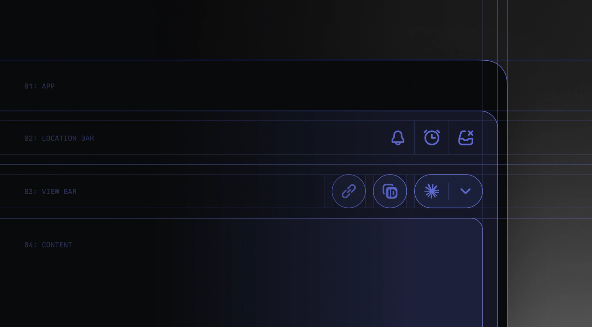 | 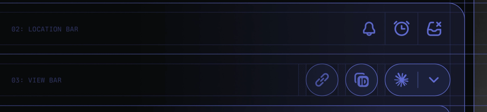 |

- 관찰: 위치를 알려주는 층과 현재 보기의 조작층이 분리되어 있다.
- 적용 판단: Persnapse 공통 헤더는 위치·전역 검색·추가, Graph toolbar는 중심·보기·기간·fit을 담당한다.
- 비교 질문: 현재 화면 제목과 Graph 조건이 구분되는가? 같은 검색·추가 행동이 여러 영역에서 경쟁하는가?
- 개선 후보: 헤더 역할 통합, 중복 버튼 이동, 기준선·높이 토큰 정리. 어두운 색·효과 자체는 적용 기준이 아니다.

### B02. Linear — 현재 화면에 집중시키는 sidebar

출처: [동일 공식 refresh 설명의 before/after](https://linear.app/now/behind-the-latest-design-refresh). 전체 자료에 변경 전/후가 있으며 crop은 오른쪽 변경 후 sidebar다.

| 공식 변경 전/후 이미지                                                                                      | 변경 후 sidebar crop                                                                                                 |
| ----------------------------------------------------------------------------------------------------------- | -------------------------------------------------------------------------------------------------------------------- |
| 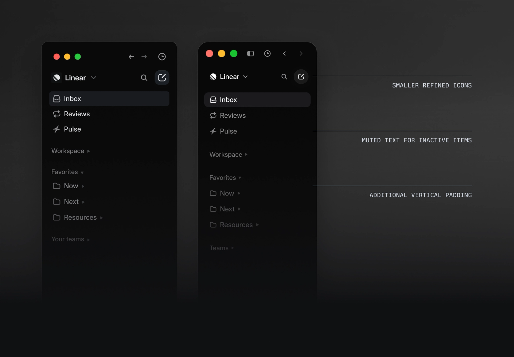 | 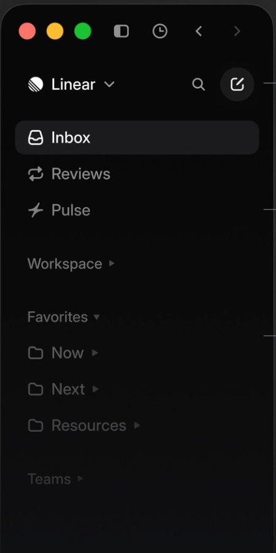 |

- 관찰: 활성 행과 비활성 메뉴의 무게, 아이콘 크기·세로 간격을 함께 정리했다.
- 적용 판단: 여섯 기존 메뉴를 보존하면서 이름·active·keyboard focus를 읽기 쉽게 만들고 주변 강조를 줄인다.
- 비교 질문: 선택한 사람보다 메뉴가 먼저 보이는가? active·hover·focus가 같은 배경으로 보이는가?
- 개선 후보: nav row 하나의 공통 상태 계약, 불필요한 badge 제거, panel 폭 조정. 낮은 대비를 그대로 가져오지 않는다.

### B03. Attio — 레코드 식별·속성·실제 활동

출처: [Record page redesign](https://attio.com/changelog/2026/record-page-redesign). 공개 자료의 대상은 **회사 레코드**다. Persnapse 사람 정보에 적용할 것은 정보 구성 패턴이다.

| 공식 레코드 이미지 전체                                                                           | identity·속성 crop                                                                                           |
| ------------------------------------------------------------------------------------------------- | ------------------------------------------------------------------------------------------------------------ |
| 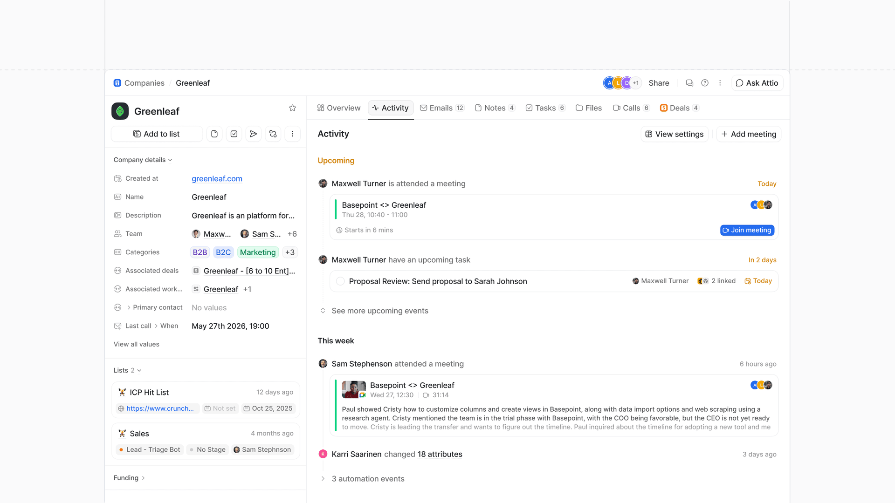 | 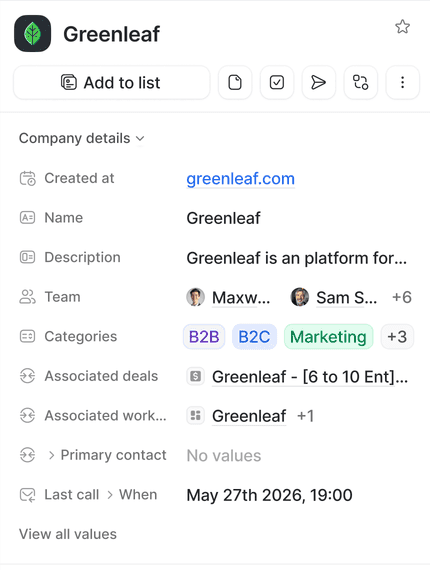 |

활동 영역 crop:

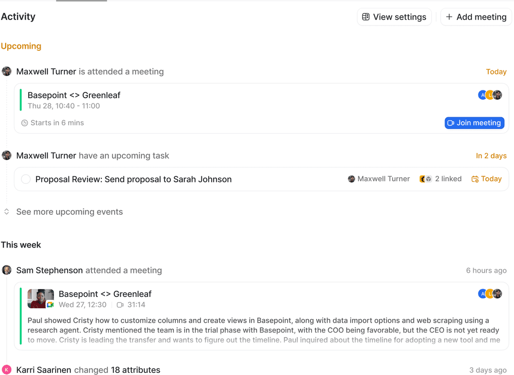

- 관찰: 이름·행동이 가깝고 속성과 시간순 활동을 구분한다. 활동은 종류·시점·내용을 함께 제공한다.
- 적용 판단: 인물 Inspector를 `이름·식별 단서 → 연결 이유 → 기억·원문 → 저장 행동`으로 구성한다. 전체 상세에서는 당시 소속·발생일·기록일을 구분한다.
- 비교 질문: 이름·연결 이유·첫 실제 근거를 찾기 쉬운가? 기록 한 개가 여러 card·badge로 분해되어 있는가?
- 개선 후보: header·섹션·timeline 공통화, 장문은 확장 읽기. CRM 자동화·deal·외부 통합은 추가하지 않는다.

### B04. Granola — 읽을 수 있는 기록의 위계

출처: [AI-enhanced notes 공식 도움말](https://docs.granola.ai/help-center/taking-notes/ai-enhanced-notes). 게재된 기록 화면의 예시다.

| 공식 이미지 전체                                                                              | 제목·메타·본문 crop                                                                                                 |
| --------------------------------------------------------------------------------------------- | ------------------------------------------------------------------------------------------------------------------- |
| 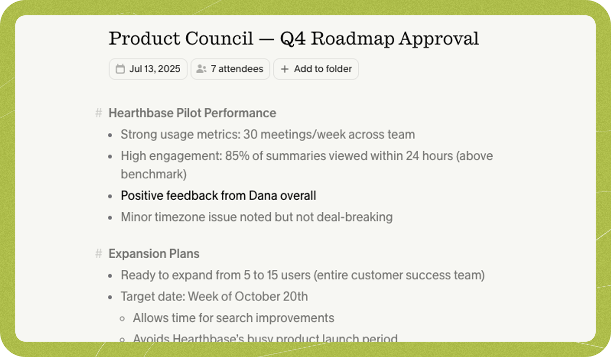 | 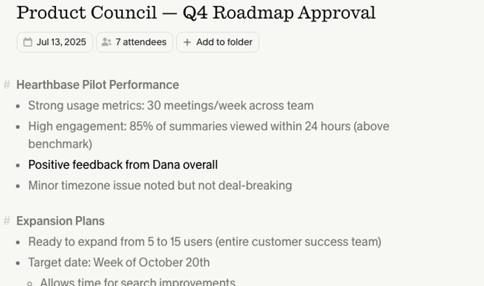 |

- 관찰: 제목·날짜·참여자·섹션·본문의 단계가 구분된다.
- 적용 판단: 기억·만남·AI 답변은 읽기 면과 행간을 확보하고 의미 있는 섹션만 구분한다.
- 비교 질문: 원문·요약·날짜가 읽히는가? 긴 한글을 축소해 카드 폭에 맞추고 있는가?
- 개선 후보: 본문/메타 타이포 토큰, 원문 읽기 폭, 불필요한 박스 제거. 녹색 배경·세리프 제목·영문 밀도는 기준으로 복제하지 않는다.

### B05. Granola — 요약에서 해당 원문으로

출처: [동일 도움말의 근거 확인 예시](https://docs.granola.ai/help-center/taking-notes/ai-enhanced-notes). 선택한 노트 구절과 전사 근거 읽기 영역을 함께 보여준다.

| 공식 이미지 전체                                                                                      | 선택 구절·근거 pane crop                                                                                            |
| ----------------------------------------------------------------------------------------------------- | ------------------------------------------------------------------------------------------------------------------- |
| 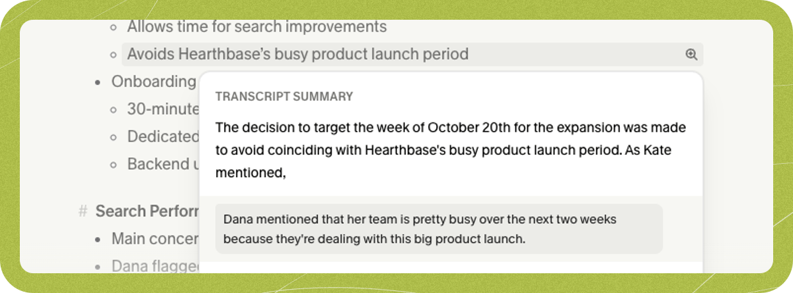 | 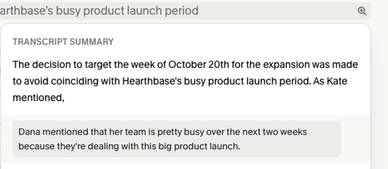 |

- 관찰: 특정 요약 내용에서 관련 전사·메모 부분을 확인하는 접근을 제공한다.
- 적용 판단: 관계·Recall 결과에는 확인 가능한 evidence 참조와 원문 열기를 둔다. 요약과 실제 발췌를 다른 라벨로 표현한다.
- 비교 질문: 왜 연결되었는지 확인할 기록으로 갈 수 있는가? AI가 쓴 문장을 원문처럼 표시하지 않는가?
- 개선 후보: 근거 행·읽기 모드·발췌 표시 공통화. 정적 이미지로 인용 정확성이 검증되었다고 판단하지 않는다.

### B06. Raycast — 입력·선택 결과·상세의 연결

출처: [공식 사이트의 File Search 이미지](https://www.raycast.com/), [File Search 동작 설명](https://manual.raycast.com/file-search), [Search Bar 설명](https://manual.raycast.com/search-bar). 홍보 이미지 자체에서 오른쪽 상세가 일부 잘려 있다.

| 공식 게재 이미지 전체                                                                                        | 검색·선택 결과 crop                                                                                                    |
| ------------------------------------------------------------------------------------------------------------ | ---------------------------------------------------------------------------------------------------------------------- |
| 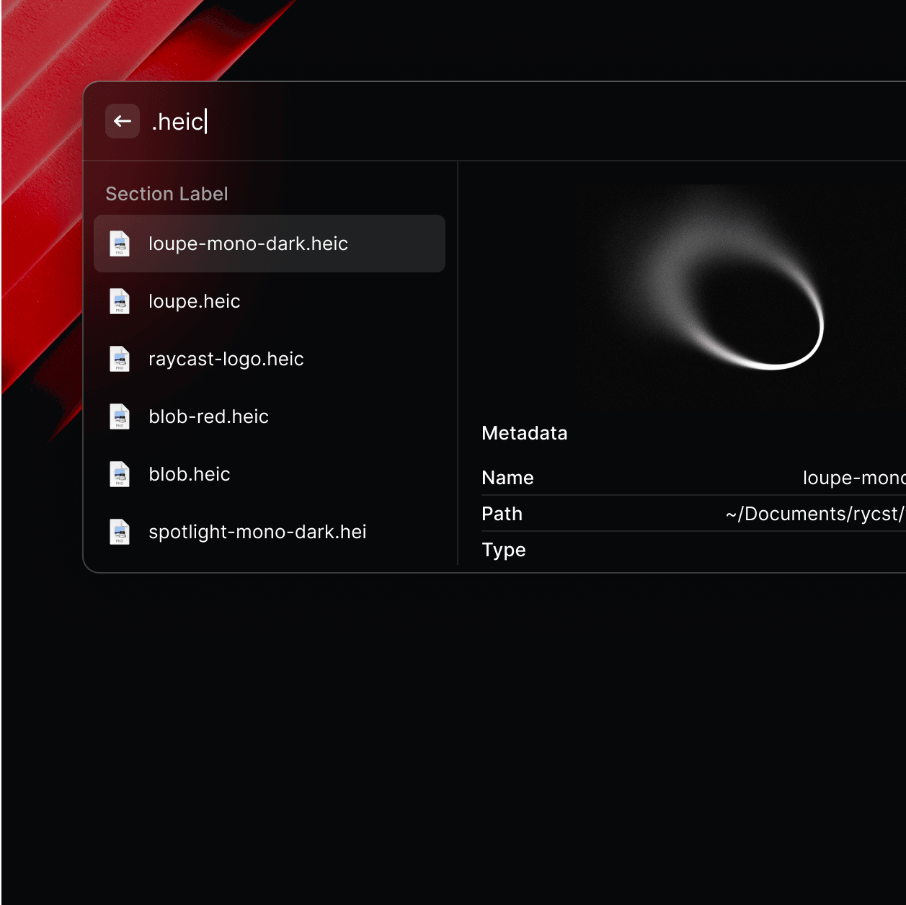 | 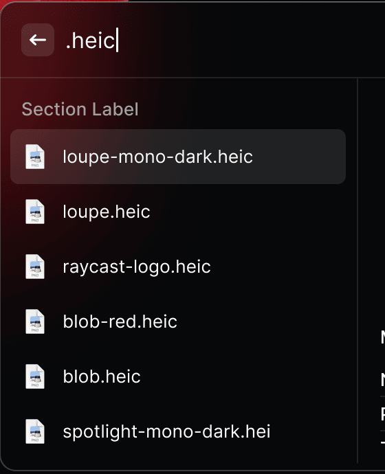 |

- 관찰: 검색 입력 아래 결과 행, 선택한 결과와 상세 정보를 연결한다.
- 적용 판단: 사람·기록 검색의 입력, ID 기반 결과 선택, Inspector를 일관되게 연결한다. 자연어 Recall은 명시 제출이다.
- 비교 질문: 현재 입력·선택 결과·검색 범위가 분명한가? 검색 밖 사람을 삭제된 사람처럼 오해하게 만드는가?
- 개선 후보: 공통 result row·키보드 focus·scope 표시. OS 검색·자동 ranking·dark 배경은 도입 범위가 아니다.

### B07. Attio — 검색 대상과 행동 명령

출처: [Create and view records 공식 도움말](https://attio.com/help/reference/managing-your-data/records/create-and-view-records). **Quick Actions menu** 자료이며 입력 필드 검토 화면은 아니다.

| 공식 menu 이미지 전체                                                                               | 검색·행동 그룹 crop                                                                                             |
| --------------------------------------------------------------------------------------------------- | --------------------------------------------------------------------------------------------------------------- |
| 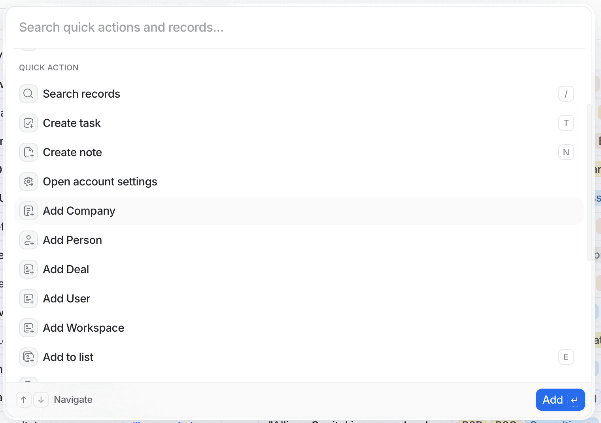 | 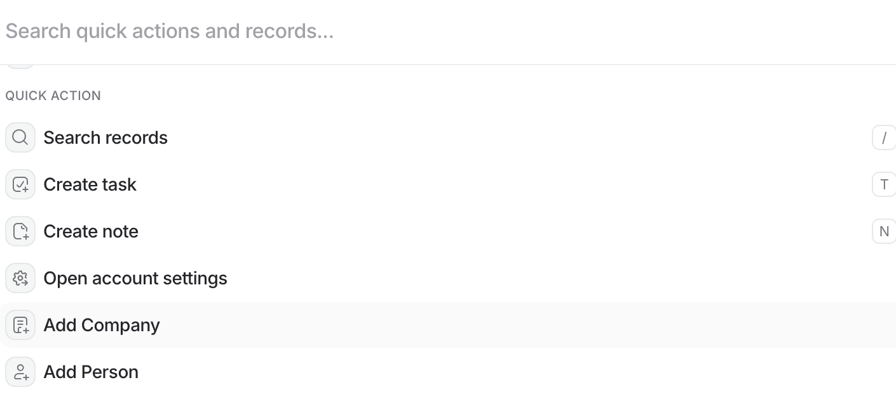 |

- 관찰: 같은 진입부에서 레코드 검색과 종류별 생성 행동을 제공한다.
- 적용 판단: Persnapse의 전역 검색·기록 추가는 진입점과 실제 행동을 명확히 구분한다.
- 비교 질문: ‘인물 열기’와 ‘기록 추가’가 같은 결과 종류처럼 보이는가? 메뉴에 미구현 행동이 있는가?
- 개선 후보: menu group·아이콘·선택·footer hint. OCR 검토·인물 중복 판정의 직접 레퍼런스로 주장하지 않는다.

### B08. folk — 모바일 상세 필드

출처: [People & company profiles on mobile](https://help.folk.app/en/articles/15179426-people-company-profiles-on-mobile). 해당 이미지의 상태는 **Details 하위 화면**이다.

| 공식 이미지 전체                                                                                     | 전화기·상세 필드 crop                                                                                         |
| ---------------------------------------------------------------------------------------------------- | ------------------------------------------------------------------------------------------------------------- |
| 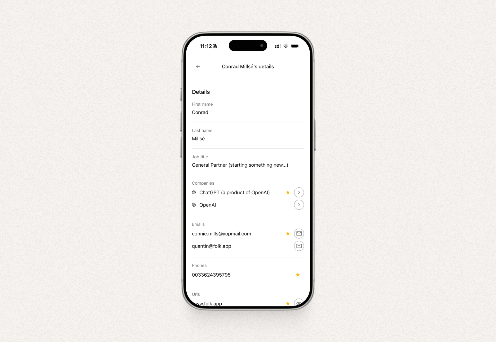 | 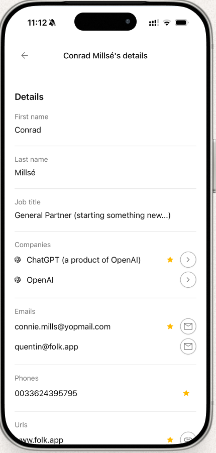 |

- 관찰: 작은 label과 실제 값, 관련 회사·연락처가 한 열에 배열된다.
- 적용 판단: mobile 전체 상세는 단일 스크롤·읽기 순서를 사용하고 긴 값의 전체 접근을 제공한다.
- 비교 질문: 이름·긴 소속·날짜가 잘리는가? 작은 아이콘만으로 핵심 조작을 요구하는가?
- 개선 후보: 단일 열·줄바꿈·touch target·필드 순서. 실제 연락처가 없는 연락 버튼은 만들지 않는다.

### B09. Dex — 후속 행동이 있는 사람 목록

출처: [Product Overview의 Keep-in-touch 이미지](https://getdex.com/product-overview/). 홍보용 그림에는 일부 행의 흐림·장식 배경이 포함된다.

| 공식 이미지 전체                                                                                   | 사람·식별 단서·그룹 crop                                                                                        |
| -------------------------------------------------------------------------------------------------- | --------------------------------------------------------------------------------------------------------------- |
| 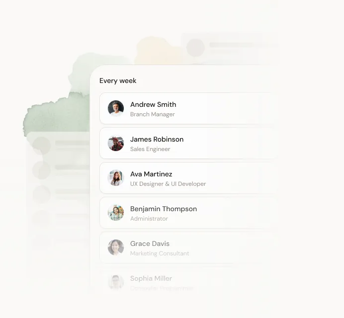 | 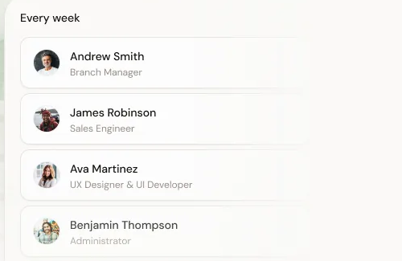 |

- 관찰: 후속 연락 맥락에서 사람 이름과 보조 식별 정보를 묶는다.
- 적용 판단: 기존 업무·약속을 인물과 연결하고 Action Lens에서는 실제 행동 이유를 보여준다.
- 비교 질문: 연락할 이유가 저장된 약속인지 AI 제안인지 구분되는가? 숫자 카드보다 사람·기억이 먼저 읽히는가?
- 개선 후보: 업무 목록·기한·인물 연결, 날짜 미정 그룹. 반복 알림 자동화는 별도 범위다.

### B10. Dex — 사람·명령을 찾는 공통 진입

출처: [동일 Product Overview의 Shortcuts 이미지](https://getdex.com/product-overview/). 하단의 흐림은 공식 이미지에 포함된 표현이다.

| 공식 이미지 전체                                                                                   | command list crop                                                                                     |
| -------------------------------------------------------------------------------------------------- | ----------------------------------------------------------------------------------------------------- |
| 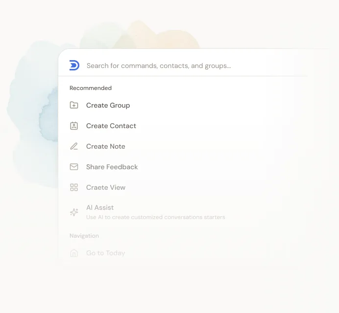 | 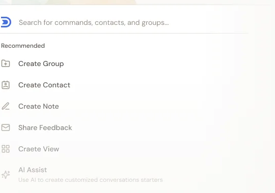 |

- 관찰: 하나의 검색 진입에서 대상과 작업을 찾는다.
- 적용 판단: 현재 지원하는 기록·명령만 노출하고 결과 선택과 행동 실행을 구분한다.
- 비교 질문: 검색 결과에 너무 많은 버튼이 붙는가? 한글 명령이 길어도 이름과 단축키가 읽히는가?
- 개선 후보: command row·그룹·힌트. 흐림·배경 장식은 제품 스타일로 가져오지 않는다.

### B11. Linkurious — 선택적 확장과 범위 제한

출처: [Expand nodes / Selective Expand 공식 문서](https://doc.linkurious.com/user-manual/latest/expand/). 이미지에는 노드·관계 종류, 선택, 추가량 제한이 보인다.

| 공식 확장 화면 전체                                                                                         | 종류·개수 제어 crop                                                                                                      |
| ----------------------------------------------------------------------------------------------------------- | ------------------------------------------------------------------------------------------------------------------------ |
| 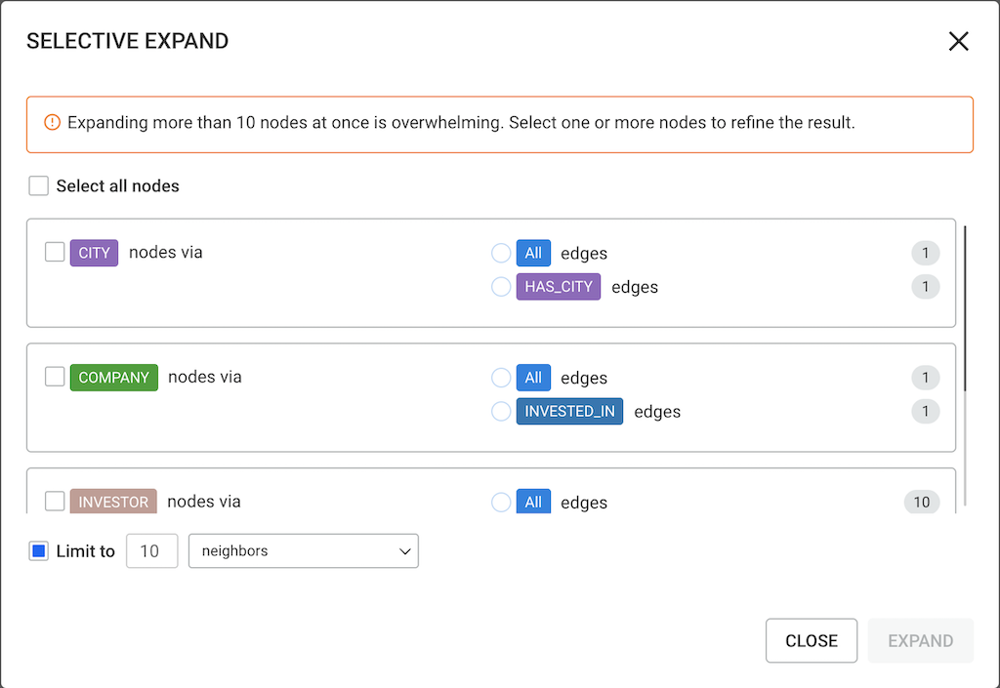 | 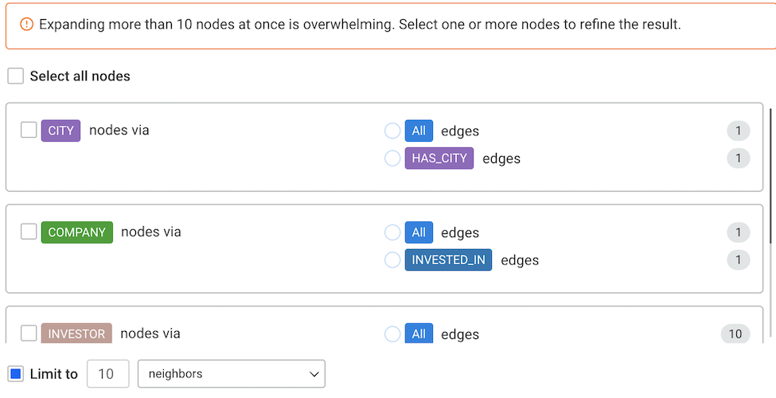 |

- 관찰: 많은 이웃을 한 번에 추가하는 대신 종류와 범위를 선택한다.
- 적용 판단: ‘관련 기록 펼치기’에서 실제 제공하는 만남·행사·주제·소속과 추가 범위를 안내한다.
- 비교 질문: 무엇이 추가되는지 알고 펼칠 수 있는가? 정확한 개수·추가 존재 여부가 구분되는가?
- 개선 후보: 작은 범위 menu·추가 보기·국소 오류. 예시의 10개 제한과 분석가용 복잡한 modal을 제품의 필수값으로 복제하지 않는다.

### B12. Linkurious — 고정 대상과 주변 Graph

출처: [Pinning nodes 공식 문서](https://doc.linkurious.com/user-manual/latest/pinning/). 공개 이미지에 node pin 표시와 주변 연결이 보인다.

| 공식 Graph 이미지 전체                                                                                         | 고정 대상 주변 crop                                                                                                         |
| -------------------------------------------------------------------------------------------------------------- | --------------------------------------------------------------------------------------------------------------------------- |
| 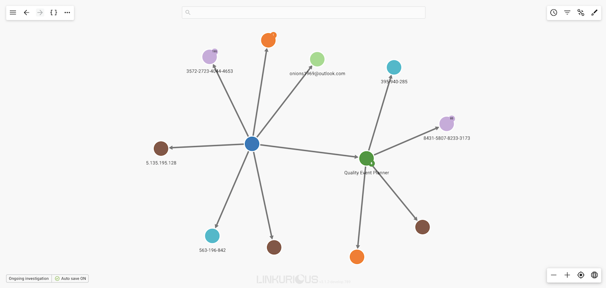 | 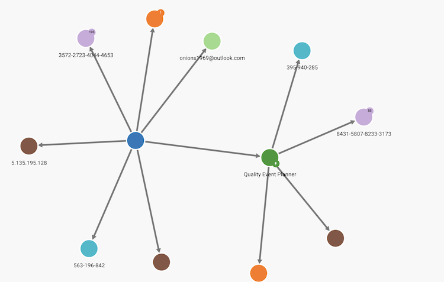 |

- 관찰: 위치 고정 표시를 노드에 작은 조작 상태로 둔다.
- 적용 판단: pin·selection·탐색 중심을 분리하고 기존 좌표 보존을 안정성 기준으로 둔다.
- 비교 질문: 위치 고정이 관계 신뢰나 중요도로 오해되는가? 확장·복귀 뒤 기존 위치가 유지되는가?
- 개선 후보: 작은 pin glyph·고정 해제·좌표 재사용. 실제 안정성은 상태 전환과 좌표 검증으로 확인한다. 예시의 모든 화살표를 Persnapse 관계에 적용하지 않는다.

### B13. folk — 모바일 기록 목록의 읽기 순서

출처: [동일 모바일 프로필 도움말의 Notes 화면](https://help.folk.app/en/articles/15179426-people-company-profiles-on-mobile).

| 공식 이미지 전체                                                                                    | 기록·시점·내용 crop                                                                                         |
| --------------------------------------------------------------------------------------------------- | ----------------------------------------------------------------------------------------------------------- |
| 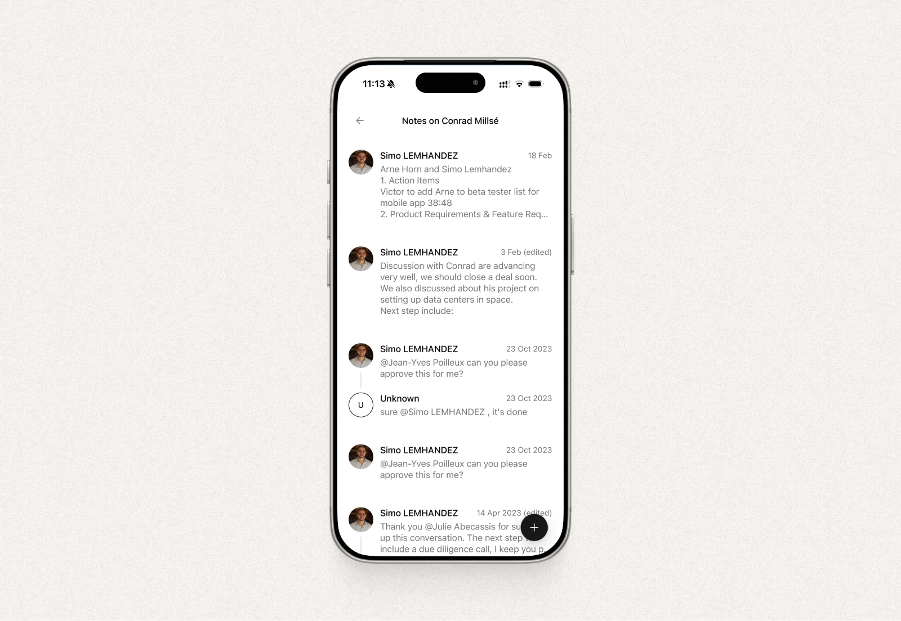 | 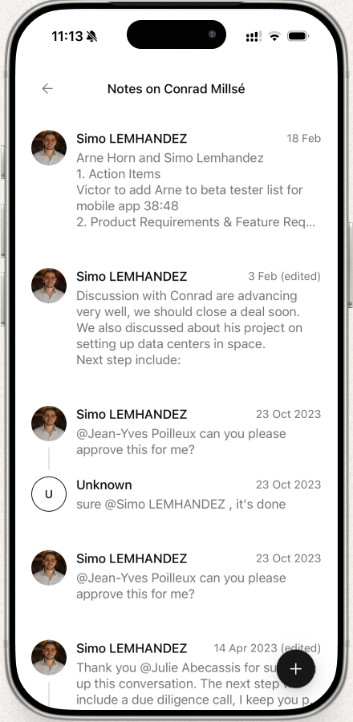 |

- 관찰: 기록 단위마다 작성자·시점·내용을 구분해 스크롤한다.
- 적용 판단: Persnapse 기억은 실제 발생일·출처·요약을 우선하고 기록일은 필요 시 별도로 표시한다.
- 비교 질문: 모바일에서 단편 카드나 탭 이동 때문에 기억을 비교하기 어려운가?
- 개선 후보: 읽기 밀도·행간·전체 기록 열기. 댓글·멘션·공유 기능은 범위에 추가하지 않는다.

### B14. folk — 키보드가 열린 모바일 작성

출처: [동일 도움말의 New note 화면](https://help.folk.app/en/articles/15179426-people-company-profiles-on-mobile). 키보드·입력·후보 선택이 함께 보이는 상태다.

| 공식 이미지 전체                                                                                  | 작성·가상 키보드 crop                                                                                                      |
| ------------------------------------------------------------------------------------------------- | -------------------------------------------------------------------------------------------------------------------------- |
| 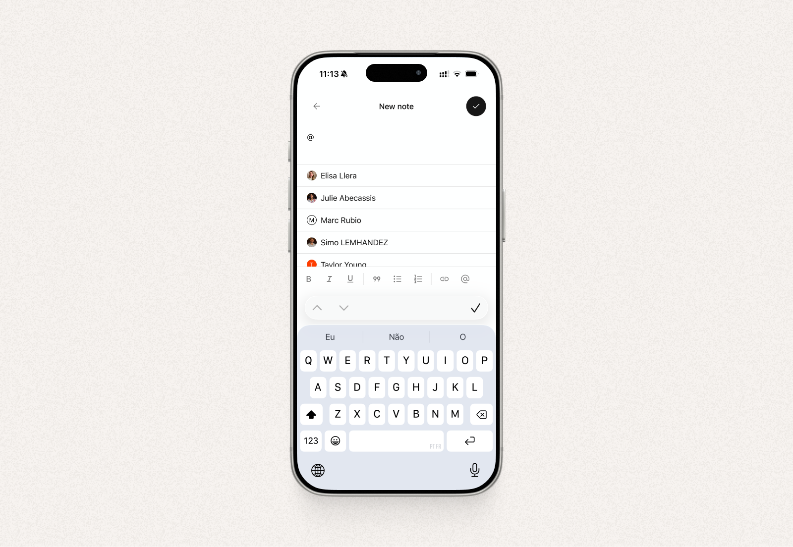 | 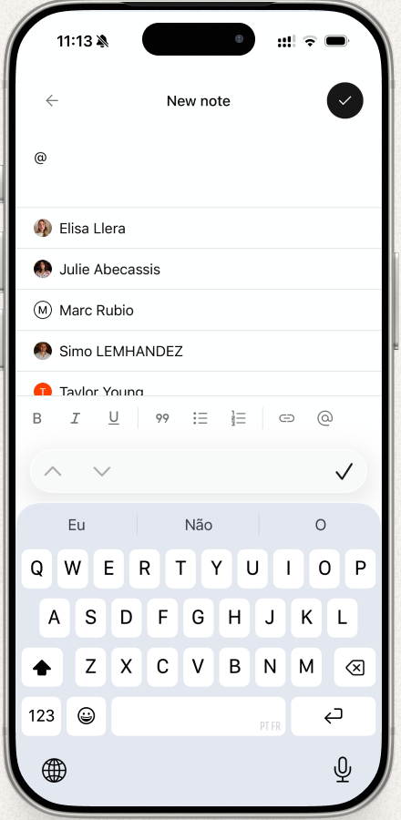 |

- 관찰: 작은 화면에서 키보드가 작업 면을 크게 줄인다.
- 적용 판단: mobile 입력 검토는 전체 편집 면을 사용하고 저장·오류·draft를 키보드에 가리지 않게 한다.
- 비교 질문: 한글 IME 조합 중 Enter가 제출되는가? 아래 필드·실패 안내·저장 버튼에 접근할 수 있는가?
- 개선 후보: viewport·safe area·스크롤·sticky footer 검증. 외부 사례의 멘션 기능 자체는 추가하지 않는다.

### B15. Dex — 적은 필드와 명확한 입력 포커스

출처: [Product Overview의 Reminders 입력 이미지](https://getdex.com/product-overview/). 저장 완료·오류·OCR 검토 상태는 이 이미지에서 확인할 수 없다.

| 공식 입력 이미지 전체                                                                             | 제목·대상·날짜 필드 crop                                                                                        |
| ------------------------------------------------------------------------------------------------- | --------------------------------------------------------------------------------------------------------------- |
| 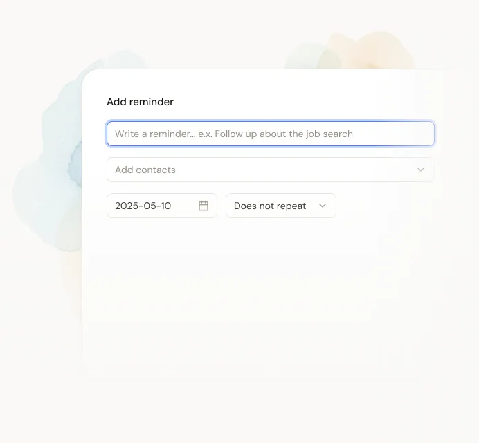 | 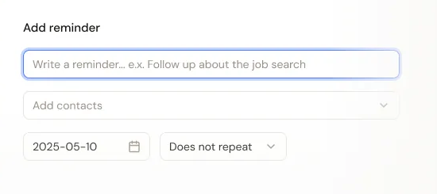 |

- 관찰: 작업에 필요한 기본 필드와 현재 입력 위치를 구분한다.
- 적용 판단: 원본·추출 검토에서는 핵심 필드·확인 필요·인물 후보를 우선한다. 저장 상태는 별도로 설계한다.
- 비교 질문: 중요하지 않은 고급 필드가 수정해야 할 누락값보다 먼저 보이는가? focus와 오류가 구분되는가?
- 개선 후보: field label·초점·단계적 정보 공개. 반복 일정 기능·placeholder만 있는 label을 그대로 복제하지 않는다.

## 3. Persnapse에 맞춘 벤치마킹 판단

### 3.1 업무 앱의 정제도와 사람의 기억

Linear의 주변 UI 정제와 Attio의 record 위계는 읽기 비용을 줄이는 참고다. Persnapse에서는 인물의 많은 속성보다 **누구인지·왜 기억해야 하는지·근거가 무엇인지**를 앞에 둔다. 같은 기능을 덜 복잡한 화면에서 읽게 하는 것이 개선이다.

초기 비교에서 메뉴 강조를 낮추거나 card를 줄였는데 실제 상태·입력 경로가 사라졌다면 되돌린다. 정제는 정보의 위계와 재사용 규칙으로 판단하며 단순히 요소 수가 줄었다고 통과시키지 않는다.

### 3.2 Graph의 가치와 안정성

Graph 전문 도구는 탐색 제어를 참고한다. Persnapse에는 실제 관계 의미를 보존한 작은 부분 Graph와 읽기 가능한 이름이 필요하다. 전문 분석가 modal·노드 색 분류·화살표·전체 이웃 확장은 목적에 맞는 일부만 채택한다.

Graph를 고칠 때 함께 묻는다: 중심과 선택이 구분되는가 → 연결 이유를 설명할 수 있는가 → 펼칠 범위를 알 수 있는가 → 기존 위치를 기억할 수 있는가 → 이전 상태로 돌아갈 수 있는가. 예쁜 static scene 하나로 이 흐름을 완료했다고 판단하지 않는다.

### 3.3 AI와 원문에 대한 신뢰

Granola의 원문 접근은 설명 가능한 결과를 위한 참고다. Persnapse의 Graph 경로는 실제 원본 ID, evidence, 관계 계약이 있을 때 표현한다. 화면 레이아웃 변경으로 없는 근거를 생성하지 않는다.

기억을 읽는 사람은 요약과 발췌를 구분할 수 있어야 한다. 답변은 짧게 시작하되 원문이 길면 넓은 읽기 모드로 이동한다. 상태가 부재·삭제·접근 불가·조회 실패 중 무엇인지 명확히 표현한다.

### 3.4 입력 검토는 자체 제품 문제로 검증

B07은 진입 menu, B15는 간단한 입력, B14는 모바일 작성의 참고다. 이번 수집 자료에는 Persnapse와 같은 명함 보정·OCR 누락·동명이인 확인·원본/추출 비교·저장 미확인 흐름을 직접 보여주는 외부 화면이 없다.

이 흐름은 기존 제품과 합성 데이터로 검증한다. 참고한 field·focus·읽기 순서를 적용하고 원본과 추출값 비교, 인물 ID 확인, 보정 승인, 안전한 재시도를 실제 조작으로 평가한다. 추가 외부 입력 레퍼런스가 필요해지면 정확히 부족한 상태를 지정해 수집한다.

## 4. V0–V7 단계별 비교·개선 계획

상세 설계 20장의 단계와 동일하다. 아래 계획은 구현 단계에서 수행할 절차이며 완료 기록이 아니다.

실제 실행 순서는 구축 실행 설계 W00–W11 표로 통일한다. V3a는 기존 인물·만남·참석, V3b는 조회 확장 이후 맥락·근거다. V4a/V5a는 VD02/03 시안, V4b/V5b는 실제 연결·저장 검증이다. 같은 표의 V3~~V5를 한 번에 통과한 것으로 해석하지 않는다.

| 단계                     | 레퍼런스·구축물의 비교 영역                            | 필수 구축물 상태                                                        | 수정 순서                                        | 다음 단계로 넘어갈 근거                                               |
| ------------------------ | ------------------------------------------------------ | ----------------------------------------------------------------------- | ------------------------------------------------ | --------------------------------------------------------------------- |
| V0 현재 기준 수집        | B01~B15의 필요한 부분, 기존 여섯 화면 inventory        | 기본 Graph·인물 선택·어시스턴트·입력 검토·모바일                        | 현재 문제와 보존 기능을 먼저 기록                | viewport·fixture·source revision·상태가 있는 before 자료              |
| V1 공통 토큰·컴포넌트    | B02 active row, B03 identity, B07 menu, B15 field      | default/hover/selected/focus/disabled/error                             | 토큰 중복 → 공통 상태 → text/spacing → 장식      | 같은 컴포넌트가 여러 화면에서 같은 의미·표현                          |
| V2 셸·Network/Person     | B01 header, B02 sidebar, B03 identity, B08 mobile      | 선택 없음·긴 이름·동명이인·패널 열림 전후                               | 역할/폭 → 이름·연결 이유 → 라벨/패널 → 세부 간격 | 세 영역 읽기·ID 일치·선택 전후 카메라 유지·작은 폭 전환               |
| V3a / V3b 관계·근거·탐색 | B05 evidence, B11 expand, B12 pin                      | a: 기존 참석·중첩 확장·고정·복귀. b: 행사·주제·소속·공유 맥락·원문 상태 | 의미·원문 → 확장 범위 → 좌표·이력 → 선/라벨      | a는 기존 기록만, b는 W06 계약 적합성과 W07 실제 evidence 검증 필요    |
| V4a / V4b 검색·Recall    | B06 results, B07/B10 commands, B04/B05 reading         | a: VD02 결과·제한 시안. b: 결과 0·2·다수, 필터 밖·준비 실패·지연 응답   | 입력/scope → 결과 선택 → 이유/근거 → keyboard    | 시안과 실제 연결을 별도 판정, 명시 제출·같은 ID·없는 경로 제한        |
| V5a / V5b 입력 검토      | B15 field, B14 keyboard, B07 진입                      | a: VD03 원본/필드 시안. b: OCR·동명이인·실패·미확인·충돌                | 원본/수정 → 인물 확인 → 저장 상태 → 작은 화면    | 시안과 저장 계약을 별도 판정, 원본·ID·draft·재시도·기존 pipeline 보존 |
| V6 전체 화면             | B03 activity, B04 notes, B09 actions, B13 mobile notes | 인맥·만남·업무·명함·녹음·설정의 현재 기능                               | 공통 컴포넌트 → 기록/날짜 → action → 밀도        | 기존 기능 접근·실제 데이터·같은 용어·모바일 읽기                      |
| V7 재검증                | 각 영역의 대표 crop과 이전 구축물                      | 긴 한글·빈 정보·다수 이웃·오류·200%·키보드·reduced motion               | 의미/기능 차단 → 읽기/접근성 → 정제 → 모션       | 차단 문제 해소, 수정 전후 증거·미해결 항목·회귀 결과                  |

Graph·검색·입력에는 기능 검증을 함께 둔다. 초기 좌표·참조 ID·저장 request·실패 복구처럼 이미지에 보이지 않는 상태는 적합한 단위/통합/E2E 검증으로 확인한다. 명령·실행 경계는 전체 작업 설계 11장을 따른다.

VD01~VD03의 실제 시각·동작 기준이 채택되기 전 V6 전체 화면 확장을 시작하지 않는다. 이후 화면은 외부 B 이미지뿐 아니라 채택된 Persnapse VD 화면·토큰·컴포넌트와 비교한다. 제품 시안을 외부 이미지로 대신하지 않는다.

## 5. 한 작업 단위의 반복 개선 루프

### 5.1 비교 가능한 작업으로 정의

작업 시작 때 `사용자 과업 / 현재 문제 / 참고 ID / 이번에 바꿀 범위 / 보존할 동작 / 통과 조건`을 적는다. 예: ‘인물 선택 후 연결 이유를 찾기 어렵다. B03·B05를 참고하여 Inspector의 이름·연결 이유·원문 순서를 정리한다. selection ID와 카메라를 보존한다.’

한 번의 반복은 서로 관련된 문제 1~3개에 집중한다. 주요 셸 비례·인물 상세·입력 저장 흐름을 동시에 바꾸어 어느 변경이 개선을 만들었는지 알 수 없게 하지 않는다.

### 5.2 반복 순서

1. **기준 재현:** 고정 합성 데이터·viewport·질문·선택·filter·zoom으로 현재 상태를 만든다.
2. **자료 비교:** 전체 맥락 후 crop을 보고 구축물의 같은 영역과 비교한다.
3. **문제 기록:** ‘답답함’ 대신 ‘연결 이유보다 속성 12개가 먼저 보인다’처럼 화면에서 확인 가능한 현상을 적는다.
4. **수정 가설:** 구조·컴포넌트·토큰·상태 동작 중 원인을 정하고 기대되는 사용자 변화를 적는다.
5. **구현 후 같은 재현:** before와 같은 조건으로 after를 만들고 전체 화면·영역 crop을 모두 저장한다.
6. **두 관점 검토:** 사용자/디자인 관점의 읽기·행동과 개발/QA 관점의 의미·계약·상태 보존을 각각 기록한다.
7. **회귀 확인:** 개선한 공통 컴포넌트를 사용하는 다른 화면, 모바일·오류·빈 상태를 확인한다.
8. **판정:** 통과·수정 필요·계약 의존·해당 없음(이유) 중 하나와 근거를 남긴다. 미해결 문제는 다음 반복의 구체 항목으로 이동한다.

사용자 리뷰는 단계별로 재현 가능한 비교 결과를 제공한다. 모든 micro spacing 선택마다 확인을 요청하는 방식으로 운영하지 않는다. 제품 방향·데이터 계약·기존 기능 접근의 변화는 별도 결정으로 기록한다.

### 5.3 수정 우선순위

| 분류 | 예시                                                                               | 처리                             |
| ---- | ---------------------------------------------------------------------------------- | -------------------------------- |
| 차단 | 가짜 관계·근거, 다른 인물 ID 열기, 입력 손실, 저장 실패를 성공으로 표시            | 다음 시각 단계 진행 전 수정      |
| 필수 | 이름/원문 읽기 불가, 의미를 색만으로 표시, 필수 행동 접근 불가, 카메라·복귀 흔들림 | 해당 작업 종료 전 해결           |
| 정제 | 정렬·간격·radius·불필요 badge·중복 배경·hover 불일치                               | 공통 토큰/컴포넌트에서 우선 정리 |
| 후속 | 고급 Time Context·저장된 보기·집계·새 외부 연동                                    | P1/P2 또는 별도 범위로 기록      |

색·모션을 개선해도 차단·필수 문제가 남으면 완료로 보고하지 않는다. 상용 SDK·Graph DB 도입을 시각적 차이만으로 결정하지 않는다.

## 6. 구축물의 상태·캡처 기준

### 6.1 공통 조건

1440×900 / 1280×800 / 1024×768 / 768×1024 / 390×844 / 360×780를 사용한다. baseline과 after 각각의 revision+diff hash를 기록하고, 합성 fixture·기준 시각·Asia/Seoul·browser zoom·device scale·폰트 조건을 동일하게 재현한다. before와 after revision이 같아야 한다는 뜻은 아니다. 기본 fixture·시간·캡처 subset·안정화·server 식별은 실행 설계 5~6장을 따른다.

Graph에서는 중심 ID·선택 ID·확장 묶음·pin·camera transform을 함께 기록한다. 폰트·simulation 안정화 후 기준 캡처를 만들되 loading 상태 자체를 검토할 때는 별도 시나리오로 재현한다. 애니메이션의 임의 프레임 때문에 before/after가 달라지지 않게 한다.

외부 홍보 이미지의 여백·기기 프레임·DPI와 실제 UI 치수를 혼동하지 않는다. 레퍼런스는 비율·위계·패턴 비교, 구축물은 computed style·실제 조작·데이터로 측정한다. 외부 화면과 pixel diff가 작아지는 것을 완료 지표로 쓰지 않는다.

### 6.2 필수 상태 ID

이 Atlas의 화면 상태는 **VS01–VS12**다. 원본 브리프 15.2장의 Golden Scenario S01~S12는 **GS01–GS12**로 인용한다. 예전 문서의 무접두 S 번호를 완료 증거에 사용하지 않는다. VS는 시각 상태이고 GS는 사용자 과업이며 서로 일대일 대응하지 않는다.

| 상태 ID | 재현 상태                                      | 연결 자료                                 |
| ------- | ---------------------------------------------- | ----------------------------------------- |
| VS01    | 데이터 0개 / 인물 1명·관계 없음                | B01·B02 구조, 상세 설계의 자체 empty 기준 |
| VS02    | 기본 Network, 선택 없음                        | B01·B02·B12                               |
| VS03    | person selected, 중심과 선택이 다름            | B03·B08                                   |
| VS04    | 참석·소개·공유 맥락 관계와 실제 근거           | B05·B12                                   |
| VS05    | 확장 전 → 종류 제한 확장 → 접기 → 복귀         | B11·B12                                   |
| VS06    | 검색 결과 2명과 설명용 맥락 다수·필터 밖 결과  | B06·B07·B10                               |
| VS07    | Recall 답변·근거 부족·연결 ID 미제공·준비 실패 | B04·B05, 자체 상태 계약                   |
| VS08    | 명함 보정·OCR 누락·인물 후보·원본/필드 검토    | B07·B15의 제한된 패턴, 자체 pipeline      |
| VS09    | 저장 성공·실패·미확인·version 충돌             | 자체 상태 계약, 실제 mock/저장 경로       |
| VS10    | mobile 상세 → 기록 → 원문 → Graph 복귀         | B08·B13                                   |
| VS11    | mobile 입력과 가상 키보드·오류·한글 IME        | B14·B15                                   |
| VS12    | 긴 이름·소속·전사, 많은 이웃, keyboard·200%    | 각 대표 crop, 자체 stress 기준            |

모든 상태의 before/after를 첫 단계에서 한꺼번에 만들 필요는 없다. 해당 작업에 직접 영향을 받는 상태와 공통 컴포넌트 회귀를 선택하고 이유를 기록한다.

| Golden ID / 원본 번호 | 과업                                        | VS 연결    | 작업·범위                                                       |
| --------------------- | ------------------------------------------- | ---------- | --------------------------------------------------------------- |
| GS01 / S01            | 지난달 행사·관심 표현·약속 근거로 인물 회상 | VS06/07/04 | W08, ID 부족 제한 포함                                          |
| GS02 / S02            | 인물에서 행사 중심으로 이동                 | VS03/04/05 | W07, 행사 ID 계약 후                                            |
| GS03 / S03            | 두 사람의 공통 맥락 비교                    | VS04       | P1. P0에서 가짜 비교 UI를 만들지 않음                           |
| GS04 / S04            | 새 만남 검토·저장·국소 반영                 | VS08/09/03 | W09                                                             |
| GS05 / S05            | 저장 약속으로 다음 행동 판단                | VS03/07    | W08~W10의 기존 업무 연결, Action Lens 강화는 P1                 |
| GS06 / S06            | 과거 소속을 당시 정보로 읽기                | VS04/12    | W07 계약 범위. 고급 시간 탐색은 P2                              |
| GS07 / S07            | 필터 밖 동명이인 전체 검색                  | VS06/03    | W08                                                             |
| GS08 / S08            | 중첩 확장 후 이전 탐색                      | VS05       | W04                                                             |
| GS09 / S09            | A/B 응답 역전 처리                          | VS07       | W08, Graph 계약 T09                                             |
| GS10 / S10            | 모바일·키보드 사람→근거→행동                | VS10/11/12 | W03·W08–W11                                                     |
| GS11 / S11            | 추정 주제 확인·수정                         | VS04/07    | 기존 수정 계약이 제공될 때만 연결, 신규 기능이면 별도 범위 결정 |
| GS12 / S12            | 근거 삭제·저장 실패 복구                    | VS04/08/09 | W07–W09                                                         |

GS/VS와 Graph 전이 T01~T12를 작업 카드에 함께 기록한다. GS11의 신규 검토 UI 등 후속 항목을 P0 완료 조건으로 몰래 추가하지 않고, 기존 지원 기능의 보존 검증과 새 구현을 구분한다.

### 6.3 전체·영역·전환의 역할

| 증거                | 용도                                       | 부족한 부분                            |
| ------------------- | ------------------------------------------ | -------------------------------------- |
| 전체 화면           | 영역 비례·시선 경쟁·오류 위치·작은 폭 전환 | 작은 텍스트·세부 상태 읽기             |
| 영역 crop           | 이름·행간·정렬·선택·field·evidence 비교    | 주변 문맥·실제 조작·저장 여부          |
| 상태 전환 연속 캡처 | 선택·확장·sheet·복귀 전후 비교             | 실제 ID·좌표·요청 version 등 내부 계약 |
| 조작·계약 검증      | ID·좌표·late response·저장·복구            | 시각적 읽기·밀도·레이아웃              |

## 7. 비교 관찰표와 통과 판단

아래는 앞으로 기록할 관찰 항목이다. 현재 제품에서 측정 완료된 값이 아니다.

| 관찰 항목       | 기록 방법                                                      | 설계 판단                                            |
| --------------- | -------------------------------------------------------------- | ---------------------------------------------------- |
| 화면 역할·시선  | 전체에서 제목·중심·선택·첫 근거 위치를 표시                    | 주변 UI가 핵심 과업보다 강하면 역할·무게 조정        |
| Graph 실효 공간 | sidebar·toolbar·Inspector가 차지한 폭/높이와 가려진 대상       | 읽기·조작이 어려우면 영역 접기·단일 면 전환          |
| 식별·타이포     | 긴 이름·소속·본문의 줄 수, 전체 값 접근, 실제 font/line-height | 중요 이름을 축소하지 않고 줄바꿈·상세 접근           |
| 관계 신뢰       | 선의 의미·방향·라벨·evidence·부재를 사례별 확인                | 실제/공유/제안·확인 상태의 문법 보존                 |
| 선택 안정성     | 선택·Inspector 열기 전후 camera·기존 화면 좌표                 | selection만으로 재배치·fit되면 수정                  |
| 확장·복귀       | 추가 종류·개수 범위·pin 좌표·history 복원                      | 범위 안내와 기존 노드 보존                           |
| 근거 접근       | 이유에서 해당 원문으로 이동하는 조작과 반환 위치               | 초기 목표는 짧은 1~2단계 접근, 실제 계약에 따라 확인 |
| 데이터 밀도     | 정보 행·badge·primary CTA·중첩 box와 역할                      | 의미가 겹치는 표현은 공통 컴포넌트에서 줄임          |
| 상태·복구       | 실패·미확인·충돌·부재·권한의 지속 안내·재시도                  | 오해·입력 손실이 있으면 차단/필수 수정               |
| 반응형·접근성   | touch·IME·focus·200%·대비·reduced motion                       | 동일 과업 경로 보존                                  |

판정은 `통과 / 수정 필요 / 계약 의존 / 해당 없음(이유)`로 남긴다. 항목을 하나의 평균 디자인 점수로 합쳐 데이터·접근성 실패를 가리지 않는다. 모든 기준을 초 단위 사용자 성능 SLA로 해석하지 않는다.

P0 필수 항목은 계약 의존·미검증이면 다음 종속 작업과 최종 완료를 통과시키지 않는다. 해당 없음은 사유·범위 근거를 기록하고 필수 요구를 임의 제외하는 수단으로 쓰지 않는다. 차단·필수 문제 0건, 실제 화면을 연 검토 기록, 관련 기능 회귀 통과가 있어야 해당 작업을 닫는다.

## 8. 비교 리뷰 기록 템플릿

다음 템플릿의 경로는 실제 캡처 후 채운다. 이번에는 빈 이미지나 없는 구축물 캡처를 문서에 연결하지 않았다. `docs/plans/assets/graph-visual-reviews/<run-id>/`는 **후속 캡처 경로 제안**이며 아직 생성하지 않았다.

```markdown
# V2 / VS03 인물 Inspector 개선 리뷰 — <run-id>

- 상태: 검토 중 / 통과 / 수정 필요 / 계약 의존
- 사용자 과업:
- 현재 문제:
- reference: B03 identity, B05 source-reading
- 상세 설계 기준: 11장 인물·근거 Inspector
- 보존 동작: person ID, 선택/중심 분리, camera, 편집 draft
- 구현 revision / 작업 트리 식별:
- W 작업 / VD 목표 화면 / VS 상태 / GS 과업 / T 전이:
- before revision+diff hash / after revision+diff hash:
- server cwd·port·소유 PID / 격리 config / fixture hash:
- fixture / 기준 시각 / timezone:
- viewport / browser zoom / device scale / font:
- query / focus ID / selection ID / filters / expansion / pin / camera:
- 재현 순서:

## 비교 자료

| 레퍼런스 crop     | 구축물 before crop | 구축물 after crop |
| ----------------- | ------------------ | ----------------- |
| 실제 B03/B05 파일 | 실제 생성한 파일   | 실제 생성한 파일  |

- before 전체 화면:
- after 전체 화면:
- 전환 상태·조작 검증:

## 발견과 수정

| 관찰한 현상     | 원인 가설                    | 변경 범위 | 기대되는 과업 개선          | 재검증 결과 |
| --------------- | ---------------------------- | --------- | --------------------------- | ----------- |
| 구체적으로 작성 | 구조/토큰/컴포넌트/상태/계약 | 실제 위치 | 사용자가 읽고 행동하는 변화 | 증거와 판정 |

## 관점별 검토

- 사용자/디자인: 읽기 순서, 관계 이해, 원문 접근, 밀도
- 개발/QA: ID, 의미, late response, 저장, 실패 복구, 상태 보존
- 모바일/키보드/대비/확대:
- 공통 컴포넌트 적용 화면의 회귀:
- 차단·필수 문제:
- 다음 반복의 작업 1~3개:
- 범위 제외·계약 의존 사항:
- 최종 판정과 근거:
```

처음 리뷰를 작성할 때 외부 이미지 전체를 다시 복제하지 않고 이 atlas의 ID·파일을 참조한다. after를 before와 다른 데이터·중심·질문으로 바꾸어 화면이 좋아 보이게 만들지 않는다. 전체 캡처를 보관하고 crop의 범위를 기록한다.

## 9. 실제 자료 상태와 유지 관리

| 항목                                     | 현재 상태                           |
| ---------------------------------------- | ----------------------------------- |
| 공식 웹검색·페이지 확인                  | 수행                                |
| 15개 이미지 전체와 16개 crop 저장        | 수행                                |
| 전체·crop 내용 직접 확인                 | 수행                                |
| 출처·크기·crop 좌표·해시 manifest        | 작성                                |
| V0–V7 비교 자료·상태·수정·통과 계획      | 작성                                |
| W 단계 연결·VS/GS 분리·VD 기준 채택 Gate | 2026-10-15 보완, 실제 Gate는 미통과 |
| Persnapse before/after 캡처              | 미수행, 실제 구현 검토 때 생성      |
| 제품 UI 수정·테스트·성능·접근성 검증     | 미수행                              |

원본 페이지가 바뀌어도 수집 시점의 이미지와 manifest는 해당 시점 자료로 보존한다. 새 버전을 참고할 때 확인일·출처·바뀐 패턴을 기록하고 기존 이미지가 최신 화면이라고 보고하지 않는다. 서명 만료 CDN URL이 있어도 로컬 이미지로 문서를 읽을 수 있다.

추가 수집은 구체적인 미해결 UX 상태가 있을 때 한다. 없는 screenshot을 생성해서 외부 제품의 실제 화면으로 소개하거나, 정적 자료로만 확인한 상태 전환을 실행 검증으로 보고하지 않는다.
